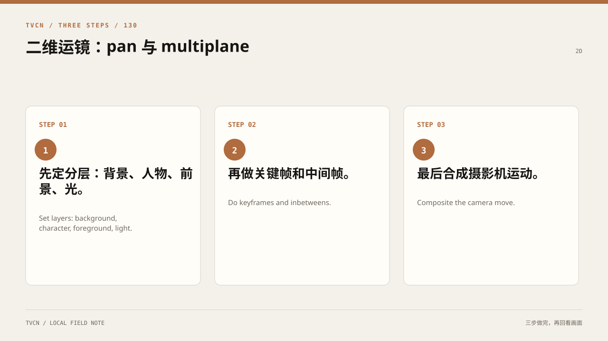

二维动画的摄影机移动，先想多层景片怎么排：前景、中景、背景各在一层，移动时速度不同，才有空间。所有层一起平移，观众只看到一张画在滑。

<!-- DIAGRAM_START -->
<h2>图解</h2>
<figure>
  
  <figcaption>看“把背景分远山、中景、近树三层”和“pan 时速度按 1 比 2 比 4”两处，判断前景、中景、背景的速度差能不能在一次移动里看出来。</figcaption>
</figure>
<!-- DIAGRAM_END -->
<section><h2 id="section-1">2D 摄影机是“舞台”，不是 3D 场景</h2>
推近时先决定是移动摄影机还是放大图层；放大图层会软，移动摄影机才能保持清晰。
<h2 id="section-2">边界</h2>
2D 摄影机不能替代透视。层与层的比例不对，再复杂的移动也像纸片；先画对空间。
<h2 id="section-3">2D 摄影机不是“放大”，是分层视差</h2>

二维镜头运动的核心不是把画面整体推近，而是让前景、中景、背景以不同速度移动。速度差决定空间感；没有分层，再大的运动也像一张图在缩放。

<table class="data-table"><thead><tr><th>层</th><th>速度</th><th>常见错误</th></tr></thead><tbody>
<tr><td>前景</td><td>最快，可出画</td><td>和背景一起缩放，失去遮挡</td></tr>
<tr><td>中景</td><td>中等，承载主体</td><td>运动模糊方向反了</td></tr>
<tr><td>背景</td><td>最慢，留余量</td><td>放大后边缘穿帮</td></tr>
</tbody></table>

<h3>项目级检查</h3>
<ol><li>先做一张 2 倍于成片尺寸的背景，给摄影机留移动余量；不要用成片尺寸硬推。</li><li>摄影机路径只设 2–3 个关键帧，用缓入缓出；线性关键帧会让画面像传送带。</li><li>运动模糊按帧率与速度单独调，前景和背景不要共用一套参数。</li><li>输出前逐层开关，确认没有空白边缘、接缝和重复纹理。</li></ol>

验收时把成片缩到 50% 再看一遍：如果空间感还在，说明分层成立；如果只剩“整体变大”，回到层速度重做。
</section><section><h2 id="section-4">现场</h2>
把背景分远山、中景、近树三层，pan 时速度按 1 比 2 比 4；人物单独一层，保持不动。
</section><section><h2 id="section-5">怎么做</h2><ol><li>把背景分远山、中景、近树三层。</li><li>pan 时速度按 1 比 2 比 4。</li><li>人物单独一层，保持不动或只做小幅跟随。</li></ol></section><section><h2 id="section-6">别踩</h2>
别把整张图一起平移；所有层同速，空间就扁了。
</section><section><h2>判断</h2>
这一页的判断只看三条可观察的验收，不靠口号：
<ul><li><strong>1.</strong> 远、中、近三层速度不同，比例接近 1:2:4。</li><li><strong>2.</strong> 人物层和背景层分开，没有跟着背景一起滑。</li><li><strong>3.</strong> pan 一遍能看出前景快、远景慢的空间感。</li></ul></section><section><h2>失败</h2>
下面任一条出现，先停，不要靠后期补：
<ul><li><strong>1.</strong> 只做到“远、中、近三层速度不同，比例接近 1:2:4”的形式，换一个机位或场景就重现不了。</li><li><strong>2.</strong> 把“人物层和背景层分开，没有跟着背景一起滑”留到后期或口头解释，现场没有留下能复查的记录。</li><li><strong>3.</strong> 别把整张图一起平移；所有层同速，空间就扁了。</li></ul></section><section><h2>延伸</h2>
<strong>10 分钟练习：</strong>用 24 fps 画 3 个关键帧，只改“pan 时速度按 1 比 2 比 4”，导出 2 秒；如果重量仍读不出来，先加预备帧，不要加模糊。
</section>
<h2>验收</h2><ul><li>远、中、近三层速度不同，比例接近 1:2:4。</li><li>人物层和背景层分开，没有跟着背景一起滑。</li><li>pan 一遍能看出前景快、远景慢的空间感。</li></ul>

<!-- SOURCES_START -->
## 参考与延伸阅读

- [S63] [Toon Boom：官方文档](https://docs.toonboom.com/) — 2026-11-26 访问。用于核对「2D 摄影机是“舞台”，不是 3D 场景」一节的术语/方法/规则（Toon Boom 官方文档，不是行业流程标准）；不核对其中由本页经验得出的数字、型号与现场结论，也不替代测试。
- [S62] [Blender：官方手册](https://docs.blender.org/manual/en/latest/) — 2026-11-26 访问。用于核对「2D 摄影机不是“放大”，是分层视差」一节的术语/方法/规则（Blender 官方手册，不是行业流程标准）；不核对其中由本页经验得出的数字、型号与现场结论，也不替代测试。
- [S59] [Adobe：After Effects 官方指南](https://helpx.adobe.com/after-effects/user-guide.html) — 2026-11-26 访问。用于核对「现场」一节的术语/方法/规则（After Effects 官方指南，不是合成美学结论）；不核对其中由本页经验得出的数字、型号与现场结论，也不替代测试。
<!-- SOURCES_END -->

