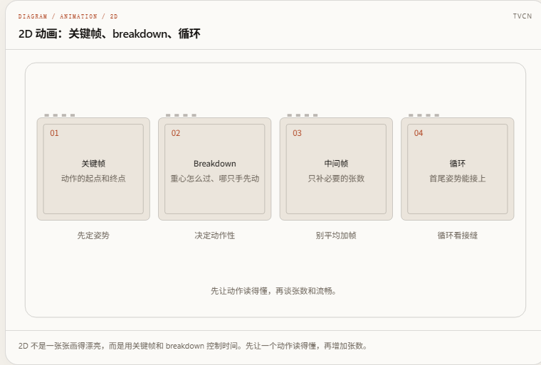

<!-- DIAGRAM_START -->
## 图解

<figure>
  
  <figcaption>2D 不是一张张画得漂亮，而是用关键帧和 breakdown 控制时间。先让一个动作读得懂，再增加张数。</figcaption>
</figure>
<!-- DIAGRAM_END -->

2D 不是一张张画得漂亮，而是用关键帧和 breakdown 控制时间。先让一个动作读得懂。

## 关键帧

先画动作的起点、转折和终点，这三张就是关键帧。不要从第一帧一路画到最后一帧；那会失去节奏。

关键帧要能把动作说清楚：手在哪里、重心在哪、视线看哪里。即使只有线稿，别人也要能看懂。

## Breakdown

关键帧之间加 breakdown，决定“快—慢—快”还是“慢—快—停”。breakdown 不是中间帧，它控制的是加速度和重心。

先做 8 张一组的动作测试，不要一上来做 3 分钟。8 张能暴露 timing 问题，成本最低。

## 循环

循环动作（走路、呼吸、雨）先做 8 或 12 帧，再检查首尾能不能接上。第一帧和最后一帧不是同一张，但动作要能无缝回到第一帧。

循环的长度由动作决定，不由软件决定。走一步 12 帧，呼吸 48 帧，不要用同一个长度套所有动作。

## 3 条验收

- 一个 8 张的动作测试能读出起点、转折、终点。
- breakdown 改变了加速度，而不是只补中间画。
- 循环首尾能无缝接上。

<!-- DEEP_DIVE_START -->
## 深读

<strong>约 7 分钟。</strong> 二维动画不是画得多，是先让关键帧说得清动作，再用中间帧控制时间。

### 先关键帧，后中间帧

一场戏先画三个关键帧：起始、转折、结束；三张能讲清动作，才加中间帧。关键帧不清楚，中间画得再多也只是模糊。

转折帧决定重量：脚落地、手碰到门、头转过去；先画接触，再画跟随。不要从第一张直接补到最后一张。

### 用层管理动作

把身体、头发、衣服、道具分成层；身体用少帧，头发和衣摆用延迟帧。所有东西同一帧一起动，画面会像贴纸。

循环动作先做四张：接触、下沉、经过、上升；检查脚有没有滑，再复制循环。循环不是重复同一张，是重复同一个节奏。

### 时间比细节重要

先定帧率：十二帧一秒适合手绘，二十四帧适合平滑；同一动作在十二帧里少一张，速度就变了。先数帧，再画细节。

一个动作的停顿比运动更能说明重量；举起重物前多停两帧，落地后多压两帧。观众感觉到的不是线条，是时间。

### 五分钟练习：四张循环

画一个人原地走四张：接触、下沉、经过、上升；每张只改脚和骨盆，不许改头。拍成十二帧循环，看脚有没有滑。

再画一版，把下沉多停一帧；比较两版哪个更像有重量。把结论写进下一次循环的帧数表。

### 什么时候算动画成立

静音播放，观众能说出角色在做什么、为什么做、碰到什么；脚不滑、重心有上下、头发和衣服有延迟。三样都过，才算成立。

如果观众要靠字幕才看懂动作，回关键帧，不要加中间帧。二维动画的问题，九成在关键帧，不在画得够不够细。

### 二维动画，十项检查
<ul><li>先画三个关键帧</li><li>关键帧能讲清动作</li><li>转折帧先画接触</li><li>身体头发衣服分层</li><li>头发衣摆延迟</li><li>循环先做四张</li><li>检查脚滑</li><li>先定帧率再画细节</li><li>停顿说明重量</li><li>每版记录帧数</li></ul>
二维动画的功夫不在画得细，在关键帧和帧数能不能让动作成立。

<!-- DEEP_DIVE_END -->
<!-- SOURCES_START -->
<h2>参考与延伸阅读</h2>

经验来源：TVCN 现场手册与项目复盘；实测来源：页面标注的复核环境与可复现练习；参考来源：以下公开链接。

<ul><li>[S12] Britannica：动画</li><li>[S28] Netflix 制作与交付帮助</li><li>[S34] Adobe Premiere Pro 用户指南</li></ul>

<a href="../../about/">完整链接与用途见 SOURCES.md</a>

<!-- SOURCES_END -->
