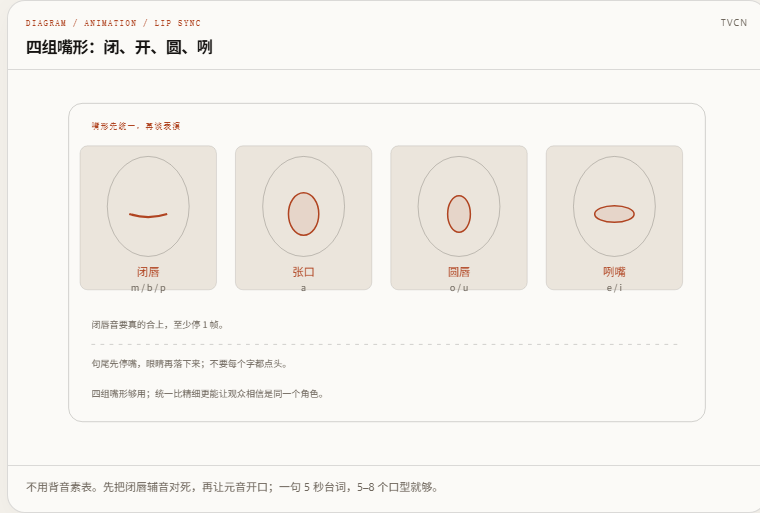

<!-- DIAGRAM_START -->
## 图解

<figure>
  
  <figcaption>不用背音素表。先把闭唇辅音对死，再让元音开口；一句 5 秒台词，5–8 个口型就够。</figcaption>
</figure>
<!-- DIAGRAM_END -->

口型不是把每个字都画出来。观众看的是闭合的那一下，不是嘴的细节。

## 先把声音分成四类嘴形

不用背完整音素表。先把嘴形分四组：闭唇（m、b、p）、张口（a）、圆唇（o、u）、咧嘴（e、i）。大多数对白，四组就够用。

给每组画一张最清楚的侧脸或正面图，贴在透写台旁边。画的时候不要临时发明第五种嘴；嘴形越统一，观众越相信是同一个人在说话。

如果角色是简化风格，嘴形还可以再少。两张——闭和开——也能成立，关键是闭合的时机，不是嘴的细节。

## 闭合帧比开口帧重要

观众判断“是不是他在说”，主要看辅音闭合的那一下。m、b、p 出现时，嘴要真的合上，哪怕只停一帧。嘴一直半开，声音再多也像配音。

做法：先听一遍台词，把闭唇音标在波形上；每个标记前 1–2 帧放闭口，后面再过渡到元音。不要把每个字都切一口；一句 5 秒的话，5–8 个口型就够。

闭合帧要干净，不要加太多中间形状。中间形状越多，嘴越像在嚼东西。

## 表情晚半拍，头别一直点

嘴动的同时，眼睛和眉毛不要同帧到位。让眼神晚 2–4 帧，头再晚一点。观众会先听见重音，再看见反应，真实感就出来了。

重音时头可以动一下，句尾让嘴先停，眼睛再落下来。最怕每个字都点头，像在打拍子。一个句子只需要一个主要动作：看开、低头、眨眼、吸一口气。

## 检查

- 四组嘴形能覆盖整段台词。
- 每个闭唇音都真的合上，至少停一帧。
- 眼睛和头比嘴晚，句尾先停嘴。
