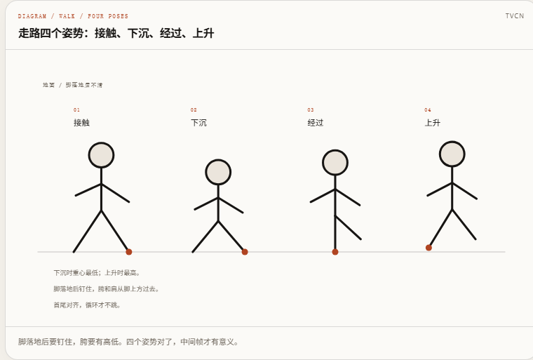

<!-- DIAGRAM_START -->
## 图解

<figure>
  
  <figcaption>脚落地后要钉住，胯要有高低。四个姿势对了，中间帧才有意义。</figcaption>
</figure>
<!-- DIAGRAM_END -->

## 四个姿势先站住

一个走路循环先画四个姿势：接触、下沉、经过、上升。接触是前脚跟着地、后脚趾还在地上；下沉是重心最低；经过是后腿摆到身体下面；上升是身体最高、前脚准备离地。

四个姿势站稳，再加中间帧。很多走路看起来飘，不是中间帧少，是这四个姿势的重心本身没落地。

## 脚不能滑

脚落地之后，在屏幕上应该像钉住一样。身体可以过，脚不能跟着漂。先锁定脚的位置，再让胯和肩过去；脚一滑，观众立刻觉得人物在冰上走。

重心也要有上下。每一步都有一个最低点和一个最高点，身体不是水平移动。下沉那一帧多留一格，重量就出来了。

## 手和头晚半拍，循环看首尾

手臂和头不要跟胯同拍。胯先动，手臂晚一两格，头再晚一点。走路才像有重量，不像一个人形在平移。手臂摆动的方向与同侧腿相反，别同手同脚。

做完循环，把首帧和尾帧并排放。对不上就会跳。先修首尾，再修中间；顺序反了，会白改十遍。

## 检查

- 四个姿势的重心都能落地。
- 脚落地后不滑，胯和肩从脚上方过去。
- 首帧和尾帧能无缝接上。

<!-- DEEP_DIVE_START -->
## 深读

<strong>约 6 分钟。</strong> 走路不是两腿交替，是重心下落、单脚支撑、再被另一只脚接住。

### 四个姿势

接触、下沉、经过、上升；四张构成半步。接触是两脚最开，下沉是重心最低，经过是支撑腿直立，上升是身体最高。

先画骨盆和胸腔的上下，再画腿；没有重心的上下，腿再对也像滑步。

### 支撑脚不能滑

支撑脚在画面里必须钉住；身体前进时，脚掌位置不变。检查方法：把背景对准脚，逐帧看它有没有漂。

脚跟先着地，脚掌过渡，脚尖离地；三个点清楚，走路才有推力。不要整只脚平着拍下去。

### 手臂和头的延迟

手臂反向摆，但比腿晚一到两帧；头比胸腔晚一帧。所有东西同时到，走路会像机器人。

疲劳走路加一个拖步：支撑时间变短、下沉变深、头先低；不要只把速度调慢。

### 五分钟练习：八张一个循环

画一个八张走路循环：左接触、左下沉、左经过、左上升、右接触、右下沉、右经过、右上升。只画侧视，不加背景。

拍成循环，先看脚滑，再看重心上下，最后看手臂延迟；三样都对，再加衣服和头发。

### 什么时候算走对

把背景对准脚，逐帧看支撑脚不漂；看骨盆有上下、头有延迟、手臂反向摆；循环接回第一张不跳。三样都过，走路才成立。

如果脚滑，先查支撑脚位置，不要先改上半身；如果像机器人，先加延迟，不要先加中间帧。

### 再看一遍骨盆

遮住腿，只看骨盆的上下和左右：骨盆没有侧移，走路会像原地踏步；骨盆侧移太大，又会像扭秧歌。先把侧移定在半个脚掌，再加腿的动作。

### 走路循环，十项检查
<ul><li>四姿势构成半步</li><li>先画骨盆胸腔上下</li><li>接触时两脚最开</li><li>下沉时重心最低</li><li>经过时支撑腿直立</li><li>支撑脚不滑</li><li>脚跟脚掌脚尖三点清楚</li><li>手臂反向摆且延迟</li><li>头比胸腔晚一帧</li><li>疲劳加拖步不减速</li></ul>
走路循环的所有问题，最后都会回到两个地方：重心有没有上下，支撑脚有没有滑。

<!-- DEEP_DIVE_END -->

<!-- SOURCES_START -->
## 参考与延伸阅读

- [S62] [Blender Foundation：Blender 官方手册](https://docs.blender.org/manual/en/latest/) — 2026-11-26 访问。用于核对首段“走路看起来难，是因为脚会滑、重心不对、手脚同拍。先把四个姿势站住，再谈风格。”中的术语与公开背景（建模、绑定、动画、渲染）；不替代现场测试。
- [S63] [Toon Boom：官方文档](https://docs.toonboom.com/) — 2026-11-26 访问。用于核对首段“走路看起来难，是因为脚会滑、重心不对、手脚同拍。先把四个姿势站住，再谈风格。”中的术语与公开背景（2D 动画、绑定与制作管线）；不替代现场测试。
<!-- SOURCES_END -->

