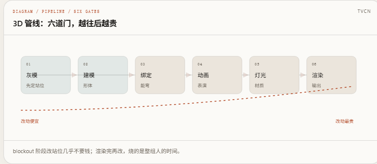

<!-- DIAGRAM_START -->
## 图解

<figure>
  
  <figcaption>blockout 阶段改站位几乎不要钱；渲染完再改，烧的是整组人的时间。</figcaption>
</figure>
<!-- DIAGRAM_END -->

## Blockout 先定时间

用最简单的方块和球，把动作的时间和机位排出来。这个阶段不建模、不贴图，只回答“什么时候发生、镜头在哪”。

Blockout 通过再往下走。blockout 里节奏不对，后面越精细越难改。

## Layout 锁机位，动画再进来

Layout 定构图、焦距、运动路径。机位没锁，动画师会在错误的画框里做表演，最后全部返工。

先做一条没有细节的 playblast，确认剪辑点。镜头长度定了，再分配动画时间。

## 灯光与渲染分开验收

灯光先看层次：主体、背景、环境是否分开。渲染再看出图：噪点、采样、通道、合成是否够用。

不要把“渲染出来再说”当流程。灯光阶段用低采样预览，确认气氛；最后才开高采样。

## 3 条验收

- blockout 的时长与剪辑点已经确认。
- 机位在动画开始前锁定。
- 灯光预览与最终渲染分两轮验收。

<!-- DEEP_DIVE_START -->
## 深读

<strong>约 7 分钟。</strong> 三维流程不是软件顺序，是每一步都能退回上一步；跳过 blockout，后面全在补结构。

### 先 blockout，再建模

用方盒和圆柱摆比例、机位、走位；先确认镜头里看得见什么，再建细节。blockout 不过，建模越细越浪费。

把相机先放进场景，用实际焦距看构图；不要建完再找机位，那时候改不动。

### 绑定和动画的交接

绑定前定关节数量和命名；动画师拿到的是能弯、能转、能重量的 rig，不是一堆控制器。交接时录一段测试动作。

动画先在低模上做，确认时间和重心，再上高模；高模上调动作，视图一卡，判断就慢。

### 灯光渲染和回退

灯光先做一版灰模照明，确认主光方向；材质不要一开始就上满，先看明暗关系。渲染先低分辨率、低采样，确认运动和构图。

每个阶段存一个版本，命名写清日期和内容；回退不是失败，是流程的一部分。没有版本，回退就是重做。

### 五分钟练习：一个镜头全流程

用一个简单场景，走一遍 blockout、低模、绑定测试、低模动画、灰模灯光、低分辨率渲染；每步只花十分钟，不追细节。

每步存版本，最后回退到 blockout，检查机位有没有变。变了，说明你在后面偷偷改结构。

### 什么时候算一个镜头完成

从 blockout 到最终渲染，机位没有偷偷移动、比例没有变、绑定没有坏、灯光方向一致、低分辨率试渲染和最终版构图相同；五样都对，才算完成。

如果最终版和 blockout 构图不一样，回退检查，不要用后期裁切掩盖。三维流程最贵的问题，都是后面改了前面的决定。

### 三维流程，十项检查
<ul><li>先 blockout 再建模</li><li>blockout 用方盒圆柱</li><li>相机先放进场景</li><li>用实际焦距看构图</li><li>绑定前定关节和命名</li><li>交接录测试动作</li><li>低模上做动画</li><li>灰模先定主光</li><li>低分辨率低采样试渲染</li><li>每阶段存版本</li></ul>
三维流程省时间的办法不是少做一步，是每一步都能退回上一步。

<!-- DEEP_DIVE_END -->

<!-- SOURCES_START -->
## 参考与延伸阅读

- [S62] [Blender Foundation：Blender 官方手册](https://docs.blender.org/manual/en/latest/) — 2026-11-26 访问。用于核对首段“3D 不是建模完就动画。先 blockout 定时间，再 layout、animation、lighting、rende”中的术语与公开背景（建模、绑定、动画、渲染）；不替代现场测试。
- [S63] [Toon Boom：官方文档](https://docs.toonboom.com/) — 2026-11-26 访问。用于核对首段“3D 不是建模完就动画。先 blockout 定时间，再 layout、animation、lighting、rende”中的术语与公开背景（2D 动画、绑定与制作管线）；不替代现场测试。
- [S12] [Britannica](https://www.britannica.com/art/animation) — 2026-11-26 访问。用于核对首段“3D 不是建模完就动画。先 blockout 定时间，再 layout、animation、lighting、rende”中的术语与公开背景（动画原理、技术与产业史的百科条目）；不替代现场测试。
- [S59] [Adobe：After Effects 用户指南](https://helpx.adobe.com/after-effects/user-guide.html) — 2026-11-26 访问。用于核对首段“3D 不是建模完就动画。先 blockout 定时间，再 layout、animation、lighting、rende”中的术语与公开背景（合成、关键帧、跟踪与导出）；不替代现场测试。
<!-- SOURCES_END -->

