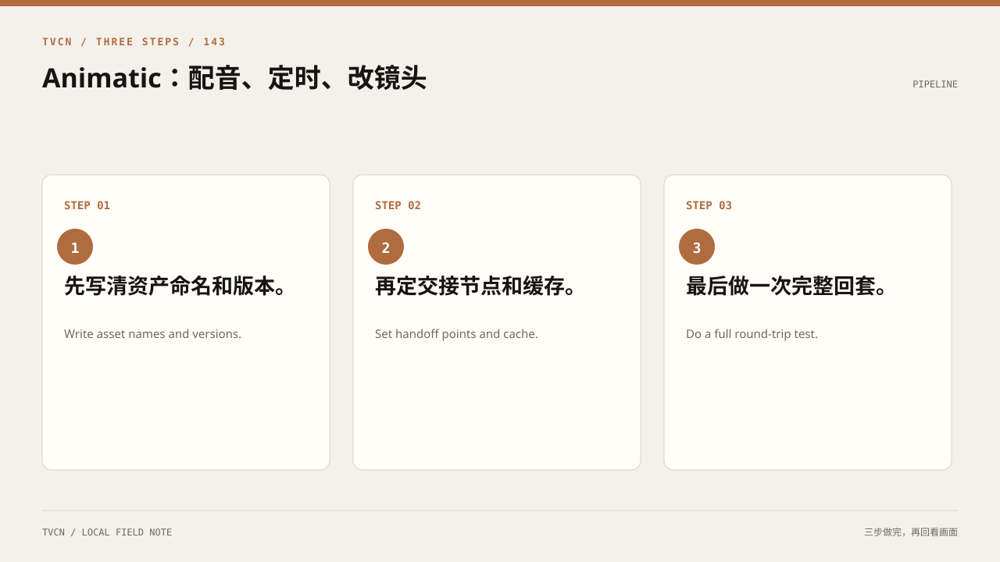

Animatic 用临时配音、简单画面和准确时长，检查镜头能不能接、节奏是否成立。每个镜头标秒数，配音先录，不要等动画完成再配。

<!-- DIAGRAM_START -->
<h2>图解</h2>
<figure>
  
  <figcaption>看“先录配音，按真实语速定时”和“每镜写秒数，总时长控制在目标 110…”两处，判断前景、中景、背景的速度差能不能在一次移动里看出来。</figcaption>
</figure>
<!-- DIAGRAM_END -->
<section><h2 id="section-1">先定时间，再定细节</h2>
把 animatic 当成可失败版本：如果这一版看不懂故事，后面加原画和特效也不会补救。
<h2 id="section-2">边界</h2>
Animatic 不是成品预览。不要在这里追求画面质量，但镜头长度和动作方向必须已经定下来。
<h2 id="section-3">Animatic 先锁三样，再进动画</h2>

Animatic 的作用不是“好看”，是把时长、配音和镜头顺序锁死。三样没锁，动画一开工就会反复改。

<ol><li>配音：先录 scratch，按真实语速，不要用读稿节奏；台词长度决定镜头长度。</li><li>定时：按 24fps 或项目帧率排，给每个镜头标出入点/出点；不要用“大概 3 秒”。</li><li>音乐：只放 temp，标出需要留白的位置；temp 不能直接交付。</li></ol>

验收：把 animatic 给剪辑以外的人看，问“哪里想快进”。想快进的地方先剪短，再进 layout。
</section><section><h2 id="section-4">现场</h2>
先录配音，按真实语速定时；每镜写秒数，总时长控制在目标 110%；再补画。
</section><section><h2 id="section-5">怎么做</h2><ol><li>先录配音，按真实语速定时。</li><li>每镜写秒数，总时长控制在目标 110%。</li><li>再补画，先锁时间。</li></ol></section><section><h2 id="section-6">别踩</h2>
别先画完再配音；语速一改，所有镜头都要重排。
</section><section><h2>判断</h2>
现场只认三个信号：
<ul><li>前景、中景、背景的速度差能在一次 pan 里看出来</li><li>动作在 0.5 秒内能读出重量或预备</li><li>关掉任意一层，空间感仍然成立</li></ul></section><section><h2>失败</h2>
下面三种做法会让页面上的细节白做：
<ul><li>层数堆上去了，但每层速度一样，空间还是扁的</li><li>动作有预备却没有跟随，重量只做了一半</li><li>资产没锁就进渲染，返工从合成端一路补</li></ul></section><section><h2>延伸</h2>
<strong>10 分钟练习：</strong>用 24 fps 画 3 个关键帧，只改“每镜写秒数，总时长控制在目标 110…”，导出 2 秒；如果重量仍读不出来，先加预备帧，不要加模糊。
</section>
<h2>验收</h2><ul><li>配音按真实语速录好，每镜秒数来自它。</li><li>总时长不超过目标 110%，时间先锁死。</li><li>闭眼只听能听懂，睁眼静音能看懂。</li></ul>

<!-- DEEP_DIVE_START -->
## 深读

<strong>约 6 分钟。</strong> 动态分镜不是把故事板播一遍，是用临时声音和时间先验证片子成不成立。

### 先定时间，再画细节

把每张故事板按预计秒数放进时间线，配临时对白和音效；先看总时长和节奏，不要先画漂亮的脸。

一个镜头超过四秒没有新信息，就剪短或拆开；动态分镜阶段改时间，比动画阶段改便宜十倍。

### 临时声音要能听懂

自己录一版对白，哪怕声音不好；观众要听懂信息，不是听配音质量。音效只放关键的：门、脚步、电话。

音乐先放一条临时轨，标出副歌和停顿；不要等到动画完成才找音乐，节奏会全部对不上。

### 锁定再进动画

动态分镜通过的标准：静音能看懂，关画面能听懂；两个都成立，才进布局和动画。

锁定后改一句台词，也要重算时间；不要一边做动画一边改故事。改故事的成本，永远比改动画低。

### 五分钟练习：三十秒动态分镜

用六张故事板、手机录的对白、两条音效，做一个三十秒动态分镜；每张标秒数，总时长不许超过三十秒。

静音看一遍，再闭眼听一遍；哪一遍不懂，就改哪一遍，不要加旁白解释。

### 什么时候算可以进动画

静音能看懂、闭眼能听懂、总时长在预算内、每一秒都有新信息、临时音乐能标出节奏点；五样都过，才进布局和动画。

如果有一秒需要旁白解释，剪掉或重画，不要留着到动画阶段再补。动态分镜的任务，就是把“看不懂”留在最便宜的阶段。

### 再看一遍总时长

把整条动态分镜连放三遍，第三遍还觉得哪一段想快进，那一段就是必须剪的；观众不会因为你看得久就原谅拖。先剪时间，再谈画风。

### 动态分镜，十项检查
<ul><li>每张故事板标秒数</li><li>临时对白自己录</li><li>音效只放关键</li><li>临时音乐标副歌</li><li>先看总时长</li><li>四秒无新信息就剪</li><li>静音能看懂</li><li>闭眼能听懂</li><li>锁定后才进动画</li><li>改台词也重算时间</li></ul>
动态分镜的唯一目的，是在还便宜的时候发现片子不成立。

<!-- DEEP_DIVE_END -->
