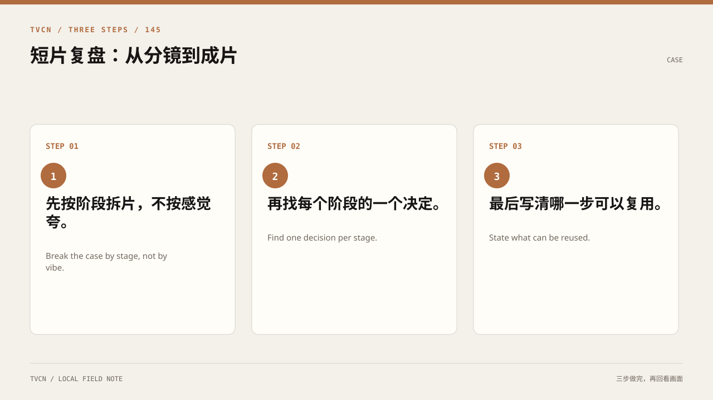

动画案例复盘按“分镜—animatic—layout—动画—灯光—合成”逐段对照，不只夸成片。

<!-- DIAGRAM_START -->
<h2>图解</h2>
<figure>
  
  <figcaption>把三步按顺序做完，再回看画面或文件。</figcaption>
</figure>
<!-- DIAGRAM_END -->
<h2>现场</h2>

逐段对照：分镜 3 格、animatic 时长、layout 机位、动画关键帧、灯光、合成；每段记一个改动。

<h2>怎么做</h2>

动画案例复盘按“分镜—animatic—layout—动画—灯光—合成”逐段对照，不只夸成片。
<ol><li>逐段对照：分镜 3 格、animatic 时长、layout 机位、动画关键帧、灯光、合成。</li><li>每段记一个改动和一处返工。</li><li>写清哪一步可以复用，不只说“好看”。</li></ol>
<h2>别踩</h2>

别只看成片；成片看不到返工。

<h2>验收</h2>
<ul><li>六个阶段都有对照，不只贴成片截图。</li><li>每个阶段记了一个决定和一处返工。</li><li>至少写出一个可复用的步骤，别人能照着做。</li></ul>
