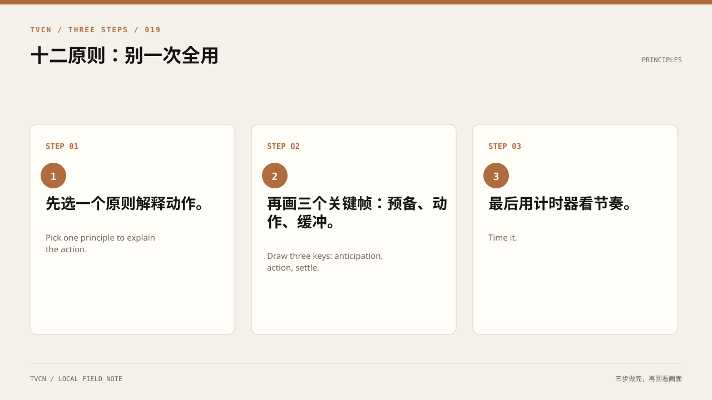

十二原则是诊断工具，不是检查清单。一个动作先看重心、弧线和时间，再决定要不要加挤压伸展；全用会把动作变成橡皮玩具。

<!-- DIAGRAM_START -->
<h2>图解</h2>
<figure>
  
  <figcaption>看“选一个动作：角色伸手拿杯”和“只用预备和缓入缓出，画 5 帧预备、…”两处，判断前景、中景、背景的速度差能不能在一次移动里看出来。</figcaption>
</figure>
<!-- DIAGRAM_END -->
<section><h2 id="section-1">一次只用两三条原则</h2>
先把关键姿势画对，再谈跟随和重叠。姿势错了，再加原则也只是把错误动得更顺。
<h2 id="section-2">边界</h2>
写实动画不需要夸张的挤压。原则服务重量和意图，不服务“看起来像动画”。
</section><section><h2 id="section-3">现场</h2>
选一个动作：角色伸手拿杯；只用预备和缓入缓出，画 5 帧预备、3 帧动作、4 帧缓冲；不要同时加挤压拉伸。
</section><section><h2 id="section-4">怎么做</h2><ol><li>选一个动作：角色伸手拿杯。</li><li>只用预备和缓入缓出，画 5 帧预备、3 帧动作、4 帧缓冲。</li><li>不要同时加挤压拉伸；一次只验证一个原则。</li></ol></section><section><h2 id="section-5">别踩</h2>
别一次套十二原则；动作会变成抽筋。
</section><section><h2>判断</h2>
这一页的判断只看三条可观察的验收，不靠口号：
<ul><li><strong>1.</strong> 一个动作只用了一个主要原则，能说出它解决什么。</li><li><strong>2.</strong> 预备、动作、缓冲三段的帧数是写下来的，不是随手画。</li><li><strong>3.</strong> 删掉这个原则后，动作明显更难读，说明它真的有用。</li></ul></section><section><h2>失败</h2>
下面任一条出现，先停，不要靠后期补：
<ul><li><strong>1.</strong> 只做到“一个动作只用了一个主要原则，能说出它解决什么”的形式，换一个机位或场景就重现不了。</li><li><strong>2.</strong> 把“预备、动作、缓冲三段的帧数是写下来的，不是随手画”留到后期或口头解释，现场没有留下能复查的记录。</li><li><strong>3.</strong> 别一次套十二原则；动作会变成抽筋。</li></ul></section><section><h2>延伸</h2>
<strong>10 分钟练习：</strong>用 24 fps 画 3 个关键帧，只改“只用预备和缓入缓出，画 5 帧预备、…”，导出 2 秒；如果重量仍读不出来，先加预备帧，不要加模糊。
</section>
<h2>验收</h2><ul><li>一个动作只用了一个主要原则，能说出它解决什么。</li><li>预备、动作、缓冲三段的帧数是写下来的，不是随手画。</li><li>删掉这个原则后，动作明显更难读，说明它真的有用。</li></ul>

<!-- DEEP_DIVE_START -->
## 深读

<strong>约 6 分钟。</strong> 动画十二原则不是十二条都要用，是每次挑三条，把动作说清楚。

### 先挑三条

一个镜头先选三条：挤压拉伸说明材质，预备说明意图，跟随说明惯性。三条能讲清，就不要再加。

十二条全上，动作会过度解释；观众看到的是技巧，不是角色。原则是工具，不是考试。

### 预备和跟随成对

跳之前先蹲，打之前先收手，跑之前先压低；预备让观众知道要发生什么。落地后头发、衣服、道具继续动，跟随让动作有重量。

预备太长会泄气，太短会突然；用两到四帧试，不要凭感觉。

### 夸张要有基准

先画一版正常比例，再决定哪里夸张：脸、手、速度；只夸张一处，观众才知道对比。

夸张不是变形，是把关键信息放大；如果观众看不出你在夸张什么，就回到正常版，删掉效果。

### 五分钟练习：三条原则一个动作

做一个开门的动作，只用三条：预备、挤压拉伸、跟随。门把手先转，身体后仰，门开后衣服停一下；每条写一句为什么用。

做完删掉一条，看动作还成不成立；成立说明那条是装饰，不成立说明它是结构。

### 什么时候算用对原则

删掉一条原则，动作还能成立，说明那条只是装饰；删掉之后动作不成立，说明它是结构。每条留下的原则都能说出它解决什么问题，才算用对。

观众看完能说出角色在想什么，而不是说“动画好厉害”，说明原则藏在动作里，没有浮在表面。

### 再看一遍预备

把预备单独播一遍：观众能不能提前半秒猜到动作方向；猜不到，加两帧反向；猜得太早，减一帧。预备不是越多越好，是刚好让下一步可信。

### 动画原则，十项检查
<ul><li>一个镜头只挑三条</li><li>挤压拉伸说明材质</li><li>预备说明意图</li><li>跟随说明惯性</li><li>跳前蹲打前收</li><li>落地后头发衣服继续</li><li>预备两到四帧试</li><li>先画正常比例</li><li>只夸张一处</li><li>删一条看还成不成立</li></ul>
原则用对，观众看到的是角色在想什么；原则用多，观众看到的是你在炫技。

<!-- DEEP_DIVE_END -->

<!-- SOURCES_START -->
## 参考与延伸阅读

- [S12] [Britannica：动画](https://www.britannica.com/art/animation) — 2026-11-26 访问。用于核对「一次只用两三条原则」一节的术语/方法/规则（Britannica 动画史条目，不是软件手册）；不核对其中由本页经验得出的数字、型号与现场结论，也不替代测试。
- [S62] [Blender：官方手册](https://docs.blender.org/manual/en/latest/) — 2026-11-26 访问。用于核对「现场」一节的术语/方法/规则（Blender 官方手册，不是行业流程标准）；不核对其中由本页经验得出的数字、型号与现场结论，也不替代测试。
<!-- SOURCES_END -->

