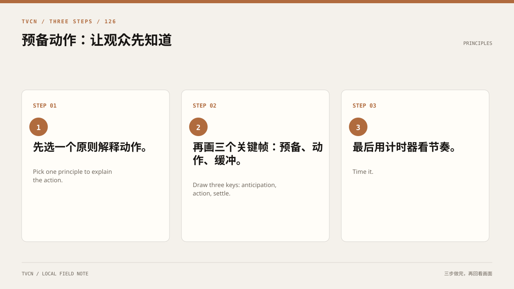

预备动作让观众提前知道要发生什么；没有预备，动作像突然被剪进来。

<!-- DIAGRAM_START -->
<h2>图解</h2>
<figure>
  
  <figcaption>把三步按顺序做完，再回看画面或文件。</figcaption>
</figure>
<!-- DIAGRAM_END -->
<h2>现场</h2>

动作前加 4 到 6 帧反向预备：身体先往后 5 厘米，再往前；让观众预判方向。

<h2>怎么做</h2>

预备动作让观众提前知道要发生什么；没有预备，动作像突然被剪进来。
<ol><li>动作前加 4 到 6 帧反向预备。</li><li>身体先往后 5 厘米，再往前。</li><li>让观众预判方向，不要用剪辑硬切。</li></ol>
<h2>别踩</h2>

别用剪辑代替预备；观众没预判，动作就没有力。

<h2>验收</h2>
<ul><li>主动作前有 4 到 6 帧反向动作。</li><li>身体先退后进，方向能被观众预判。</li><li>删掉预备后动作明显变突然，说明它有效。</li></ul>
