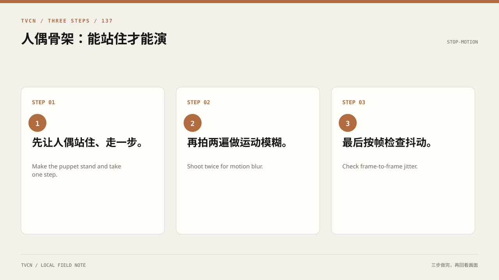

定格骨架先测三个动作：站立不晃、抬手不软、坐下不塌。关节用金属骨架加硅胶垫，脚底加大接触面；不要先做手指，先把重心和膝盖做稳。

<!-- DIAGRAM_START -->
<h2>图解</h2>
<figure>
  
  <figcaption>看“先让人偶站 10 秒不晃”和“再走 3 步不塌”两处，判断前景、中景、背景的速度差能不能在一次移动里看出来。</figcaption>
</figure>
<!-- DIAGRAM_END -->
<section><h2 id="section-1">骨架先保“能站稳”，再保“能表演”</h2>
每一帧都用手碰模型前，先想“它会不会倒”；拍一条测试，逐帧看支点有没有滑。
<h2 id="section-2">边界</h2>
骨架不是越硬越好。太硬动作会像机器人；需要弯曲的位置留一点软，承受重量的位置加硬。
<h2 id="section-3">骨架绑定：先做“极限测试”，再开始动画</h2>

绑定不是把骨骼连上就结束。动画师一拉，问题才出现：肘部塌陷、膝盖反转、肩膀穿模。绑定交付前必须做一组极限姿势测试，不合格不进入动画。

<table class="data-table"><thead><tr><th>测试</th><th>动作</th><th>通过标准</th></tr></thead><tbody>
<tr><td>肩</td><td>手臂上举 180°</td><td>腋下不塌，衣服不穿</td></tr>
<tr><td>肘</td><td>弯曲 140°</td><td>体积保持，无糖纸扭曲</td></tr>
<tr><td>膝</td><td>深蹲 + 反向</td><td>膝盖不反折，脚不滑</td></tr>
<tr><td>脊柱</td><td>扭转 + 侧弯</td><td>胸腔和骨盆过渡自然</td></tr>
</tbody></table>

<h3>项目级检查</h3>
<ol><li>控制器命名统一：左/右、FK/IK、镜像规则写在一页纸上，动画师不猜。</li><li>锁定不该动的轴，隐藏不用的控制器；能误触的绑定一定会被误触。</li><li>每个极限姿势存一张截图，作为绑定验收附件；口头说“能用”不算。</li><li>蒙皮权重先做关节，再做肌肉；一次刷全身，问题会互相掩盖。</li></ol>

如果项目周期少于 3 天，不要做电影级面部绑定；用简化面部控制器，把时间留给表演和渲染。
</section><section><h2 id="section-4">现场</h2>
先让人偶站 10 秒不晃，再走 3 步不塌；关节用金属骨架，脚底加配重。
</section><section><h2 id="section-5">怎么做</h2><ol><li>先让人偶站 10 秒不晃。</li><li>再走 3 步不塌。</li><li>关节用金属骨架，脚底加配重。</li></ol></section><section><h2 id="section-6">别踩</h2>
别让骨架软；拍十帧就会塌。
</section><section><h2>判断</h2>
这一页的判断只看三条可观察的验收，不靠口号：
<ul><li><strong>1.</strong> 人偶能站 10 秒不晃，脚底有配重。</li><li><strong>2.</strong> 走 3 步不塌，关节没有突然锁死。</li><li><strong>3.</strong> 同一姿势拍十帧，位置没有漂移。</li></ul></section><section><h2>失败</h2>
下面任一条出现，先停，不要靠后期补：
<ul><li><strong>1.</strong> 只做到“人偶能站 10 秒不晃，脚底有配重”的形式，换一个机位或场景就重现不了。</li><li><strong>2.</strong> 把“走 3 步不塌，关节没有突然锁死”留到后期或口头解释，现场没有留下能复查的记录。</li><li><strong>3.</strong> 别让骨架软；拍十帧就会塌。</li></ul></section><section><h2>延伸</h2>
<strong>10 分钟练习：</strong>用 24 fps 画 3 个关键帧，只改“再走 3 步不塌”，导出 2 秒；如果重量仍读不出来，先加预备帧，不要加模糊。
</section>
<h2>验收</h2><ul><li>人偶能站 10 秒不晃，脚底有配重。</li><li>走 3 步不塌，关节没有突然锁死。</li><li>同一姿势拍十帧，位置没有漂移。</li></ul>

<!-- SOURCES_START -->
## 参考与延伸阅读

- [S50] [Kodak：动态影像](https://www.kodak.com/en/motion/home) — 2026-11-26 访问。用于核对「骨架先保“能站稳”，再保“能表演”」一节的术语/方法/规则（Kodak 胶片与动态影像资料，不是数码参数）；不核对其中由本页经验得出的数字、型号与现场结论，也不替代测试。
- [S62] [Blender：官方手册](https://docs.blender.org/manual/en/latest/) — 2026-11-26 访问。用于核对「骨架绑定：先做“极限测试”，再开始动画」一节的术语/方法/规则（Blender 官方手册，不是行业流程标准）；不核对其中由本页经验得出的数字、型号与现场结论，也不替代测试。
- [S12] [Britannica：动画](https://www.britannica.com/art/animation) — 2026-11-26 访问。用于核对「现场」一节的术语/方法/规则（Britannica 动画史条目，不是软件手册）；不核对其中由本页经验得出的数字、型号与现场结论，也不替代测试。
<!-- SOURCES_END -->

