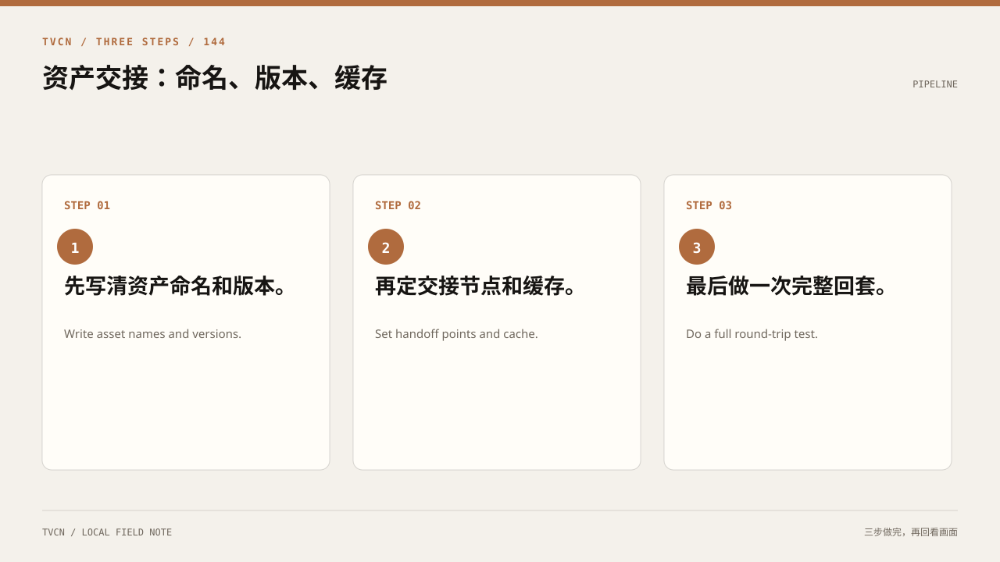

交接包必须让别人在没有你的电脑上打开：贴图用相对路径、缓存写清版本、文件名带场景和日期。不要用“最终版 final final”当版本号。

<!-- DIAGRAM_START -->
<h2>图解</h2>
<figure>
  
  <figcaption>看“命名写项目_资产_版本”和“交接到共享盘，附依赖清单和缓存路径”两处，判断前景、中景、背景的速度差能不能在一次移动里看出来。</figcaption>
</figure>
<!-- DIAGRAM_END -->
<section><h2 id="section-1">命名、版本、路径，三样都要能独立打开</h2>
每个资产写一行说明：谁做的、做什么用、依赖什么、哪一版是当前版。收包的人按说明能重建，不用问你。
<h2 id="section-2">边界</h2>
交接不是把整个工程文件夹压给你。只交当前镜头需要的资产和缓存，历史版本放归档；否则包会大到没人敢动。
</section><section><h2 id="section-3">现场</h2>
命名写项目_资产_版本；交接到共享盘，附依赖清单和缓存路径；下一个人先跑一遍。
</section><section><h2 id="section-4">怎么做</h2><ol><li>命名写项目_资产_版本。</li><li>交接到共享盘，附依赖清单和缓存路径。</li><li>下一个人先跑一遍，确认能打开再接手。</li></ol></section><section><h2 id="section-5">别踩</h2>
别把资产放在个人桌面；下一个人找不到。
</section><section><h2>判断</h2>
现场只认三个信号：
<ul><li>前景、中景、背景的速度差能在一次 pan 里看出来</li><li>动作在 0.5 秒内能读出重量或预备</li><li>关掉任意一层，空间感仍然成立</li></ul></section><section><h2>失败</h2>
下面三种做法会让页面上的细节白做：
<ul><li>层数堆上去了，但每层速度一样，空间还是扁的</li><li>动作有预备却没有跟随，重量只做了一半</li><li>资产没锁就进渲染，返工从合成端一路补</li></ul></section><section><h2>延伸</h2>
<strong>10 分钟练习：</strong>用 24 fps 画 3 个关键帧，只改“交接到共享盘，附依赖清单和缓存路径”，导出 2 秒；如果重量仍读不出来，先加预备帧，不要加模糊。
</section>
<h2>验收</h2><ul><li>资产名包含项目、资产和版本，能直接排序。</li><li>共享盘里有依赖清单和缓存路径。</li><li>下一个人按清单能打开资产，不需要问原作者。</li></ul>
