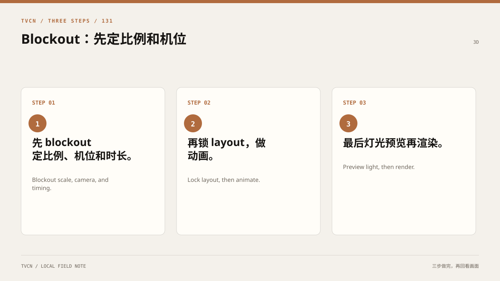

Blockout 先定比例、机位和时长，不建模细节；这一步错了，后面全返工。

<!-- DIAGRAM_START -->
<h2>图解</h2>
<figure>
  
  <figcaption>把三步按顺序做完，再回看画面或文件。</figcaption>
</figure>
<!-- DIAGRAM_END -->
<h2>现场</h2>

用盒子人定比例：头、胸、骨盆三块；先锁机位和 10 秒时长，再进建模。

<h2>怎么做</h2>

Blockout 先定比例、机位和时长，不建模细节；这一步错了，后面全返工。
<ol><li>用盒子人定比例：头、胸、骨盆三块。</li><li>先锁机位和 10 秒时长。</li><li>比例和机位确认后再进建模。</li></ol>
<h2>别踩</h2>

别在机位没锁时做表演；一定返工。

<h2>验收</h2>
<ul><li>盒子人能看出头、胸、骨盆三块比例。</li><li>机位和 10 秒时长已经锁死，有截图和参数。</li><li>最终镜头与 blockout 机位一致，没有中途换构图。</li></ul>

<!-- DEEP_DIVE_START -->
## 深读

<strong>约 6 分钟。</strong> blockout 不是草稿，是用最简单的形体决定镜头里发生什么。

### 比例和机位先定

用方盒代表人、门、桌，先定高度和距离；人和门的关系不对，后面建模再准也没用。用实际焦距看一遍，不要用广角把问题藏起来。

机位定三个：主镜头、反打、一个细节；三个都能讲清空间，再往下做。

### 走位用时间画

不要只摆一个姿势；用简单的代理人物走一遍，标出起点、转折、终点。每段时间写一个动作，不要写“走过去”。

用手机拍一版真人走位，和 blockout 对比；真人做不到的，动画也会假。

### 灰模只解决三件事

空间、比例、运动；材质、灯光、细节都不属于 blockout。灰模阶段加材质，只会让你舍不得改结构。

blockout 通过的标准：静音看一遍，能说出谁在哪、要做什么、什么挡着他。

### 五分钟练习：一个房间三个机位

搭一个房间，放一个人和一件障碍物；摆三个机位，每个机位只解决一个信息。用灰模渲染三张，不许加材质。

把三张给一个人看，问他“他想去哪、什么挡着他”；答不出，改机位，不要改模型。

### 什么时候算 blockout 通过

静音播放，一个没看过剧本的人能说出谁在哪、想做什么、什么挡着他、镜头为什么在这个位置；四项都答对，blockout 才算通过。

如果答不出，先改机位和走位，不要加模型细节。细节会让问题更难看见，不会让问题消失。

### Blockout，十项检查
<ul><li>方盒定人和门的高度</li><li>先定距离关系</li><li>用实际焦距看构图</li><li>主镜头反打细节三个机位</li><li>代理人物走一遍</li><li>标出起点转折终点</li><li>每段写一个动作</li><li>手机拍真人走位对比</li><li>灰模不加材质灯光</li><li>静音能说出谁在哪要做什么</li></ul>
blockout 的唯一任务，是让后面的人不用猜空间。

<!-- DEEP_DIVE_END -->
