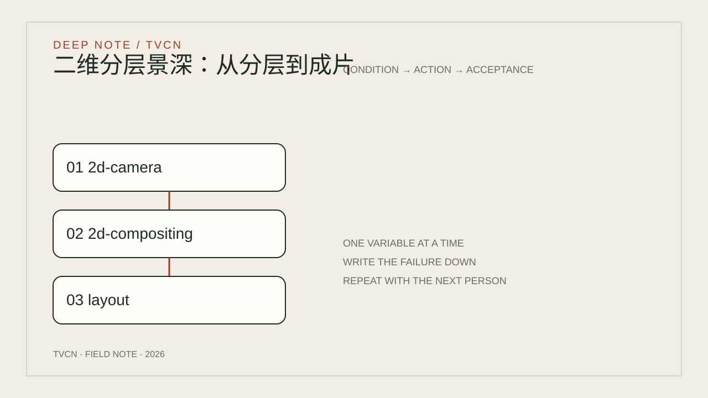

二维的空间不是画出来的，是分层、速度差和遮挡一起算出来的。 单看《二维运镜：pan 与 multiplane》只能解决一个局部；把《二维运镜：pan 与 multiplane》《二维合成：背景、前景、光》《Layout：镜头与资产交接》接成一条链，才会暴露“条件没写、变量太多、结果无法复现”的真问题。

<!-- DEEP_DIVE_START -->
<!-- DIAGRAM_START -->
<h2>图解</h2>
<figure>
  
  <figcaption>看“二维运镜：pan 与 multiplane”和“二维合成：背景、前景、光”两处，先定条件，再看失败能不能被记录下来。</figcaption>
</figure>
<!-- DIAGRAM_END -->

<section><h2 id="section-1">问题</h2>
这一页的问题不是“方法不够多”，而是三个环节各自成立、合起来却不成立：条件没写、变量太多、结果不能复现。

本页按“先定条件—再做判断—只改一个变量—留下证据”的顺序；每一步都能被下一个人复述，才算完成。
</section>
<section><h2 id="section-2">判断</h2><ul><li>《二维运镜：pan 与 multiplane》的第一道门槛：远、中、近三层速度不同，比例接近 1:2:4</li><li>《二维合成：背景、前景、光》的第二道门槛：人物层和背景层分开，没有跟着背景一起滑</li><li>《Layout：镜头与资产交接》的第三道门槛：pan 一遍能看出前景快、远景慢的空间感</li></ul>
三条里有一条不成立，就先回到对应单页；不要用整条链掩盖一个没解决的单点。
</section>
<section><h2 id="section-3">做法</h2><ol><li>先写条件：把《二维运镜：pan 与 multiplane》里“把背景分远山、中景、近树三层”落到一张三行表：素材、环境、验收。</li><li>再做一次最小动作：只按《二维运镜：pan 与 multiplane》的步骤做 30 秒，不加入第二页的方法。</li><li>把《二维合成：背景、前景、光》的步骤接上：pan 时速度按 1 比 2 比 4。</li><li>用《Layout：镜头与资产交接》做对照：人物单独一层，保持不动或只做小幅跟随。</li><li>每改一次只动一个变量；其他条件写进记录，不靠记忆。</li><li>把失败也拍下来：失败版本和成功版本并排，才知道哪一步不能省。</li><li>让下一个人按记录复现一次；他做不出来，说明记录还不够。</li></ol></section>
<section><h2 id="section-4">现场案例</h2>
可复现实验（不是客户案例）：拿 30 秒素材，先按《二维运镜：pan 与 multiplane》的“远、中、近三层速度不同，比例接近 1:2:4”做 A 版；再按《二维合成：背景、前景、光》的“人物层和背景层分开，没有跟着背景一起滑”做 B 版；两版只允许一个变量不同。把两版并排看，记录《Layout：镜头与资产交接》里最先崩的是哪一项：条件、动作还是验收。如果一次就成功，说明变量还不够多，再加一个现实限制重做。
</section>
<section><h2 id="section-5">失败表</h2>
<table class="data-table"><thead><tr><th>现象</th><th>原因</th><th>替换动作</th></tr></thead><tbody><tr><td>别把整张图一起平移；所有层同速，空间就扁了</td><td>条件没写清</td><td>回到第一页重写三行表</td></tr><tr><td>别把所有东西画在一层；改一笔就要重画全图</td><td>条件没写清</td><td>回到第一页重写三行表</td></tr><tr><td>别在 layout 里留活机位；动画一开做，改机位就是返工</td><td>条件没写清</td><td>回到第一页重写三行表</td></tr></tbody></table>
</section>
<section><h2 id="section-6">验收</h2><ul><li>远、中、近三层速度不同，比例接近 1:2:4。</li><li>人物层和背景层分开，没有跟着背景一起滑。</li><li>pan 一遍能看出前景快、远景慢的空间感。</li><li>背景、角色、前景、光效四层分开，文件结构清楚。</li><li>影子在独立层，没有画死在角色身上。</li><li>改角色动作时只动角色层，背景和光效不用重画。</li><li>机位、角色比例、资产版本三项都锁死并有版本号。</li><li>文件头能看到版本和依赖，动画师不用猜。</li><li>动画段没有擅自改机位，最终镜头和 layout 一致。</li><li>把 二维运镜：pan 与 multiplane 的条件写成一行，能复述给下一个人。</li></ul></section>
<section><h2 id="section-7">替代方案</h2><ul><li>只处理《二维运镜：pan 与 multiplane》里的单点问题：回到<a href="https://animation.tvcn.org/article/2d-camera/">《二维运镜：pan 与 multiplane》</a>，不要用整条链。</li><li>只比较两个动作：看<a href="https://animation.tvcn.org/article/2d-compositing/">《二维合成：背景、前景、光》</a>，先不改第三页。</li><li>只做验收：看<a href="https://animation.tvcn.org/article/layout/">《Layout：镜头与资产交接》</a>，把判断表拿去做自测。</li></ul></section>

<!-- SOURCES_START -->
## 参考与延伸阅读

- [S63] [Toon Boom：官方文档](https://docs.toonboom.com/) — 2026-11-26 访问。用于核对「问题」一节的术语/方法/规则（Toon Boom 官方文档，不是行业流程标准）；不核对其中由本页经验得出的数字、型号与现场结论，也不替代测试。
- [S62] [Blender：官方手册](https://docs.blender.org/manual/en/latest/) — 2026-11-26 访问。用于核对「判断」一节的术语/方法/规则（Blender 官方手册，不是行业流程标准）；不核对其中由本页经验得出的数字、型号与现场结论，也不替代测试。
- [S59] [Adobe：After Effects 官方指南](https://helpx.adobe.com/after-effects/user-guide.html) — 2026-11-26 访问。用于核对「做法」一节的术语/方法/规则（After Effects 官方指南，不是合成美学结论）；不核对其中由本页经验得出的数字、型号与现场结论，也不替代测试。
<!-- SOURCES_END -->

