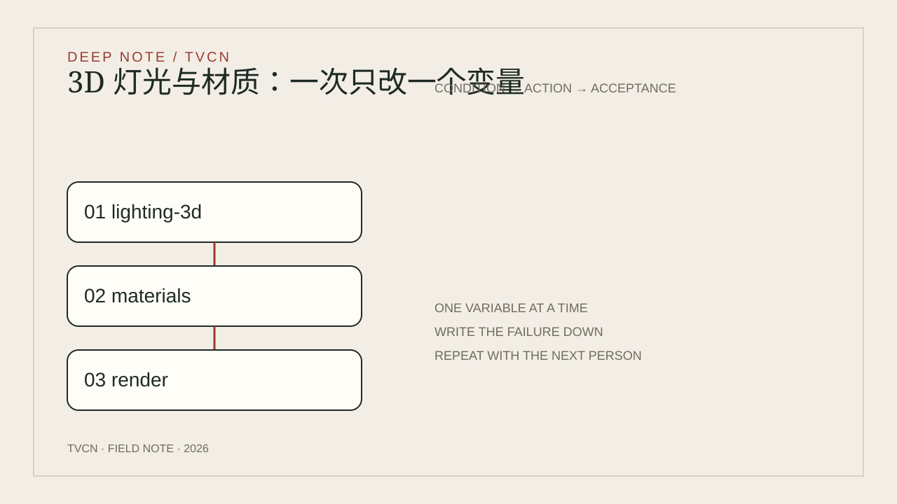

灯光和材质互相伪装；先固定一个，再判断另一个，才不会越调越糊。 单看《三维灯光：三点与 HDRI》只能解决一个局部；把《三维灯光：三点与 HDRI》《材质：粗糙度与高光》《渲染：采样与噪点》接成一条链，才会暴露“条件没写、变量太多、结果无法复现”的真问题。

<!-- DEEP_DIVE_START -->
<!-- DIAGRAM_START -->
<h2>图解</h2>
<figure>
  
  <figcaption>看“三维灯光：三点与 HDRI”和“材质：粗糙度与高光”两处，先定条件，再看失败能不能被记录下来。</figcaption>
</figure>
<!-- DIAGRAM_END -->

<section><h2 id="section-1">问题</h2>
这一页的问题不是“方法不够多”，而是三个环节各自成立、合起来却不成立：条件没写、变量太多、结果不能复现。

本页按“先定条件—再做判断—只改一个变量—留下证据”的顺序；每一步都能被下一个人复述，才算完成。
</section>
<section><h2 id="section-2">判断</h2><ul><li>《三维灯光：三点与 HDRI》的第一道门槛：关 HDRI 时，主光已经能把形体打出来</li><li>《材质：粗糙度与高光》的第二道门槛：补光和轮廓光各司其职，没有把主光打平</li><li>《渲染：采样与噪点》的第三道门槛：HDRI 只占 20% 到 30%，没有抢走主光</li></ul>
三条里有一条不成立，就先回到对应单页；不要用整条链掩盖一个没解决的单点。
</section>
<section><h2 id="section-3">做法</h2><ol><li>先写条件：把《三维灯光：三点与 HDRI》里“先关 HDRI，只用主光看形体”落到一张三行表：素材、环境、验收。</li><li>再做一次最小动作：只按《三维灯光：三点与 HDRI》的步骤做 30 秒，不加入第二页的方法。</li><li>把《材质：粗糙度与高光》的步骤接上：再加补光和轮廓光。</li><li>用《渲染：采样与噪点》做对照：最后开 HDRI 到 20% 到 30% 补环境。</li><li>每改一次只动一个变量；其他条件写进记录，不靠记忆。</li><li>把失败也拍下来：失败版本和成功版本并排，才知道哪一步不能省。</li><li>让下一个人按记录复现一次；他做不出来，说明记录还不够。</li></ol></section>
<section><h2 id="section-4">现场案例</h2>
可复现实验（不是客户案例）：拿 30 秒素材，先按《三维灯光：三点与 HDRI》的“关 HDRI 时，主光已经能把形体打出来”做 A 版；再按《材质：粗糙度与高光》的“补光和轮廓光各司其职，没有把主光打平”做 B 版；两版只允许一个变量不同。把两版并排看，记录《渲染：采样与噪点》里最先崩的是哪一项：条件、动作还是验收。如果一次就成功，说明变量还不够多，再加一个现实限制重做。
</section>
<section><h2 id="section-5">失败表</h2>
<table class="data-table"><thead><tr><th>现象</th><th>原因</th><th>替换动作</th></tr></thead><tbody><tr><td>别一上来就开 HDRI；环境光一盖，形体就看不清了</td><td>条件没写清</td><td>回到第一页重写三行表</td></tr><tr><td>别用纹理掩盖材质；粗糙度不对，贴图再细也像纸</td><td>条件没写清</td><td>回到第一页重写三行表</td></tr><tr><td>别用总采样硬压噪点；找不到来源，时间全烧在渲染上</td><td>条件没写清</td><td>回到第一页重写三行表</td></tr></tbody></table>
</section>
<section><h2 id="section-6">验收</h2><ul><li>关 HDRI 时，主光已经能把形体打出来。</li><li>补光和轮廓光各司其职，没有把主光打平。</li><li>HDRI 只占 20% 到 30%，没有抢走主光。</li><li>三块球在同一盏灯下高光大小明显不同。</li><li>粗糙度 0.2 和 0.8 的差别能说清，不是只换颜色。</li><li>材质确认后才贴纹理，纹理没有掩盖高光问题。</li><li>50% 低采样下能看出噪点集中在灯光还是材质。</li><li>灯光采样和材质采样分开调整过。</li><li>最终噪点来自具体一项，不是靠无脑拉高总采样。</li><li>把 三维灯光：三点与 HDRI 的条件写成一行，能复述给下一个人。</li></ul></section>
<section><h2 id="section-7">替代方案</h2><ul><li>只处理《三维灯光：三点与 HDRI》里的单点问题：回到<a href="https://animation.tvcn.org/article/lighting-3d/">《三维灯光：三点与 HDRI》</a>，不要用整条链。</li><li>只比较两个动作：看<a href="https://animation.tvcn.org/article/materials/">《材质：粗糙度与高光》</a>，先不改第三页。</li><li>只做验收：看<a href="https://animation.tvcn.org/article/render/">《渲染：采样与噪点》</a>，把判断表拿去做自测。</li></ul></section>

<!-- SOURCES_START -->
## 参考与延伸阅读

- [S62] [Blender Foundation：Blender 官方手册](https://docs.blender.org/manual/en/latest/) — 2026-11-26 访问。用于核对首段“灯光和材质互相伪装；先固定一个，再判断另一个，才不会越调越糊。”中的术语与公开背景（建模、绑定、动画、渲染）；不替代现场测试。
- [S63] [Toon Boom：官方文档](https://docs.toonboom.com/) — 2026-11-26 访问。用于核对首段“灯光和材质互相伪装；先固定一个，再判断另一个，才不会越调越糊。”中的术语与公开背景（2D 动画、绑定与制作管线）；不替代现场测试。
- [S12] [Britannica](https://www.britannica.com/art/animation) — 2026-11-26 访问。用于核对首段“灯光和材质互相伪装；先固定一个，再判断另一个，才不会越调越糊。”中的术语与公开背景（动画原理、技术与产业史的百科条目）；不替代现场测试。
- [S59] [Adobe：After Effects 用户指南](https://helpx.adobe.com/after-effects/user-guide.html) — 2026-11-26 访问。用于核对首段“灯光和材质互相伪装；先固定一个，再判断另一个，才不会越调越糊。”中的术语与公开背景（合成、关键帧、跟踪与导出）；不替代现场测试。
<!-- SOURCES_END -->

