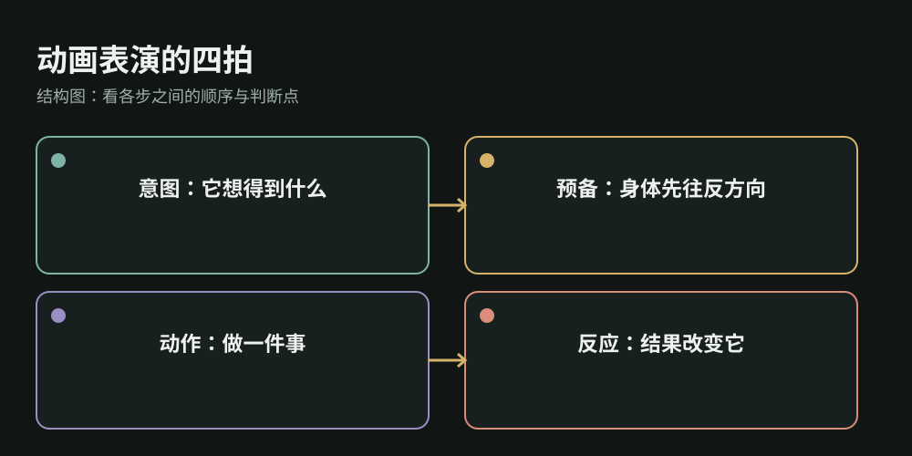

3D 角色最容易“动作正确但像机器”：手到了门把，脚走到了位置，头转对了方向，但观众不觉得它想开门。问题不在绑定，在动画师只 K 了姿势，没有给角色一个意图。

<!-- DIAGRAM_START -->
<h2 id="diagram">图解</h2>
<figure class="diagram">
  
  <figcaption>看“意图、预备、动作、反应”四拍；如果角色只是从 A 点移动到 B 点，没有想要的东西，动作再顺也是机械。</figcaption>
</figure>
<!-- DIAGRAM_END -->

<section><h2 id="section-1">现场</h2>
一个 3D 短片镜头：角色走到门前，停住，开门，走进黑暗。动画师 K 了 4 个关键姿势：站、伸手、拉门、迈步。动作很顺，导演说“像机器人”。角色没有犹豫，没有听，没有在开门前决定什么。
</section>
<section><h2 id="section-2">判断</h2><ul><li><strong>意图可见：</strong>观众能说出角色在门开之前想要什么——进去、逃开、确认里面有没有人。</li><li><strong>预备存在：</strong>身体先往反方向或停顿一下，再行动；没有预备，动作像被推着走。</li><li><strong>视线有目标：</strong>眼睛先到门把、门缝或猫眼，手才跟上；视线和手同时到，显得假。</li><li><strong>反应改变身体：</strong>门开之后，角色重心、呼吸或手的位置变了；没有反应，动作只是完成。</li></ul></section>
<section><h2 id="section-3">怎么做</h2><ol><li>写一句意图：不是“开门”，是“确认房间里有没有人”；意图要能被一个动作检验。</li><li>加预备：身体先向后退半寸、手先握紧、呼吸先停；预备让观众知道动作要发生。</li><li>定视线顺序：眼睛先到目标，头再转，手最后到；三个时间点分开，不要同一帧。</li><li>做 breakdown：在关键姿势之间加 2–3 个 breakdown，决定重心怎么过去，不要只靠曲线。</li><li>拍参考：自己或演员做一遍，拍手机；参考不是照抄，是看身体在哪一刻决定。</li></ol></section>
<section><h2 id="section-4">失败</h2><ul><li><strong>只 K 关键姿势：</strong>站、伸手、拉门、迈步四个 pose 很准，但身体没有决定的过程。</li><li><strong>全身同时动：</strong>手、头、脚同一帧启动，像被一根绳子拉着。</li><li><strong>表情先于动作：</strong>脸先惊讶，手才去开门；观众觉得表情是贴上去的。</li></ul></section>
<section><h2 id="section-5">边界</h2>
这套方法适合角色镜头、叙事动画、表演向的 3D/2D；不适合纯物理循环（走路、跑步）和特效模拟，那些更依赖曲线和物理。动画表演也不能替代绑定：绑定没有控制器的部位，意图再好也做不出来。先检查绑定，再谈表演。
</section>
<section><h2 id="section-6">验收</h2><ul><li>观众能说出角色在动作前想要什么。</li><li>动作前有至少一个预备帧组，不是直接启动。</li><li>视线、头、手分三个时间点到达。</li><li>动作结束后，身体有一个反应变化。</li></ul></section>
<!-- DEEP_DIVE_START -->
## 深读

<strong>约 8 分钟。</strong> 下面把同一套判断放进两个不同条件，再看一个反例和一个可复用模型；不是重复前文，而是决定什么时候该换做法。

### 条件 A：写实表演

写实动画的意图要小，反应要细。不要给角色“我很悲伤”这种大意图，给“我想把杯子放稳，但手在抖”。观众看见的是手，感受到的是悲伤。写实表演靠抑制：角色越不想让人看见，观众越看得见。

写实表演的参考要拍“没在演”的人：让演员做一件真事，比如系鞋带、找钥匙、接电话；拍完看他在哪一刻停顿。动画师抄的不是表情，是停顿的位置。停顿对了，表情可以很少。

### 条件 B：风格化表演

风格化动画可以把意图放大到身体之外：角色想要的东西变成一条伸长的胳膊、一个变大的影子、一次夸张的冲刺。但放大必须有规则：只放大一个部位，其他部位保持稳定；全都放大，观众会疲劳。

风格化表演的节拍比写实更硬：预备更长、动作更快、停顿更短。观众需要先看到“要发生”，再看到“发生”，最后看到“结果”。三段分明，风格才不散。不要用中间帧把三段糊在一起。

### 反例：意图太多

一个角色在同一镜头里想开门、想看手机、想回头、想喘气。动画师给每个意图都做了预备，结果身体一直在抖，观众不知道它最想要什么。问题不是动作不够，是意图没有排序。

修法是把意图排成一条线：先确认门里有没有人（主意图），手机是干扰，回头是反应，喘气是结果。主意图只有一个，其他都是它的阻力或后果。删掉两个，动作反而更清楚。

### 可复用模型

<strong>意图 → 预备 → 动作 → 反应。</strong> 意图让观众知道为什么动；预备让观众知道要动；动作让观众看到做什么；反应让观众看到结果落在谁身上。四拍里最难的是反应，很多动画只做到动作就停了。

每个镜头只写一个主意图，最多两个阻力。写不出主意图，说明这个镜头还没有设计，只是在移动角色。先写意图，再 K 帧；不要用 K 帧找意图。

<!-- DEEP_DIVE_END -->
<!-- SOURCES_START -->
## 参考与延伸阅读

- [S62] [Blender Foundation：Blender 官方手册](https://docs.blender.org/manual/en/latest/) — 2026-11-26 访问。用于核对“判断”一节的术语、方法或规则；不核对本页由经验得出的数字、型号与现场结论，也不替代测试或合同。
- [S42] [Khan Academy：Pixar in a Box](https://www.khanacademy.org/partner-content/pixar) — 2026-11-26 访问。用于核对“边界”一节的术语、方法或规则；不核对本页由经验得出的数字、型号与现场结论，也不替代测试或合同。
<!-- SOURCES_END -->
