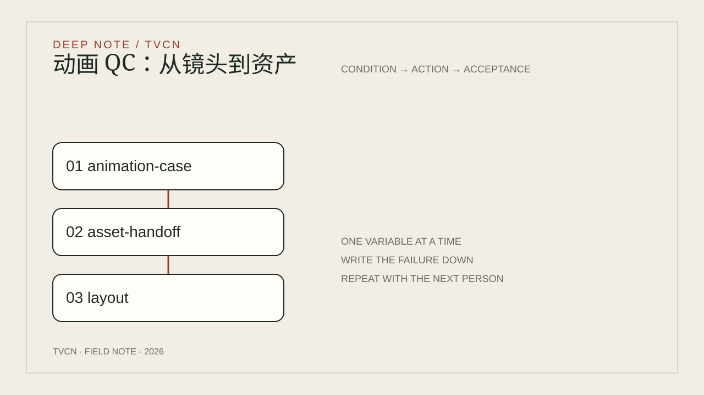

动画 QC 不是只看画面漂不漂亮，而是镜头、绑定、资产和交付命名都能被复现。 单看《短片复盘：从分镜到成片》只能解决一个局部；把《短片复盘：从分镜到成片》《资产交接：命名、版本、缓存》《Layout：镜头与资产交接》接成一条链，才会暴露“条件没写、变量太多、结果无法复现”的真问题。

<!-- DEEP_DIVE_START -->
<!-- DIAGRAM_START -->
<h2>图解</h2>
<figure>
  
  <figcaption>看“短片复盘：从分镜到成片”和“资产交接：命名、版本、缓存”两处，先定条件，再看失败能不能被记录下来。</figcaption>
</figure>
<!-- DIAGRAM_END -->

<section><h2 id="section-1">问题</h2>
这一页的问题不是“方法不够多”，而是三个环节各自成立、合起来却不成立：条件没写、变量太多、结果不能复现。

本页按“先定条件—再做判断—只改一个变量—留下证据”的顺序；每一步都能被下一个人复述，才算完成。
</section>
<section><h2 id="section-2">判断</h2><ul><li>《短片复盘：从分镜到成片》的第一道门槛：六个阶段都有对照，不只贴成片截图</li><li>《资产交接：命名、版本、缓存》的第二道门槛：每个阶段记了一个决定和一处返工</li><li>《Layout：镜头与资产交接》的第三道门槛：至少写出一个可复用的步骤，别人能照着做</li></ul>
三条里有一条不成立，就先回到对应单页；不要用整条链掩盖一个没解决的单点。
</section>
<section><h2 id="section-3">做法</h2><ol><li>先写条件：把《短片复盘：从分镜到成片》里“逐段对照：分镜 3 格、animatic 时长、layout 机位、动画关键帧、灯光、合成”落到一张三行表：素材、环境、验收。</li><li>再做一次最小动作：只按《短片复盘：从分镜到成片》的步骤做 30 秒，不加入第二页的方法。</li><li>把《资产交接：命名、版本、缓存》的步骤接上：每段记一个改动和一处返工。</li><li>用《Layout：镜头与资产交接》做对照：写清哪一步可以复用，不只说“好看”。</li><li>每改一次只动一个变量；其他条件写进记录，不靠记忆。</li><li>把失败也拍下来：失败版本和成功版本并排，才知道哪一步不能省。</li><li>让下一个人按记录复现一次；他做不出来，说明记录还不够。</li></ol></section>
<section><h2 id="section-4">现场案例</h2>
可复现实验（不是客户案例）：拿 30 秒素材，先按《短片复盘：从分镜到成片》的“六个阶段都有对照，不只贴成片截图”做 A 版；再按《资产交接：命名、版本、缓存》的“每个阶段记了一个决定和一处返工”做 B 版；两版只允许一个变量不同。把两版并排看，记录《Layout：镜头与资产交接》里最先崩的是哪一项：条件、动作还是验收。如果一次就成功，说明变量还不够多，再加一个现实限制重做。
</section>
<section><h2 id="section-5">失败表</h2>
<table class="data-table"><thead><tr><th>现象</th><th>原因</th><th>替换动作</th></tr></thead><tbody><tr><td>别只看成片；成片看不到返工</td><td>条件没写清</td><td>回到第一页重写三行表</td></tr><tr><td>别把资产放在个人桌面；下一个人找不到</td><td>条件没写清</td><td>回到第一页重写三行表</td></tr><tr><td>别在 layout 里留活机位；动画一开做，改机位就是返工</td><td>条件没写清</td><td>回到第一页重写三行表</td></tr></tbody></table>
</section>
<section><h2 id="section-6">验收</h2><ul><li>六个阶段都有对照，不只贴成片截图。</li><li>每个阶段记了一个决定和一处返工。</li><li>至少写出一个可复用的步骤，别人能照着做。</li><li>资产名包含项目、资产和版本，能直接排序。</li><li>共享盘里有依赖清单和缓存路径。</li><li>下一个人按清单能打开资产，不需要问原作者。</li><li>机位、角色比例、资产版本三项都锁死并有版本号。</li><li>文件头能看到版本和依赖，动画师不用猜。</li><li>动画段没有擅自改机位，最终镜头和 layout 一致。</li><li>把 短片复盘：从分镜到成片 的条件写成一行，能复述给下一个人。</li></ul></section>
<section><h2 id="section-7">替代方案</h2><ul><li>只处理《短片复盘：从分镜到成片》里的单点问题：回到<a href="https://animation.tvcn.org/article/animation-case/">《短片复盘：从分镜到成片》</a>，不要用整条链。</li><li>只比较两个动作：看<a href="https://animation.tvcn.org/article/asset-handoff/">《资产交接：命名、版本、缓存》</a>，先不改第三页。</li><li>只做验收：看<a href="https://animation.tvcn.org/article/layout/">《Layout：镜头与资产交接》</a>，把判断表拿去做自测。</li></ul></section>
