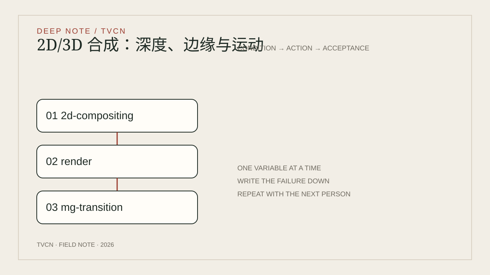

合成不是把两层叠在一起，而是让深度、边缘和运动方向同时说同一种空间。 单看《二维合成：背景、前景、光》只能解决一个局部；把《二维合成：背景、前景、光》《渲染：采样与噪点》《图形转场：形状接形状》接成一条链，才会暴露“条件没写、变量太多、结果无法复现”的真问题。

<!-- DEEP_DIVE_START -->
<!-- DIAGRAM_START -->
<h2>图解</h2>
<figure>
  
  <figcaption>看“二维合成：背景、前景、光”和“渲染：采样与噪点”两处，先定条件，再看失败能不能被记录下来。</figcaption>
</figure>
<!-- DIAGRAM_END -->

<section><h2 id="section-1">问题</h2>
这一页的问题不是“方法不够多”，而是三个环节各自成立、合起来却不成立：条件没写、变量太多、结果不能复现。

本页按“先定条件—再做判断—只改一个变量—留下证据”的顺序；每一步都能被下一个人复述，才算完成。
</section>
<section><h2 id="section-2">判断</h2><ul><li>《二维合成：背景、前景、光》的第一道门槛：背景、角色、前景、光效四层分开，文件结构清楚</li><li>《渲染：采样与噪点》的第二道门槛：影子在独立层，没有画死在角色身上</li><li>《图形转场：形状接形状》的第三道门槛：改角色动作时只动角色层，背景和光效不用重画</li></ul>
三条里有一条不成立，就先回到对应单页；不要用整条链掩盖一个没解决的单点。
</section>
<section><h2 id="section-3">做法</h2><ol><li>先写条件：把《二维合成：背景、前景、光》里“背景、角色、前景、光效分四层”落到一张三行表：素材、环境、验收。</li><li>再做一次最小动作：只按《二维合成：背景、前景、光》的步骤做 30 秒，不加入第二页的方法。</li><li>把《渲染：采样与噪点》的步骤接上：每层单独调色，别把影子画在角色层。</li><li>用《图形转场：形状接形状》做对照：合成时先对位置，再对光和影。</li><li>每改一次只动一个变量；其他条件写进记录，不靠记忆。</li><li>把失败也拍下来：失败版本和成功版本并排，才知道哪一步不能省。</li><li>让下一个人按记录复现一次；他做不出来，说明记录还不够。</li></ol></section>
<section><h2 id="section-4">现场案例</h2>
可复现实验（不是客户案例）：拿 30 秒素材，先按《二维合成：背景、前景、光》的“背景、角色、前景、光效四层分开，文件结构清楚”做 A 版；再按《渲染：采样与噪点》的“影子在独立层，没有画死在角色身上”做 B 版；两版只允许一个变量不同。把两版并排看，记录《图形转场：形状接形状》里最先崩的是哪一项：条件、动作还是验收。如果一次就成功，说明变量还不够多，再加一个现实限制重做。
</section>
<section><h2 id="section-5">失败表</h2>
<table class="data-table"><thead><tr><th>现象</th><th>原因</th><th>替换动作</th></tr></thead><tbody><tr><td>别把所有东西画在一层；改一笔就要重画全图</td><td>条件没写清</td><td>回到第一页重写三行表</td></tr><tr><td>别用总采样硬压噪点；找不到来源，时间全烧在渲染上</td><td>条件没写清</td><td>回到第一页重写三行表</td></tr><tr><td>别用白闪和推拉当万能转场；形状接不上，观众就断片</td><td>条件没写清</td><td>回到第一页重写三行表</td></tr></tbody></table>
</section>
<section><h2 id="section-6">验收</h2><ul><li>背景、角色、前景、光效四层分开，文件结构清楚。</li><li>影子在独立层，没有画死在角色身上。</li><li>改角色动作时只动角色层，背景和光效不用重画。</li><li>50% 低采样下能看出噪点集中在灯光还是材质。</li><li>灯光采样和材质采样分开调整过。</li><li>最终噪点来自具体一项，不是靠无脑拉高总采样。</li><li>转场前后是同一个形状在变形，不是硬切。</li><li>变形在 8 到 12 帧内完成，速度可读。</li><li>拿掉白闪后信息仍能接上，观众知道到了哪里。</li><li>把 二维合成：背景、前景、光 的条件写成一行，能复述给下一个人。</li></ul></section>
<section><h2 id="section-7">替代方案</h2><ul><li>只处理《二维合成：背景、前景、光》里的单点问题：回到<a href="https://animation.tvcn.org/article/2d-compositing/">《二维合成：背景、前景、光》</a>，不要用整条链。</li><li>只比较两个动作：看<a href="https://animation.tvcn.org/article/render/">《渲染：采样与噪点》</a>，先不改第三页。</li><li>只做验收：看<a href="https://animation.tvcn.org/article/mg-transition/">《图形转场：形状接形状》</a>，把判断表拿去做自测。</li></ul></section>

<!-- SOURCES_START -->
## 参考与延伸阅读

- [S63] [Toon Boom：官方文档](https://docs.toonboom.com/) — 2026-11-26 访问。用于核对「问题」一节的术语/方法/规则（Toon Boom 官方文档，不是行业流程标准）；不核对其中由本页经验得出的数字、型号与现场结论，也不替代测试。
- [S62] [Blender：官方手册](https://docs.blender.org/manual/en/latest/) — 2026-11-26 访问。用于核对「判断」一节的术语/方法/规则（Blender 官方手册，不是行业流程标准）；不核对其中由本页经验得出的数字、型号与现场结论，也不替代测试。
- [S59] [Adobe：After Effects 官方指南](https://helpx.adobe.com/after-effects/user-guide.html) — 2026-11-26 访问。用于核对「做法」一节的术语/方法/规则（After Effects 官方指南，不是合成美学结论）；不核对其中由本页经验得出的数字、型号与现场结论，也不替代测试。
<!-- SOURCES_END -->

