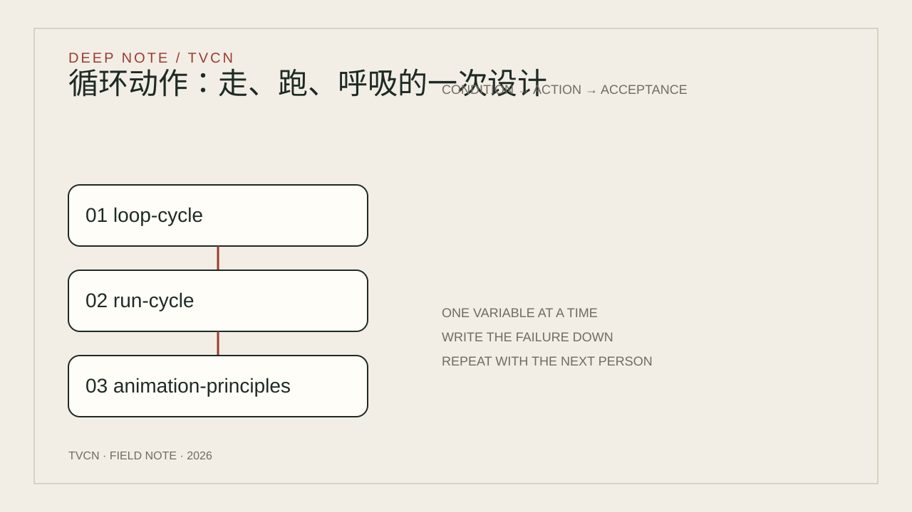

循环不是把首尾接上，而是让重心、接触和节奏在同一拍里闭合。 单看《循环动作：首尾怎么接》只能解决一个局部；把《循环动作：首尾怎么接》《跑步循环：脚与重心》《十二原则：别一次全用》接成一条链，才会暴露“条件没写、变量太多、结果无法复现”的真问题。

<!-- DEEP_DIVE_START -->
<!-- DIAGRAM_START -->
<h2>图解</h2>
<figure>
  
  <figcaption>看“循环动作：首尾怎么接”和“跑步循环：脚与重心”两处，先定条件，再看失败能不能被记录下来。</figcaption>
</figure>
<!-- DIAGRAM_END -->

<section><h2 id="section-1">问题</h2>
这一页的问题不是“方法不够多”，而是三个环节各自成立、合起来却不成立：条件没写、变量太多、结果不能复现。

本页按“先定条件—再做判断—只改一个变量—留下证据”的顺序；每一步都能被下一个人复述，才算完成。
</section>
<section><h2 id="section-2">判断</h2><ul><li>《循环动作：首尾怎么接》的第一道门槛：首帧和尾帧是同一姿势，位置和形状一致</li><li>《跑步循环：脚与重心》的第二道门槛：中间 8 到 12 帧，节奏均匀</li><li>《十二原则：别一次全用》的第三道门槛：循环播放十圈，接缝处没有跳一下或黏一下</li></ul>
三条里有一条不成立，就先回到对应单页；不要用整条链掩盖一个没解决的单点。
</section>
<section><h2 id="section-3">做法</h2><ol><li>先写条件：把《循环动作：首尾怎么接》里“首尾各画同一帧”落到一张三行表：素材、环境、验收。</li><li>再做一次最小动作：只按《循环动作：首尾怎么接》的步骤做 30 秒，不加入第二页的方法。</li><li>把《跑步循环：脚与重心》的步骤接上：中间 8 到 12 帧。</li><li>用《十二原则：别一次全用》做对照：循环播放，看最后一帧到第一帧有没有跳。</li><li>每改一次只动一个变量；其他条件写进记录，不靠记忆。</li><li>把失败也拍下来：失败版本和成功版本并排，才知道哪一步不能省。</li><li>让下一个人按记录复现一次；他做不出来，说明记录还不够。</li></ol></section>
<section><h2 id="section-4">现场案例</h2>
可复现实验（不是客户案例）：拿 30 秒素材，先按《循环动作：首尾怎么接》的“首帧和尾帧是同一姿势，位置和形状一致”做 A 版；再按《跑步循环：脚与重心》的“中间 8 到 12 帧，节奏均匀”做 B 版；两版只允许一个变量不同。把两版并排看，记录《十二原则：别一次全用》里最先崩的是哪一项：条件、动作还是验收。如果一次就成功，说明变量还不够多，再加一个现实限制重做。
</section>
<section><h2 id="section-5">失败表</h2>
<table class="data-table"><thead><tr><th>现象</th><th>原因</th><th>替换动作</th></tr></thead><tbody><tr><td>别让首尾差一帧；循环一多，抖动会越来越明显</td><td>条件没写清</td><td>回到第一页重写三行表</td></tr><tr><td>别先修手臂；脚一滑，手臂再顺也像飘</td><td>条件没写清</td><td>回到第一页重写三行表</td></tr><tr><td>别一次套十二原则；动作会变成抽筋</td><td>条件没写清</td><td>回到第一页重写三行表</td></tr></tbody></table>
</section>
<section><h2 id="section-6">验收</h2><ul><li>首帧和尾帧是同一姿势，位置和形状一致。</li><li>中间 8 到 12 帧，节奏均匀。</li><li>循环播放十圈，接缝处没有跳一下或黏一下。</li><li>四个关键姿势齐全，接触、下压、通过、腾空都能认出来。</li><li>支撑脚从脚跟滚到脚尖，没有整只脚平移。</li><li>重心上下不超过一个头，循环播放不飘。</li><li>一个动作只用了一个主要原则，能说出它解决什么。</li><li>预备、动作、缓冲三段的帧数是写下来的，不是随手画。</li><li>删掉这个原则后，动作明显更难读，说明它真的有用。</li><li>一个镜头只挑三条</li></ul></section>
<section><h2 id="section-7">替代方案</h2><ul><li>只处理《循环动作：首尾怎么接》里的单点问题：回到<a href="https://animation.tvcn.org/article/loop-cycle/">《循环动作：首尾怎么接》</a>，不要用整条链。</li><li>只比较两个动作：看<a href="https://animation.tvcn.org/article/run-cycle/">《跑步循环：脚与重心》</a>，先不改第三页。</li><li>只做验收：看<a href="https://animation.tvcn.org/article/animation-principles/">《十二原则：别一次全用》</a>，把判断表拿去做自测。</li></ul></section>
