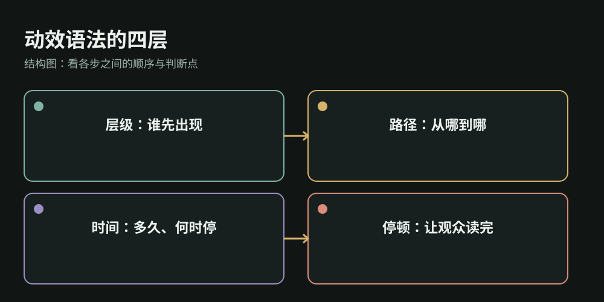

信息动效最常见的失败，是每个元素都在动：标题飞入、图标旋转、数字跳动、背景粒子飘。观众看见很多动作，却不知道先看哪一个。动效不是装饰，是注意力的排序。

<!-- DIAGRAM_START -->
<h2 id="diagram">图解</h2>
<figure class="diagram">
  
  <figcaption>看“层级、路径、时间、停顿”四层；如果所有元素同时动、同时停，观众只会记住热闹，不会记住信息。</figcaption>
</figure>
<!-- DIAGRAM_END -->

<section><h2 id="section-1">现场</h2>
一条 30 秒数据解释片，要讲三个数字：增长 40%、成本下降 18%、用户停留 2 分钟。设计师给三个数字都加了弹跳、旋转和粒子；客户觉得“很有科技感”。粗剪放给五个人看，三个人只记住了 40%，没人记得另外两个数字。
</section>
<section><h2 id="section-2">判断</h2><ul><li><strong>一条线只讲一件事：</strong>主运动只有一个方向；出现第二条同等强度的运动，注意力就分叉。</li><li><strong>运动方向一致：</strong>所有元素从左到右或从下到上；方向相反，观众会以为发生冲突。</li><li><strong>停得够久：</strong>数字落定后至少留 0.5 秒；没有停顿，观众读不完。</li><li><strong>缓动统一：</strong>同一条片用同一组缓动；每条线不同，画面会显得散。</li></ul></section>
<section><h2 id="section-3">怎么做</h2><ol><li>先写信息层级：观众第一眼、第二眼、第三眼各看什么；用一句话写，不用分镜。</li><li>给每条信息一条主运动：出现、移动、落定；不要同时加旋转、缩放、变色。</li><li>用同一组缓动：入场用 ease-out，移动用 ease-in-out，落定用轻微回弹；全片不超过三种。</li><li>在落定后留 0.5–1 秒停顿；停顿不是空帧，是让观众读完。</li><li>做成系统：颜色、线宽、圆角、间距、节奏各定一个规则；下一张图直接套，不重新发明。</li></ol></section>
<section><h2 id="section-4">失败</h2><ul><li><strong>全屏都在动：</strong>背景粒子、标题、数字、图标同时动，观众不知道看哪。</li><li><strong>每条线不同缓动：</strong>有的弹、有的滑、有的闪，像五个设计师各做各的。</li><li><strong>字和图形同时动：</strong>观众读字时图形在抢，读完字图形已经走了。</li></ul></section>
<section><h2 id="section-5">边界</h2>
这套语法适合信息图、数据解释、产品说明；不适合叙事片头、MV 或实验影像，那些类型需要冲突和意外。动效也不能替代平面设计：层级不清，动得再好也只是把混乱加速。先做一张静态版，静态能读，动态才有意义。
</section>
<section><h2 id="section-6">验收</h2><ul><li>静音看一遍，能说出第一、第二、第三眼各看什么。</li><li>全片不超过三种缓动，方向一致。</li><li>每个数字落定后至少 0.5 秒停顿。</li><li>把最后一帧截成静态图，信息仍然成立。</li></ul></section>
<!-- DEEP_DIVE_START -->
## 深读

<strong>约 8 分钟。</strong> 下面把同一套判断放进两个不同条件，再看一个反例和一个可复用模型；不是重复前文，而是决定什么时候该换做法。

### 条件 A：数据/信息图

数据动效的第一任务是“可读”，第二才是“好看”。数字不要从 0 滚到目标值，除非滚动本身是信息；多数时候，数字直接落定，配一个短促的 scale，观众更快读到。比较关系用位置，不用颜色：两根柱子一高一低，比红蓝更直接。

信息图的停顿要按阅读速度算：中文一秒读 4–6 个字，英文一秒 3–4 个词；一个 12 字的结论至少留 2 秒。不要用“感觉差不多”决定停顿，用字数除以阅读速度，再加 0.3 秒呼吸。

### 条件 B：片头/品牌动效

片头不是信息图，它可以先制造期待，再给答案。品牌动效通常只有一个记忆点：一个形状、一条线、一个字母的变形；其他元素都退到背景。记忆点出现前留 0.5 秒空白，出现后留 1 秒；空白不是省事，是让观众注意。

片头最容易过度设计：每个字母都加光效、粒子、故障。观众记住的是效果，不是品牌。先把黑白静帧做对，再加一层动效；一层不够，说明静帧不成立，不是动效不够。

### 反例：动效很酷，但读不完

一条 20 秒信息片，标题从五个方向飞入，数字滚动 3 秒，图表从屏幕外滑入，结尾 logo 旋转 720 度。客户很喜欢，投放后完播率低。观众不是不喜欢，是没跟上；每次想看，画面已经换了。

修法不是把动效删光，而是给每个元素“落定—停顿—再走”。标题落定 0.8 秒，数字落定 1 秒，图表落定 1.5 秒，logo 只出现不旋转。总时长没变，信息量却进去了。

### 可复用模型

<strong>层级 → 路径 → 时间 → 停顿。</strong> 层级决定观众先看什么；路径决定运动是否可信；时间决定动作多快；停顿决定信息是否被读完。四层都定好，再谈风格；风格是第四层之后的事。

做一套 5 页的动效规范：主色、辅色、线宽、圆角、三种缓动、两种停顿。下一张图直接套规范，不重新调；规范越简单，系统越稳。

<!-- DEEP_DIVE_END -->
<!-- SOURCES_START -->
## 参考与延伸阅读

- [S59] [Adobe：After Effects 用户指南](https://helpx.adobe.com/after-effects/user-guide.html) — 2026-11-26 访问。用于核对“判断”一节的术语、方法或规则；不核对本页由经验得出的数字、型号与现场结论，也不替代测试或合同。
- [S62] [Blender Foundation：Blender 官方手册](https://docs.blender.org/manual/en/latest/) — 2026-11-26 访问。用于核对“边界”一节的术语、方法或规则；不核对本页由经验得出的数字、型号与现场结论，也不替代测试或合同。
<!-- SOURCES_END -->
