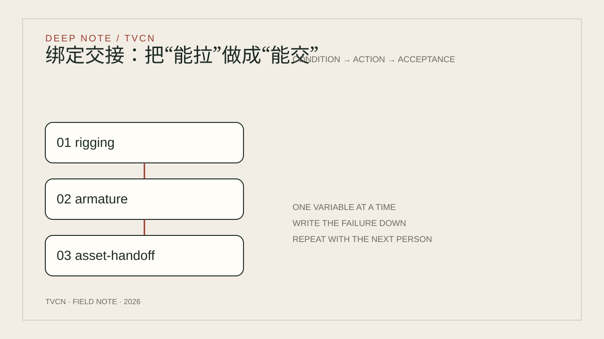

绑定交付不是骨骼能动能拉，而是极限姿势、命名和权重都能被下一位接住。 单看《绑定：让关节能转》只能解决一个局部；把《绑定：让关节能转》《人偶骨架：能站住才能演》《资产交接：命名、版本、缓存》接成一条链，才会暴露“条件没写、变量太多、结果无法复现”的真问题。

<!-- DEEP_DIVE_START -->
<!-- DIAGRAM_START -->
<h2>图解</h2>
<figure>
  
  <figcaption>看“绑定：让关节能转”和“人偶骨架：能站住才能演”两处，先定条件，再看失败能不能被记录下来。</figcaption>
</figure>
<!-- DIAGRAM_END -->

<section><h2 id="section-1">问题</h2>
这一页的问题不是“方法不够多”，而是三个环节各自成立、合起来却不成立：条件没写、变量太多、结果不能复现。

本页按“先定条件—再做判断—只改一个变量—留下证据”的顺序；每一步都能被下一个人复述，才算完成。
</section>
<section><h2 id="section-2">判断</h2><ul><li>《绑定：让关节能转》的第一道门槛：肩、肘、膝三个关节都能转到极限，网格没有塌陷</li><li>《人偶骨架：能站住才能演》的第二道门槛：塌陷处先调权重，不是靠加骨骼盖住</li><li>《资产交接：命名、版本、缓存》的第三道门槛：十帧旋转回放，皮肤没有突然的撕裂或夹面</li></ul>
三条里有一条不成立，就先回到对应单页；不要用整条链掩盖一个没解决的单点。
</section>
<section><h2 id="section-3">做法</h2><ol><li>先写条件：把《绑定：让关节能转》里“先转肩、肘、膝三个关节，各拍 10 帧”落到一张三行表：素材、环境、验收。</li><li>再做一次最小动作：只按《绑定：让关节能转》的步骤做 30 秒，不加入第二页的方法。</li><li>把《人偶骨架：能站住才能演》的步骤接上：如果网格塌陷，先调权重，不要加更多骨骼。</li><li>用《资产交接：命名、版本、缓存》做对照：三个关节都能转到极限再进动画。</li><li>每改一次只动一个变量；其他条件写进记录，不靠记忆。</li><li>把失败也拍下来：失败版本和成功版本并排，才知道哪一步不能省。</li><li>让下一个人按记录复现一次；他做不出来，说明记录还不够。</li></ol></section>
<section><h2 id="section-4">现场案例</h2>
可复现实验（不是客户案例）：拿 30 秒素材，先按《绑定：让关节能转》的“肩、肘、膝三个关节都能转到极限，网格没有塌陷”做 A 版；再按《人偶骨架：能站住才能演》的“塌陷处先调权重，不是靠加骨骼盖住”做 B 版；两版只允许一个变量不同。把两版并排看，记录《资产交接：命名、版本、缓存》里最先崩的是哪一项：条件、动作还是验收。如果一次就成功，说明变量还不够多，再加一个现实限制重做。
</section>
<section><h2 id="section-5">失败表</h2>
<table class="data-table"><thead><tr><th>现象</th><th>原因</th><th>替换动作</th></tr></thead><tbody><tr><td>别用加骨骼解决塌陷；权重没调对，骨头越多越乱</td><td>条件没写清</td><td>回到第一页重写三行表</td></tr><tr><td>别让骨架软；拍十帧就会塌</td><td>条件没写清</td><td>回到第一页重写三行表</td></tr><tr><td>别把资产放在个人桌面；下一个人找不到</td><td>条件没写清</td><td>回到第一页重写三行表</td></tr></tbody></table>
</section>
<section><h2 id="section-6">验收</h2><ul><li>肩、肘、膝三个关节都能转到极限，网格没有塌陷。</li><li>塌陷处先调权重，不是靠加骨骼盖住。</li><li>十帧旋转回放，皮肤没有突然的撕裂或夹面。</li><li>人偶能站 10 秒不晃，脚底有配重。</li><li>走 3 步不塌，关节没有突然锁死。</li><li>同一姿势拍十帧，位置没有漂移。</li><li>资产名包含项目、资产和版本，能直接排序。</li><li>共享盘里有依赖清单和缓存路径。</li><li>下一个人按清单能打开资产，不需要问原作者。</li><li>把 绑定：让关节能转 的条件写成一行，能复述给下一个人。</li></ul></section>
<section><h2 id="section-7">替代方案</h2><ul><li>只处理《绑定：让关节能转》里的单点问题：回到<a href="https://animation.tvcn.org/article/rigging/">《绑定：让关节能转》</a>，不要用整条链。</li><li>只比较两个动作：看<a href="https://animation.tvcn.org/article/armature/">《人偶骨架：能站住才能演》</a>，先不改第三页。</li><li>只做验收：看<a href="https://animation.tvcn.org/article/asset-handoff/">《资产交接：命名、版本、缓存》</a>，把判断表拿去做自测。</li></ul></section>

<!-- SOURCES_START -->
## 参考与延伸阅读

- [S62] [Blender：官方手册](https://docs.blender.org/manual/en/latest/) — 2026-11-26 访问。用于核对「问题」一节的术语/方法/规则（Blender 官方手册，不是行业流程标准）；不核对其中由本页经验得出的数字、型号与现场结论，也不替代测试。
- [S59] [Adobe：After Effects 官方指南](https://helpx.adobe.com/after-effects/user-guide.html) — 2026-11-26 访问。用于核对「判断」一节的术语/方法/规则（After Effects 官方指南，不是合成美学结论）；不核对其中由本页经验得出的数字、型号与现场结论，也不替代测试。
<!-- SOURCES_END -->

