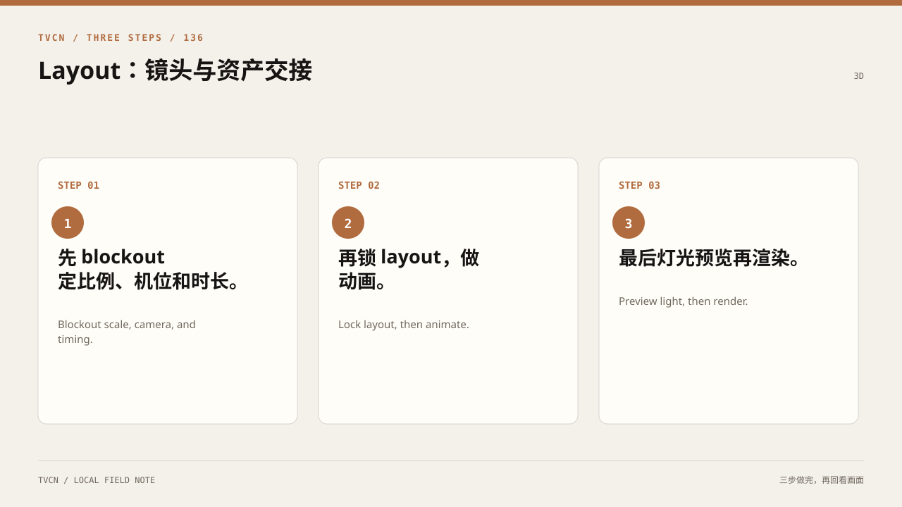

Layout 把机位、比例、资产版本锁死，再交给动画；交接不清，动画师只能猜。

<!-- DIAGRAM_START -->
<h2>图解</h2>
<figure>
  
  <figcaption>把三步按顺序做完，再回看画面或文件。</figcaption>
</figure>
<!-- DIAGRAM_END -->
<h2>现场</h2>

交付前锁三样：机位、角色比例、资产版本；在文件头写版本号，动画师按 layout 做。

<h2>怎么做</h2>

Layout 把机位、比例、资产版本锁死，再交给动画；交接不清，动画师只能猜。
<ol><li>交付前锁三样：机位、角色比例、资产版本。</li><li>在文件头写版本号。</li><li>动画师按 layout 做，不自行改机位。</li></ol>
<h2>别踩</h2>

别在 layout 里留活机位；动画一开做，改机位就是返工。

<h2>验收</h2>
<ul><li>机位、角色比例、资产版本三项都锁死并有版本号。</li><li>文件头能看到版本和依赖，动画师不用猜。</li><li>动画段没有擅自改机位，最终镜头和 layout 一致。</li></ul>
