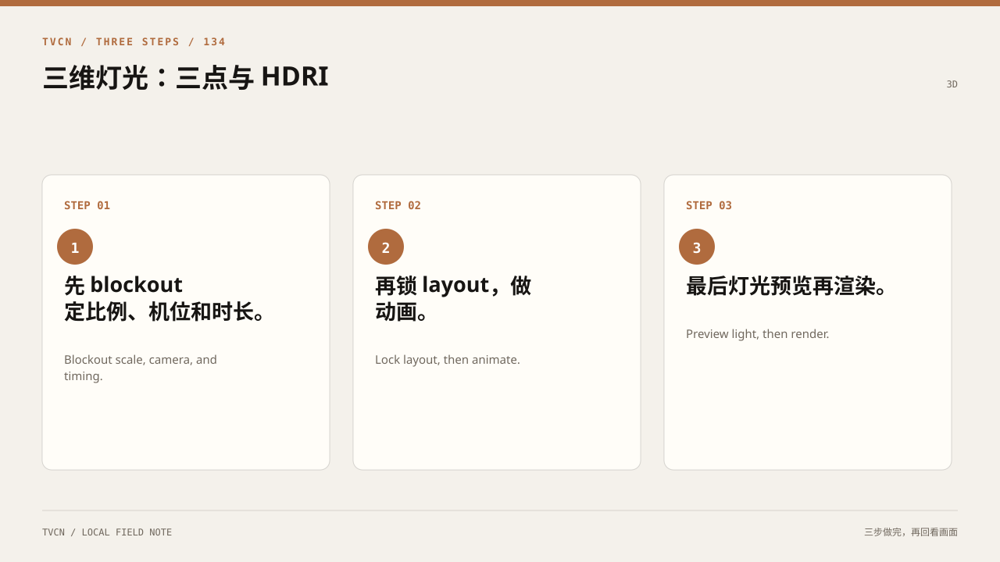

三维灯光先用主光、补光、轮廓光定结构，再用 HDRI 补环境；顺序反了，空间会平。

<!-- DIAGRAM_START -->
<h2>图解</h2>
<figure>
  
  <figcaption>把三步按顺序做完，再回看画面或文件。</figcaption>
</figure>
<!-- DIAGRAM_END -->
<h2>现场</h2>

先关 HDRI，只用主光看形体；再加补光、轮廓光；最后开 HDRI 到 20% 到 30% 补环境。

<h2>怎么做</h2>

三维灯光先用主光、补光、轮廓光定结构，再用 HDRI 补环境；顺序反了，空间会平。
<ol><li>先关 HDRI，只用主光看形体。</li><li>再加补光和轮廓光。</li><li>最后开 HDRI 到 20% 到 30% 补环境。</li></ol>
<h2>别踩</h2>

别一上来就开 HDRI；环境光一盖，形体就看不清了。

<h2>验收</h2>
<ul><li>关 HDRI 时，主光已经能把形体打出来。</li><li>补光和轮廓光各司其职，没有把主光打平。</li><li>HDRI 只占 20% 到 30%，没有抢走主光。</li></ul>
