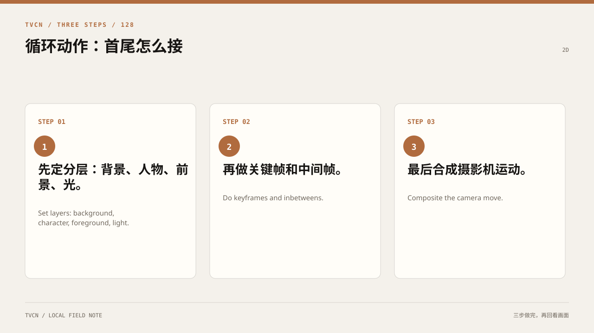

循环动作首尾帧必须对得上，否则每转一圈就抖一下。

<!-- DIAGRAM_START -->
<h2>图解</h2>
<figure>
  
  <figcaption>把三步按顺序做完，再回看画面或文件。</figcaption>
</figure>
<!-- DIAGRAM_END -->
<h2>现场</h2>

首尾各画同一帧，中间 8 到 12 帧；循环播放，看最后一帧到第一帧有没有跳。

<h2>怎么做</h2>

循环动作首尾帧必须对得上，否则每转一圈就抖一下。
<ol><li>首尾各画同一帧。</li><li>中间 8 到 12 帧。</li><li>循环播放，看最后一帧到第一帧有没有跳。</li></ol>
<h2>别踩</h2>

别让首尾差一帧；循环一多，抖动会越来越明显。

<h2>验收</h2>
<ul><li>首帧和尾帧是同一姿势，位置和形状一致。</li><li>中间 8 到 12 帧，节奏均匀。</li><li>循环播放十圈，接缝处没有跳一下或黏一下。</li></ul>
