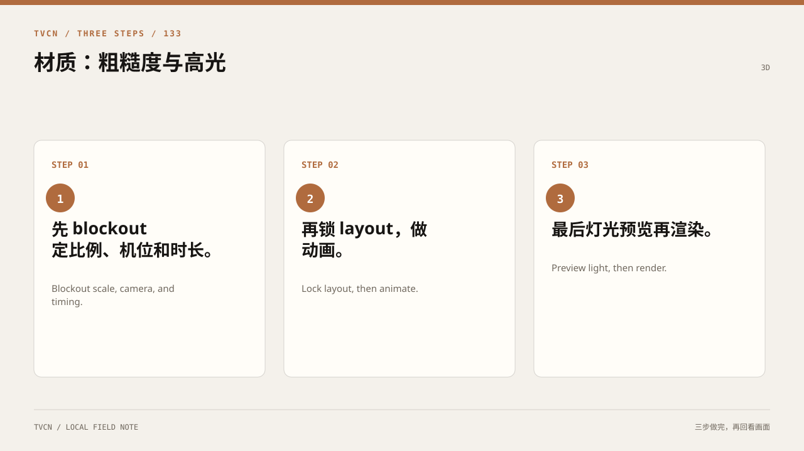

不要从“金属/木头”开始，从表面行为开始：反光是否清晰、粗糙度多高、边缘是否透光、有没有凹痕。同一个“金属”可以是镜面、拉丝、锈蚀，差别在行为，不在名字。

<!-- DIAGRAM_START -->
<h2>图解</h2>
<figure>
  
  <figcaption>看“同一盏灯下试三块球：粗糙度从 0.2…”和“看高光大小和边缘软硬”两处，判断前景、中景、背景的速度差能不能在一次移动里看出来。</figcaption>
</figure>
<!-- DIAGRAM_END -->
<section><h2 id="section-1">材质先问“表面在干什么”</h2>
用一张灰球和一张方格图测试：看反射、粗糙度和法线；先调这三项，再贴颜色。
<h2 id="section-2">边界</h2>
材质不能救模型。模型没有厚度、接缝和倒角，再好的贴图也像纸片；先修形状。
<h2 id="section-3">材质：先定尺度，再调粗糙度</h2>

材质看起来假，通常不是贴图不够大，而是纹理尺度错了。一块木头的纹理在 1 米和 10 厘米下不是同一张图；没有尺度参考，粗糙度也会调错。

<table class="data-table"><thead><tr><th>材质</th><th>先定</th><th>常见错误</th></tr></thead><tbody>
<tr><td>木材</td><td>纹理方向、板宽</td><td>一张图铺满整面墙</td></tr>
<tr><td>金属</td><td>拉丝方向、粗糙度</td><td>全部镜面，像塑料</td></tr>
<tr><td>布料</td><td>经纬密度、褶皱尺度</td><td>纹理比褶皱还大</td></tr>
<tr><td>皮肤</td><td>毛孔尺度、油光区</td><td>全脸同一粗糙度</td></tr>
</tbody></table>

<h3>项目级检查</h3>
<ol><li>放一个已知尺寸的参考物（硬币、A4 纸）在场景里，先校准纹理重复次数。</li><li>粗糙度用 0–1 的灰阶图，不用单一数值；油光、干燥、磨损分开画。</li><li>法线强度先 0.3 起步，逐级加；拉满会让边缘发黑。</li><li>在最终灯光下看材质，不在默认 HDRI 下看；光变了，材质观感全变。</li></ol>

交付前做一张“材质球接触表”：同一材质在强光、逆光、暗部各看一次，确保不是只在一种光下成立。
</section><section><h2 id="section-4">现场</h2>
同一盏灯下试三块球：粗糙度从 0.2 到 0.8，看高光大小；先定材质，再贴纹理。
</section><section><h2 id="section-5">怎么做</h2><ol><li>同一盏灯下试三块球：粗糙度从 0.2 到 0.8。</li><li>看高光大小和边缘软硬。</li><li>先定材质，再贴纹理。</li></ol></section><section><h2 id="section-6">别踩</h2>
别用纹理掩盖材质；粗糙度不对，贴图再细也像纸。
</section><section><h2>判断</h2>
现场只认三个信号：
<ul><li>前景、中景、背景的速度差能在一次 pan 里看出来</li><li>动作在 0.5 秒内能读出重量或预备</li><li>关掉任意一层，空间感仍然成立</li></ul></section><section><h2>失败</h2>
下面三种做法会让页面上的细节白做：
<ul><li>层数堆上去了，但每层速度一样，空间还是扁的</li><li>动作有预备却没有跟随，重量只做了一半</li><li>资产没锁就进渲染，返工从合成端一路补</li></ul></section><section><h2>延伸</h2>
<strong>10 分钟练习：</strong>用 24 fps 画 3 个关键帧，只改“看高光大小和边缘软硬”，导出 2 秒；如果重量仍读不出来，先加预备帧，不要加模糊。
</section>
<h2>验收</h2><ul><li>三块球在同一盏灯下高光大小明显不同。</li><li>粗糙度 0.2 和 0.8 的差别能说清，不是只换颜色。</li><li>材质确认后才贴纹理，纹理没有掩盖高光问题。</li></ul>
