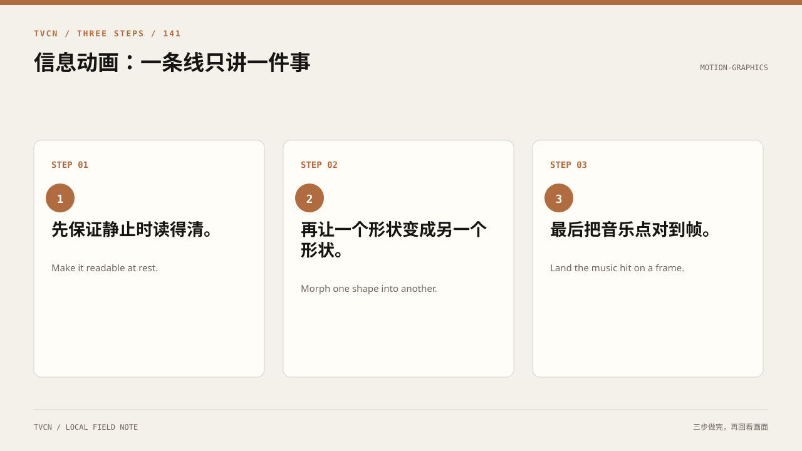

信息图不是把数字放大再加箭头。先确定关系：比较、趋势、占比、流程；每种关系对应一种图形。关系错了，动画再顺也读不懂。

<!-- DIAGRAM_START -->
<h2>图解</h2>
<figure>
  
  <figcaption>看“一条线只承载一个变量”和“先把线画成静态，再让它随数据长出来”两处，判断前景、中景、背景的速度差能不能在一次移动里看出来。</figcaption>
</figure>
<!-- DIAGRAM_END -->
<section><h2 id="section-1">图表动画先画“关系”，再画“装饰”</h2>
先做静态版，让同事在 5 秒内说出结论；说不出来，改图形，不要加动效。
<h2 id="section-2">边界</h2>
装饰不能替代数据。没有样本、时间和来源的图表，再好看也只是插画；先把三样写清。
</section><section><h2 id="section-3">现场</h2>
一条线只承载一个变量；先把线画成静态，再让它随数据长出来，别同时加标签和图标。
</section><section><h2 id="section-4">怎么做</h2><ol><li>一条线只承载一个变量。</li><li>先把线画成静态，再让它随数据长出来。</li><li>不要同时加标签和图标，先让线说清楚。</li></ol></section><section><h2 id="section-5">别踩</h2>
别让一条线同时讲三件事；观众一条都记不住。
</section><section><h2>判断</h2>
现场只认三个信号：
<ul><li>前景、中景、背景的速度差能在一次 pan 里看出来</li><li>动作在 0.5 秒内能读出重量或预备</li><li>关掉任意一层，空间感仍然成立</li></ul></section><section><h2>失败</h2>
下面三种做法会让页面上的细节白做：
<ul><li>层数堆上去了，但每层速度一样，空间还是扁的</li><li>动作有预备却没有跟随，重量只做了一半</li><li>资产没锁就进渲染，返工从合成端一路补</li></ul></section><section><h2>延伸</h2>
<strong>10 分钟练习：</strong>用 24 fps 画 3 个关键帧，只改“先把线画成静态，再让它随数据长出来”，导出 2 秒；如果重量仍读不出来，先加预备帧，不要加模糊。
</section>
<h2>验收</h2><ul><li>每条线只对应一个变量，标题能说出它是什么。</li><li>线的生长和数字变化同步，不是先画完再补数。</li><li>静音看一遍，能复述每条线在讲什么。</li></ul>
