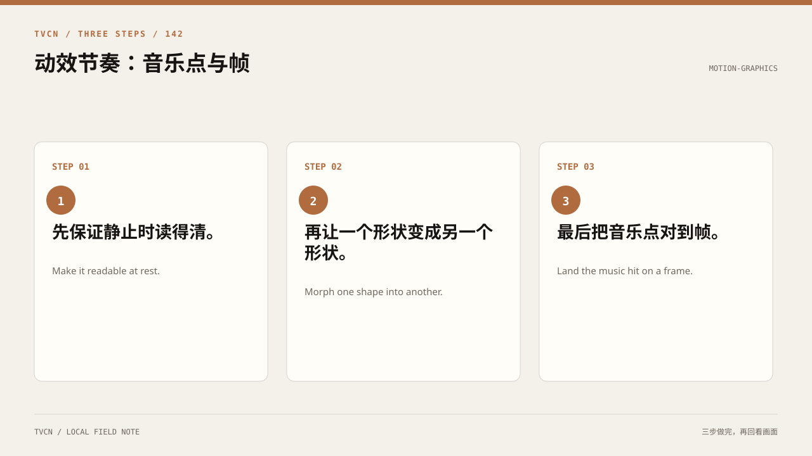

动效节奏先把音乐点对到帧，再决定缓入缓出；点没对上，再顺也乱。

<!-- DIAGRAM_START -->
<h2>图解</h2>
<figure>
  
  <figcaption>把三步按顺序做完，再回看画面或文件。</figcaption>
</figure>
<!-- DIAGRAM_END -->
<h2>现场</h2>

先把音乐波形放到时间线，标出 8 个重拍；每个重拍对应一个关键帧，再调缓动。

<h2>怎么做</h2>

动效节奏先把音乐点对到帧，再决定缓入缓出；点没对上，再顺也乱。
<ol><li>把音乐波形放到时间线，标出 8 个重拍。</li><li>每个重拍对应一个关键帧。</li><li>再调缓动，不要先做动画再找音乐。</li></ol>
<h2>别踩</h2>

别先做动画再贴音乐；点对不上，缓动再顺也乱。

<h2>验收</h2>
<ul><li>时间线上标出 8 个重拍，每个都有对应关键帧。</li><li>动画变化与重拍同步，不是音乐在后面追。</li><li>静音看一遍，节奏仍然成立，不靠音乐硬撑。</li></ul>
