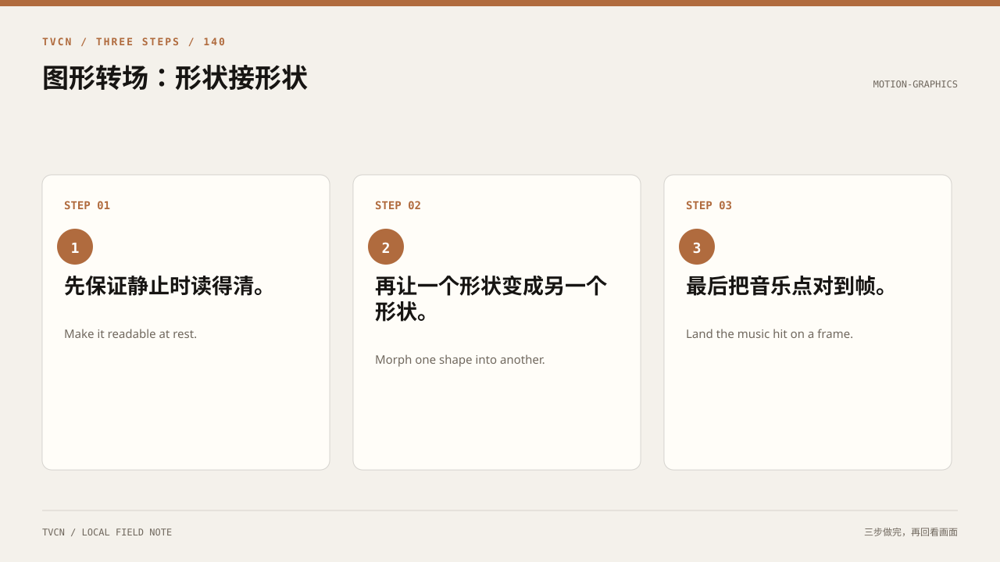

动态图形转场不是加一个花哨划像。它要把上一段的信息带到下一段：一个圆变成图表、一条线变成时间轴、一个词拆成新词。转场结束，观众应该多知道一件事。

<!-- DIAGRAM_START -->
<h2>图解</h2>
<figure>
  
  <figcaption>看“选一个形状：圆变方、线变箭头”和“用 8 到 12 帧完成变形”两处，判断前景、中景、背景的速度差能不能在一次移动里看出来。</figcaption>
</figure>
<!-- DIAGRAM_END -->
<section><h2 id="section-1">转场要“带信息”，不是遮丑</h2>
先写“从什么变到什么”，再做动画；不要让软件预设决定内容。
<h2 id="section-2">边界</h2>
转场不能掩盖结构问题。两段内容没有关系，再顺的转场也只是拖延；先删一段，再谈过渡。
</section><section><h2 id="section-3">现场</h2>
选一个形状：圆变方、线变箭头；用 8 到 12 帧完成，别用白闪。
</section><section><h2 id="section-4">怎么做</h2><ol><li>选一个形状：圆变方、线变箭头。</li><li>用 8 到 12 帧完成变形。</li><li>不要用白闪，前后信息要能接上。</li></ol></section><section><h2 id="section-5">别踩</h2>
别用白闪和推拉当万能转场；形状接不上，观众就断片。
</section><section><h2>判断</h2>
现场只认三个信号：
<ul><li>前景、中景、背景的速度差能在一次 pan 里看出来</li><li>动作在 0.5 秒内能读出重量或预备</li><li>关掉任意一层，空间感仍然成立</li></ul></section><section><h2>失败</h2>
下面三种做法会让页面上的细节白做：
<ul><li>层数堆上去了，但每层速度一样，空间还是扁的</li><li>动作有预备却没有跟随，重量只做了一半</li><li>资产没锁就进渲染，返工从合成端一路补</li></ul></section><section><h2>延伸</h2>
<strong>10 分钟练习：</strong>用 24 fps 画 3 个关键帧，只改“用 8 到 12 帧完成变形”，导出 2 秒；如果重量仍读不出来，先加预备帧，不要加模糊。
</section>
<h2>验收</h2><ul><li>转场前后是同一个形状在变形，不是硬切。</li><li>变形在 8 到 12 帧内完成，速度可读。</li><li>拿掉白闪后信息仍能接上，观众知道到了哪里。</li></ul>
