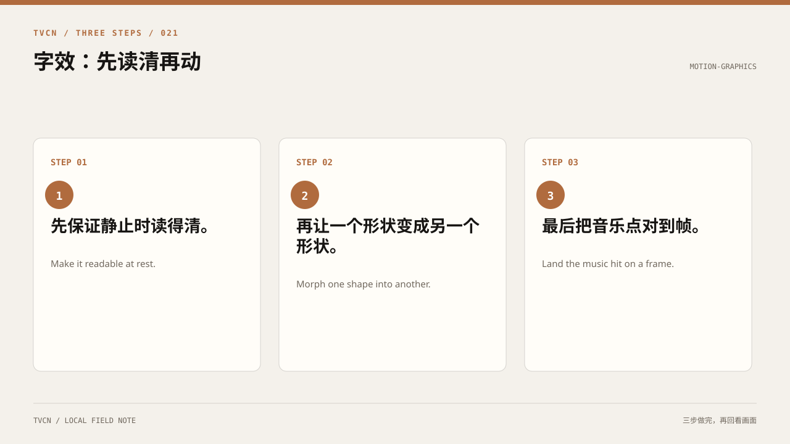

字效先保证静止时读得清，再决定怎么动；边动边读，阅读速度会掉一半。

<!-- DIAGRAM_START -->
<h2>图解</h2>
<figure>
  
  <figcaption>把三步按顺序做完，再回看画面或文件。</figcaption>
</figure>
<!-- DIAGRAM_END -->
<h2>现场</h2>

先做静止版，手机宽度下读清；再做 6 帧入场，只动位置和透明度，别同时旋转、缩放、发光。

<h2>怎么做</h2>

字效先保证静止时读得清，再决定怎么动；边动边读，阅读速度会掉一半。
<ol><li>先做静止版，手机宽度下读清。</li><li>再做 6 帧入场，只动位置和透明度。</li><li>不要同时旋转、缩放、发光，先保信息。</li></ol>
<h2>别踩</h2>

别用白闪和推拉当万能转场；字没读清，动效再花也白费。

<h2>验收</h2>
<ul><li>静止版在手机宽度下能读清，最长一行不出画。</li><li>入场只动了位置和透明度，没有同时旋转缩放。</li><li>静音看一遍，能说出信息出现的顺序。</li></ul>
