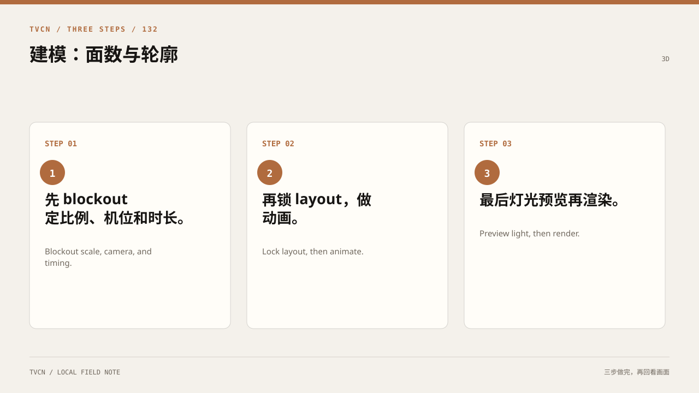

建模先看轮廓，再看面数；轮廓不对，细分再多也不像。

<!-- DIAGRAM_START -->
<h2>图解</h2>
<figure>
  
  <figcaption>把三步按顺序做完，再回看画面或文件。</figcaption>
</figure>
<!-- DIAGRAM_END -->
<h2>现场</h2>

先看剪影：把模型全黑渲染，轮廓能认出角色再细分；面数按镜头距离分配。

<h2>怎么做</h2>

建模先看轮廓，再看面数；轮廓不对，细分再多也不像。
<ol><li>先看剪影：把模型全黑渲染。</li><li>轮廓能认出角色再细分。</li><li>面数按镜头距离分配，近景多、远景少。</li></ol>
<h2>别踩</h2>

别用细分救轮廓；剪影不对，面数再多也不像。

<h2>验收</h2>
<ul><li>全黑剪影能认出角色，不靠颜色和纹理。</li><li>轮廓确认后才细分，没有先堆面数。</li><li>近景面数高于远景，预算按镜头距离分配。</li></ul>
