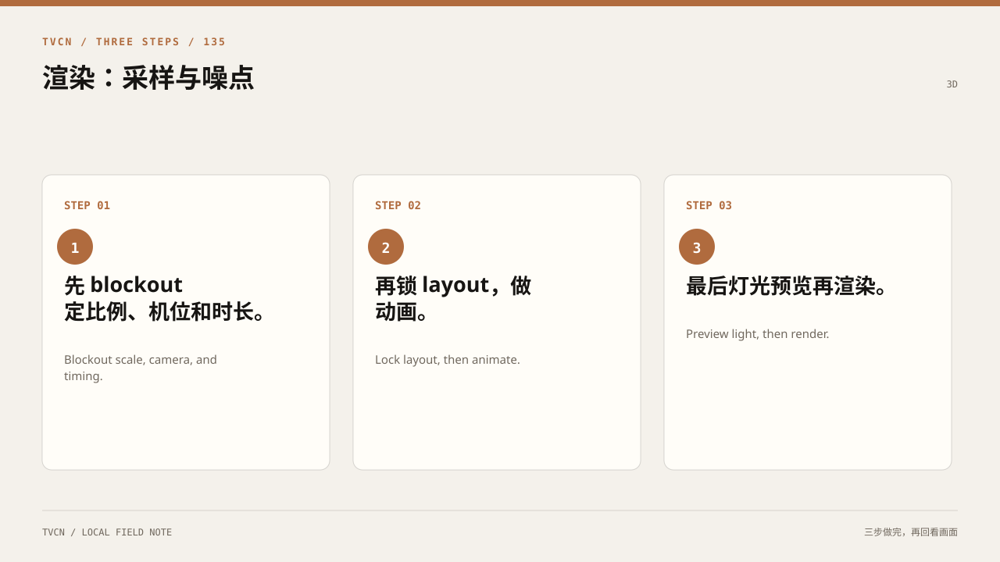

渲染先看采样和噪点，再看分辨率；噪点没压住，4K 也只是更大的脏。

<!-- DIAGRAM_START -->
<h2>图解</h2>
<figure>
  
  <figcaption>把三步按顺序做完，再回看画面或文件。</figcaption>
</figure>
<!-- DIAGRAM_END -->
<h2>现场</h2>

先 50% 分辨率、低采样看噪点分布；把灯光采样和材质采样分开调，别只加总采样。

<h2>怎么做</h2>

渲染先看采样和噪点，再看分辨率；噪点没压住，4K 也只是更大的脏。
<ol><li>先 50% 分辨率、低采样看噪点分布。</li><li>把灯光采样和材质采样分开调。</li><li>不要只加总采样，先找出噪点来自哪一项。</li></ol>
<h2>别踩</h2>

别用总采样硬压噪点；找不到来源，时间全烧在渲染上。

<h2>验收</h2>
<ul><li>50% 低采样下能看出噪点集中在灯光还是材质。</li><li>灯光采样和材质采样分开调整过。</li><li>最终噪点来自具体一项，不是靠无脑拉高总采样。</li></ul>
