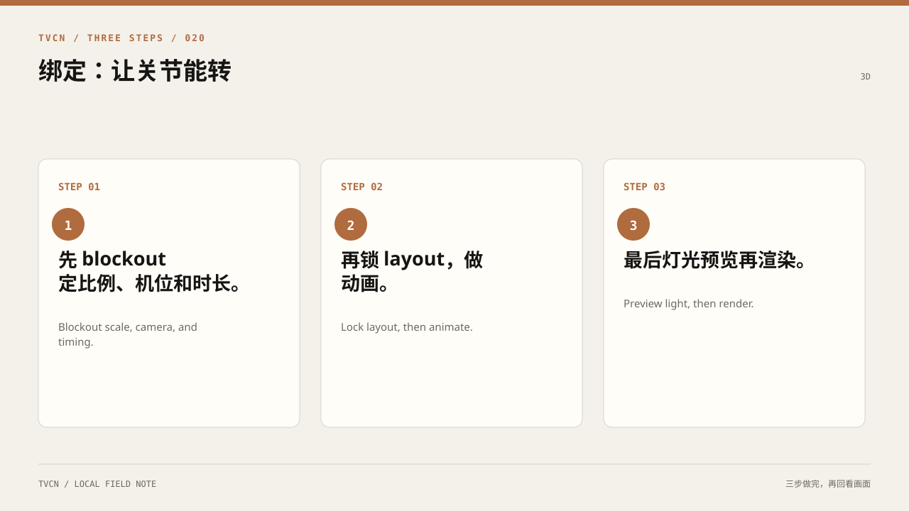

绑定先保证三个基本动作：肘和膝能单向弯、肩能抬起、头能转。每个关节设限位，再做权重测试；不要先加几十根控制棒。

<!-- DIAGRAM_START -->
<h2>图解</h2>
<figure>
  
  <figcaption>看“先转肩、肘、膝三个关节，各拍 10 …”和“如果网格塌陷，先调权重，不要加更多骨…”两处，判断前景、中景、背景的速度差能不能在一次移动里看出来。</figcaption>
</figure>
<!-- DIAGRAM_END -->
<section><h2 id="section-1">关节能转，权重不撕</h2>
用极限姿势测试：抬手过头、深蹲、转身。看腋下、膝盖和胯部是否撕裂；撕裂处先修权重，不要用修正形态硬盖。
<h2 id="section-2">边界</h2>
绑定不是越复杂越专业。一个能稳定完成片中动作的简单骨架，胜过一个功能多但每次都炸的复杂 rig。
</section><section><h2 id="section-3">现场</h2>
先转肩、肘、膝三个关节，各拍 10 帧；如果网格塌陷，先调权重，不要加更多骨骼。
</section><section><h2 id="section-4">怎么做</h2><ol><li>先转肩、肘、膝三个关节，各拍 10 帧。</li><li>如果网格塌陷，先调权重，不要加更多骨骼。</li><li>三个关节都能转到极限再进动画。</li></ol></section><section><h2 id="section-5">别踩</h2>
别用加骨骼解决塌陷；权重没调对，骨头越多越乱。
</section><section><h2>判断</h2>
这一页的判断只看三条可观察的验收，不靠口号：
<ul><li><strong>1.</strong> 肩、肘、膝三个关节都能转到极限，网格没有塌陷。</li><li><strong>2.</strong> 塌陷处先调权重，不是靠加骨骼盖住。</li><li><strong>3.</strong> 十帧旋转回放，皮肤没有突然的撕裂或夹面。</li></ul></section><section><h2>失败</h2>
下面任一条出现，先停，不要靠后期补：
<ul><li><strong>1.</strong> 只做到“肩、肘、膝三个关节都能转到极限，网格没有塌陷”的形式，换一个机位或场景就重现不了。</li><li><strong>2.</strong> 把“塌陷处先调权重，不是靠加骨骼盖住”留到后期或口头解释，现场没有留下能复查的记录。</li><li><strong>3.</strong> 别用加骨骼解决塌陷；权重没调对，骨头越多越乱。</li></ul></section><section><h2>延伸</h2>
<strong>10 分钟练习：</strong>用 24 fps 画 3 个关键帧，只改“如果网格塌陷，先调权重，不要加更多骨…”，导出 2 秒；如果重量仍读不出来，先加预备帧，不要加模糊。
</section>
<h2>验收</h2><ul><li>肩、肘、膝三个关节都能转到极限，网格没有塌陷。</li><li>塌陷处先调权重，不是靠加骨骼盖住。</li><li>十帧旋转回放，皮肤没有突然的撕裂或夹面。</li></ul>

<!-- DEEP_DIVE_START -->
## 深读

<strong>约 8 分钟。</strong> 这一节不重复前面的做法，只补三个东西：两种条件、一个反例、一个可复用模型；读完能判断什么时候换做法。

### 条件 A：简单角色/少控制器

简单角色不需要全套面部控制器；先把身体四个点做好：重心、脚、手、头。重心控制器决定角色往哪倒，脚决定接触，手决定抓取，头决定看。四个点能动，角色就能演大部分镜头。

控制器越少，动画师越敢用。给每个控制器一个清楚的名字和颜色，不要用默认名；默认名在交接时没人知道。简单绑定也要做一次极限测试：每个关节转到最大，看有没有穿模。

### 条件 B：复杂角色/面部

复杂角色要分层：身体、手指、面部、服装、道具各一层控制器；不要让所有控制器挤在一个面板。动画师需要的是“快速找到”，不是“全部看见”。每层只暴露常用的 5–8 个控制器，其余收进次级面板。

面部绑定要先做“表情范围表”：这个角色能做什么、不能做什么；不能做的用动画/贴图/镜头解决，不要硬绑。绑定不是越全越好，是越可预测越好。

### 反例：所有控制器在一层

一个角色的控制器全部摊在一个面板，手指 30 个、面部 60 个、身体 20 个。动画师每次要抓一个手指，都要在面板里找半天；做了三天，开始用表情代替手指，角色变得不会拿东西。

修法不是删控制器，是分组：常用一组、次级一组、调试一组；常用组只留 8 个。分组不是省事，是让动画师把注意力放在表演，不放在找按钮。

### 可复用模型

<strong>控制地图 → 极限测试 → 命名 → 交接。</strong> 先画控制地图，再做极限测试，再统一命名，最后写交接说明。四步都在，绑定才是资产，不是某个人的记忆。

交接时让另一个动画师不看说明先做三个动作：抓、走、看；做不出来，说明绑定或命名有问题。绑定不是给自己用的，是给下一个人用的。

<!-- DEEP_DIVE_END -->

<!-- SOURCES_START -->
## 参考与延伸阅读

- [S62] [Blender：官方手册](https://docs.blender.org/manual/en/latest/) — 2026-11-26 访问。用于核对「关节能转，权重不撕」一节的术语/方法/规则（Blender 官方手册，不是行业流程标准）；不核对其中由本页经验得出的数字、型号与现场结论，也不替代测试。
- [S59] [Adobe：After Effects 官方指南](https://helpx.adobe.com/after-effects/user-guide.html) — 2026-11-26 访问。用于核对「现场」一节的术语/方法/规则（After Effects 官方指南，不是合成美学结论）；不核对其中由本页经验得出的数字、型号与现场结论，也不替代测试。
<!-- SOURCES_END -->

