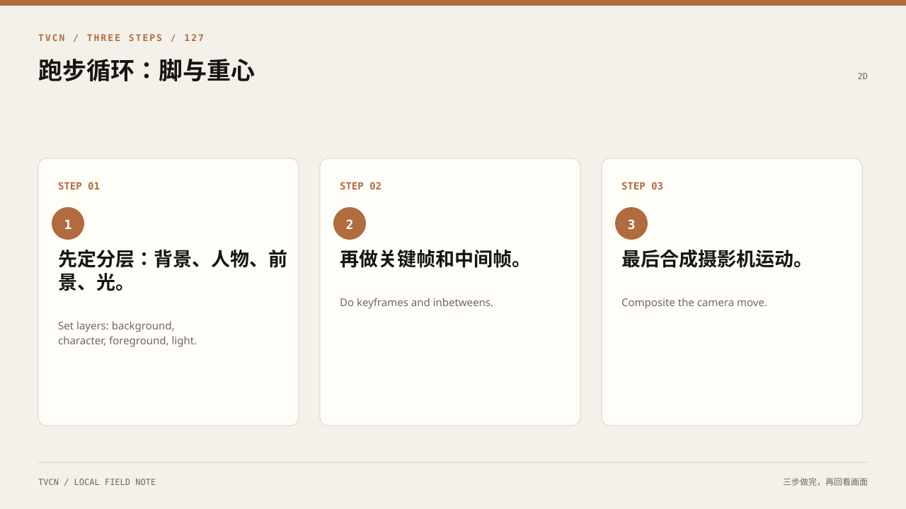

跑步循环先定重心和脚掌着地顺序，再修手臂；脚不对，全身都飘。

<!-- DIAGRAM_START -->
<h2>图解</h2>
<figure>
  
  <figcaption>把三步按顺序做完，再回看画面或文件。</figcaption>
</figure>
<!-- DIAGRAM_END -->
<h2>现场</h2>

先画 4 个关键姿势：接触、下压、通过、腾空；脚掌从脚跟滚到脚尖，重心上下不超过一个头。

<h2>怎么做</h2>

跑步循环先定重心和脚掌着地顺序，再修手臂；脚不对，全身都飘。
<ol><li>先画 4 个关键姿势：接触、下压、通过、腾空。</li><li>脚掌从脚跟滚到脚尖。</li><li>重心上下不超过一个头，再修手臂。</li></ol>
<h2>别踩</h2>

别先修手臂；脚一滑，手臂再顺也像飘。

<h2>验收</h2>
<ul><li>四个关键姿势齐全，接触、下压、通过、腾空都能认出来。</li><li>支撑脚从脚跟滚到脚尖，没有整只脚平移。</li><li>重心上下不超过一个头，循环播放不飘。</li></ul>
