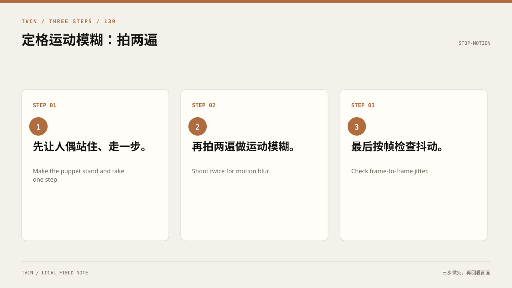

定格运动模糊靠两次曝光或后期合成，不是把帧率调低。

<!-- DIAGRAM_START -->
<h2>图解</h2>
<figure>
  
  <figcaption>把三步按顺序做完，再回看画面或文件。</figcaption>
</figure>
<!-- DIAGRAM_END -->
<h2>现场</h2>

每个姿势拍两遍，第二遍把可动部分挪 2 到 3 毫米；后期叠两帧，得到方向性模糊。

<h2>怎么做</h2>

定格运动模糊靠两次曝光或后期合成，不是把帧率调低。
<ol><li>每个姿势拍两遍。</li><li>第二遍把可动部分挪 2 到 3 毫米。</li><li>后期叠两帧，得到方向性模糊。</li></ol>
<h2>别踩</h2>

别用低帧率制造模糊；那只会让动作抖，不是运动模糊。

<h2>验收</h2>
<ul><li>每个动作姿势都有两遍曝光，第二遍有 2 到 3 毫米位移。</li><li>叠帧后模糊有方向，和运动方向一致。</li><li>没有靠降低帧率制造假模糊。</li></ul>
