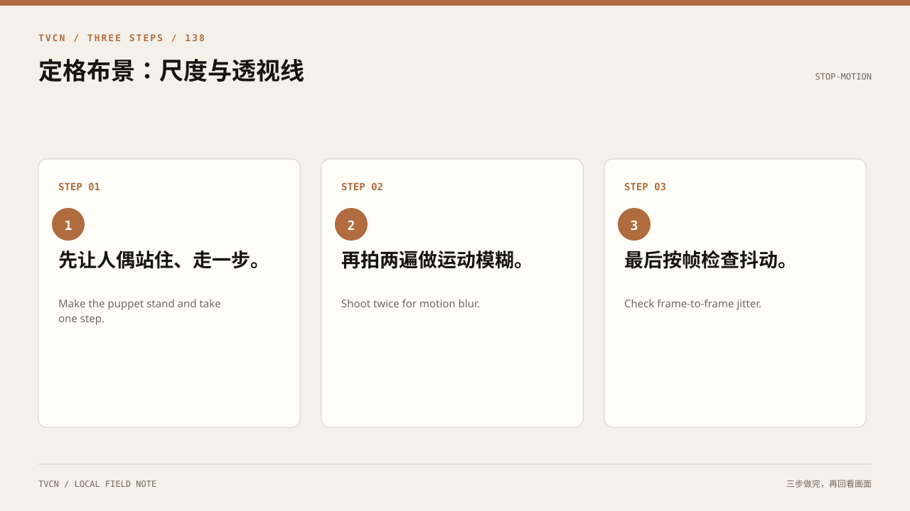

定格布景不是微缩景观。每个需要调整的位置都要留出至少两指宽的操作口；墙、家具和地面要能单独拆装，否则一碰就全倒。

<!-- DIAGRAM_START -->
<h2>图解</h2>
<figure>
  
  <figcaption>看“先量人偶身高”和“按镜头透视算布景尺寸”两处，判断前景、中景、背景的速度差能不能在一次移动里看出来。</figcaption>
</figure>
<!-- DIAGRAM_END -->
<section><h2 id="section-1">布景先保“手能进去”</h2>
用 1:6 或 1:12 的比例先做纸模，确认摄影机、灯和手的空间；不要先做细节。
<h2 id="section-2">边界</h2>
布景不是越满越好。前景留遮挡，后景留空，手才有地方；塞满道具，连对焦都进不去。
<h2 id="section-3">定格场景：先定比例，再定光</h2>

定格片的场景不是“缩小版真实世界”，而是一个需要被手伸进去的工作台。比例、景深和灯光稳定性，比精致程度更早决定成片质量。

<table class="data-table"><thead><tr><th>项目</th><th>现场做法</th><th>失败信号</th></tr></thead><tbody>
<tr><td>比例</td><td>先定 1:6 或 1:12，所有道具同一比例</td><td>手和道具比例不对</td></tr>
<tr><td>景深</td><td>小光圈 + 足够光，避免前景虚</td><td>只有主体清楚，场景糊</td></tr>
<tr><td>灯光</td><td>锁定灯位、用遮光板，不用自动曝光</td><td>帧与帧之间亮度跳</td></tr>
<tr><td>替换件</td><td>每个动作备 2–3 个口型/手势</td><td>拍到一半手不够用</td></tr>
</tbody></table>

<h3>项目级检查</h3>
<ol><li>先拍 10 帧测试，检查手伸进去会不会挡光、碰景。</li><li>所有灯用夹具固定并标记位置；移动后要能回到同一刻度。</li><li>用定格软件锁曝光和白平衡，关掉相机自动功能。</li><li>拍完一个镜头立刻备份，定格素材丢一帧就要重拍整段。</li></ol>

如果场景需要演员手入镜，先排练走位；手是最容易穿帮的“道具”。
</section><section><h2 id="section-4">现场</h2>
先量人偶身高，再按镜头透视算布景尺寸；用一条透视线从镜头到背景，所有东西对齐。
</section><section><h2 id="section-5">怎么做</h2><ol><li>先量人偶身高。</li><li>按镜头透视算布景尺寸。</li><li>用一条透视线从镜头到背景，所有东西对齐。</li></ol></section><section><h2 id="section-6">别踩</h2>
别凭感觉做布景；人偶和门一比，比例就露馅。
</section><section><h2>判断</h2>
现场只认三个信号：
<ul><li>前景、中景、背景的速度差能在一次 pan 里看出来</li><li>动作在 0.5 秒内能读出重量或预备</li><li>关掉任意一层，空间感仍然成立</li></ul></section><section><h2>失败</h2>
下面三种做法会让页面上的细节白做：
<ul><li>层数堆上去了，但每层速度一样，空间还是扁的</li><li>动作有预备却没有跟随，重量只做了一半</li><li>资产没锁就进渲染，返工从合成端一路补</li></ul></section><section><h2>延伸</h2>
<strong>10 分钟练习：</strong>用 24 fps 画 3 个关键帧，只改“按镜头透视算布景尺寸”，导出 2 秒；如果重量仍读不出来，先加预备帧，不要加模糊。
</section>
<h2>验收</h2><ul><li>人偶身高和布景尺寸有一份换算记录。</li><li>镜头到背景有一条透视线，主要物件都对齐。</li><li>人偶站在门、桌旁比例成立，不靠镜头藏。</li></ul>
