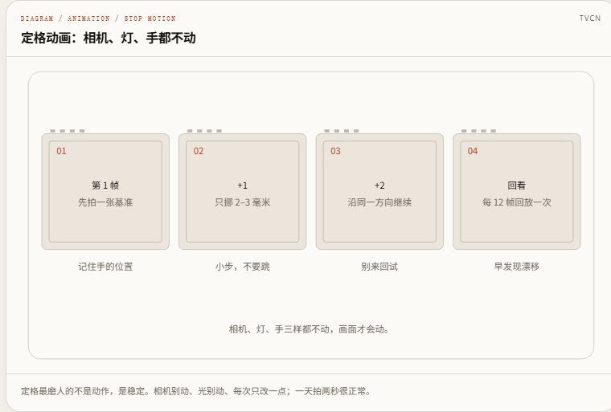

<!-- DIAGRAM_START -->
## 图解

<figure>
  
  <figcaption>定格最磨人的不是动作，是稳定。相机别动、光别动、每次只改一点；一天拍两秒很正常。</figcaption>
</figure>
<!-- DIAGRAM_END -->

定格的门槛不是设备，是稳定。相机不动、光不动、动作每次只改一点，魔法才会出现。

## 固定相机

三脚架、快门线、手动曝光、手动白平衡。任何自动功能都会在几百帧里制造闪烁。相机哪怕移动一毫米，动作就会跳。

用胶带标记三脚架位置和焦距。拍完一个镜头前，不要碰相机。

## 拍两遍

12fps 是定格的常用帧率，动作快的可以 24fps。先拍一遍测试，确认运动方向和幅度，再正式拍。

用洋葱皮看上一帧，但不要完全依赖它。每隔几帧回看整段，否则会陷入“每一帧都对，整体不对”。

## 光和运动

光要持续、无频闪。用直流灯，避免便宜 LED 的 PWM 闪烁；拍之前用手机拍一段视频检查条纹。

动作每次只改一点。走路一帧挪 2 毫米，转身一帧转 3 度；宁可多拍几帧，不要一次挪太多。

## 3 条验收

- 相机、曝光、白平衡全部手动且锁定。
- 有一个 12fps 的测试片段。
- 动作每次只改一个很小的量。

<!-- DEEP_DIVE_START -->
## 深读

<strong>约 7 分钟。</strong> 定格动画不是逐帧拍，是先把每一帧的运动量算清，再让灯和支架保持不动。

### 先算帧数

十二帧一秒，一秒需要十二次移动；三秒动作就是三十六次。先算总帧数，再决定拍多少，不要拍到一半才发现不够。

运动量按“每帧走几毫米”算；走太多会跳，走太少会黏。用尺子在轨道上标刻度，不要凭感觉。

### 灯和支架不能动

所有灯用沙袋和胶带固定，标一条位置线；拍摄中有人碰灯，整段会闪。相机用快门线或软件，不要手按。

人离开画面再动模型；手入画就用替身或长工具。每次只改一个关节，改完拍一张，不要一次改三个。

### 设置和后期

布景要能承受多次触碰：墙面固定、地面平整、道具加重。衣服用不会自己回弹的布料，头发用硬一点的材质。

后期先稳定闪烁，再补运动模糊；不要用插件掩盖拍摄时的灯闪。声音可以后期做，但脚步和接触要对着帧。

### 五分钟练习：十二帧一个动作

让一个物体移动十厘米，拍十二帧；每帧标刻度，拍完在软件里放成一秒。看它是滑、跳，还是匀速。

再拍一版，启动两帧少走、落地两帧多走；比较哪版有重量。把刻度表留着，下次直接用。

### 什么时候算定格拍完

播放时没有灯闪、没有支架抖、没有脚滑、没有手指入画；每个接触点都有声音对得上；总帧数和计划差不超过两帧。五样都过，才算拍完。

如果闪烁，先查灯和快门，不要先加后期稳定；如果动作黏，先查每帧移动量，不要先加运动模糊。

### 定格动画，十项检查
<ul><li>先算总帧数</li><li>十二帧一秒按尺子走</li><li>每帧运动量以毫米算</li><li>灯用沙袋胶带固定</li><li>相机用快门线</li><li>人离开画面再动模型</li><li>一次只改一个关节</li><li>布景墙面地面固定</li><li>后期先稳闪烁再补模糊</li><li>脚步接触对帧</li></ul>
定格动画的真实感，不是模型多细，是每一帧的移动量和灯的位置都没有变。

<!-- DEEP_DIVE_END -->

<!-- SOURCES_START -->
## 参考与延伸阅读

- [S62] [Blender Foundation：Blender 官方手册](https://docs.blender.org/manual/en/latest/) — 2026-11-26 访问。用于核对首段“定格最磨人的地方是稳定：相机别动、光别动、动作每次只改一点。一天拍两秒很正常，别以为自己慢。”中的术语与公开背景（建模、绑定、动画、渲染）；不替代现场测试。
- [S63] [Toon Boom：官方文档](https://docs.toonboom.com/) — 2026-11-26 访问。用于核对首段“定格最磨人的地方是稳定：相机别动、光别动、动作每次只改一点。一天拍两秒很正常，别以为自己慢。”中的术语与公开背景（2D 动画、绑定与制作管线）；不替代现场测试。
- [S12] [Britannica](https://www.britannica.com/art/animation) — 2026-11-26 访问。用于核对首段“定格最磨人的地方是稳定：相机别动、光别动、动作每次只改一点。一天拍两秒很正常，别以为自己慢。”中的术语与公开背景（动画原理、技术与产业史的百科条目）；不替代现场测试。
- [S59] [Adobe：After Effects 用户指南](https://helpx.adobe.com/after-effects/user-guide.html) — 2026-11-26 访问。用于核对首段“定格最磨人的地方是稳定：相机别动、光别动、动作每次只改一点。一天拍两秒很正常，别以为自己慢。”中的术语与公开背景（合成、关键帧、跟踪与导出）；不替代现场测试。
<!-- SOURCES_END -->

