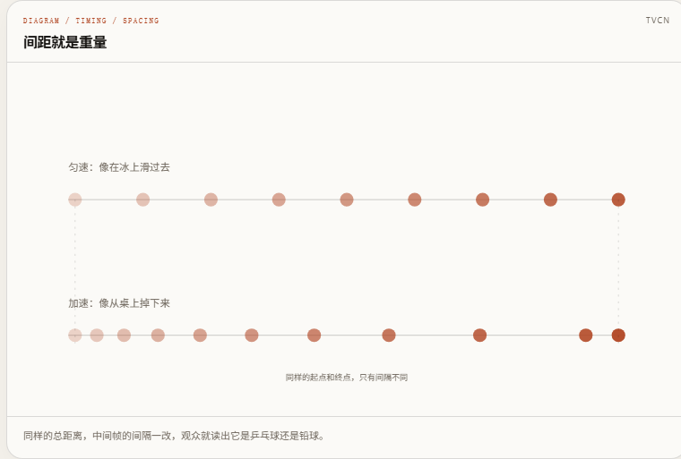

<!-- DIAGRAM_START -->
## 图解

<figure>
  
  <figcaption>同样的总距离，中间帧的间隔一改，观众就读出它是乒乓球还是铅球。</figcaption>
</figure>
<!-- DIAGRAM_END -->

## 先决定它有多重

同样是从 A 到 B，中间帧平均分布，看起来像匀速滑过去；靠近起点和终点密、中间疏，才有加速和减速。动画师说的“spacing”，说的就是这件事。

画之前先问：它是被扔出去，还是自己走？落在地上要不要弹？弹几下？这几个答案定了，中间帧的位置基本就定了。

## 用 12 格试，再用 24 格做

草稿阶段别急着做满帧。12 格一秒先看节奏，动作对不对一眼就能看出来。等节奏对了，再补到 24 格，不然你会花很多时间修饰一个本来就错的动作。

有条件就拍一段真人参考，尤其是搬东西、坐下、转身。真人不会匀速，动画最容易犯的错，就是太顺。

## 循环看首尾，不看中间

循环动作做完，把首帧和尾帧并排放。两帧对不上，播起来就会跳一下。先把首尾对齐，再修中间，顺序反了会白改十遍。

走路循环还要看脚。脚落地的那一帧如果滑，观众马上觉得像在冰上走。把落地帧多留一格，常常比加更多中间帧有效。

## 3 条验收

- 能说出这个动作是重还是轻，以及为什么。
- 12 格测试版里，动作已经能读清楚。
- 循环的首帧和尾帧能无缝接上。

<!-- DEEP_DIVE_START -->
## 深读

<strong>约 6 分钟。</strong> 动画的时间不是匀速，是加速、减速、停顿和突然；观众靠这四样感觉重量。

### 间距决定速度

两张关键帧之间，中间帧靠近起点就是慢起，靠近终点就是快落；等距就是匀速，通常最假。先调间距，再调曲线。

一个动作至少有两种速度：启动慢、过程快、落地停。全部匀速，观众会觉得东西在飘。

### 停顿也是动作

停顿不是没画，是让观众读上一张。转身前停两帧、说话前停三帧、落地后停四帧；停得对，动作才有因有果。

停顿太长会断，太短会糊；用手机逐帧看，找到观众还能读清的最长停顿。

### 缓动不是万能

重物用慢起快落，轻物用快起慢停；弹性用回弹，机械用线性。所有东西都加缓动，画面会像果冻。

先问物体有多重、由谁推、碰到什么；答案决定曲线，不是软件默认决定曲线。

### 五分钟练习：同一动作三种时间

画一个人捡起杯子，做三版：匀速、慢起快落、快起慢停；每版只改间距，不改画。连着放，看哪版像杯子、哪版像气球。

把三版给一个人看，让他说杯子的重量；他说得越具体，说明时间越对。

### 什么时候算时间对

遮住画面只看运动，能感觉出物体的重量；放慢一倍，仍然能看出启动、过程和落地；关掉声音，动作还有节奏。三样都过，时间才算对。

如果只能靠音效才有重量，说明画面时间还不够；先调间距和停顿，不要先加音乐。

### 再看一遍落地

把落地前后各放慢四倍：如果落地那一下没有停顿，重量就还没有出来；加一帧停顿，再减一帧回弹，通常就够了。时间不是越顺越好，是该停的地方敢停。

### 动画时间，十项检查
<ul><li>中间帧间距先调</li><li>一个动作至少两种速度</li><li>启动慢过程快落地停</li><li>匀速只用于机械</li><li>停顿前读得清上一张</li><li>停顿长短逐帧看</li><li>重物慢起快落</li><li>轻物快起慢停</li><li>弹性有回弹</li><li>曲线由重量决定</li></ul>
时间做对，观众会相信一个球有重量；时间做错，再细的画也像纸片。

<!-- DEEP_DIVE_END -->
