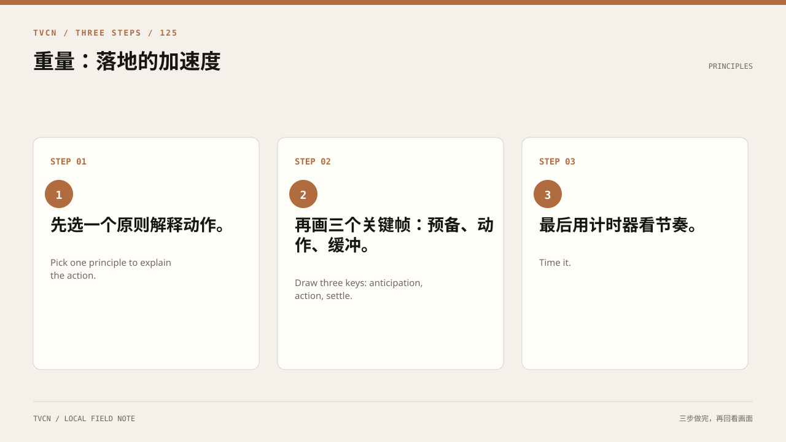

重量不在姿势，在落地那几帧的加减速；没有加速度，一切像气球。

<!-- DIAGRAM_START -->
<h2>图解</h2>
<figure>
  
  <figcaption>把三步按顺序做完，再回看画面或文件。</figcaption>
</figure>
<!-- DIAGRAM_END -->
<h2>现场</h2>

落地前 2 帧加速，接触后 2 帧停住，再 3 帧回弹；给重物加 1 到 2 帧延迟。

<h2>怎么做</h2>

重量不在姿势，在落地那几帧的加减速；没有加速度，一切像气球。
<ol><li>落地前 2 帧加速。</li><li>接触后 2 帧停住，再 3 帧回弹。</li><li>给重物加 1 到 2 帧延迟，让重量落在接触之后。</li></ol>
<h2>别踩</h2>

别只画姿势不画加减速；姿势再重，落地还是像气球。

<h2>验收</h2>
<ul><li>落地前有加速，接触后有停顿和回弹。</li><li>重物比轻物多 1 到 2 帧延迟，重量有差别。</li><li>遮住姿势只看落地点，仍能感到重量。</li></ul>
