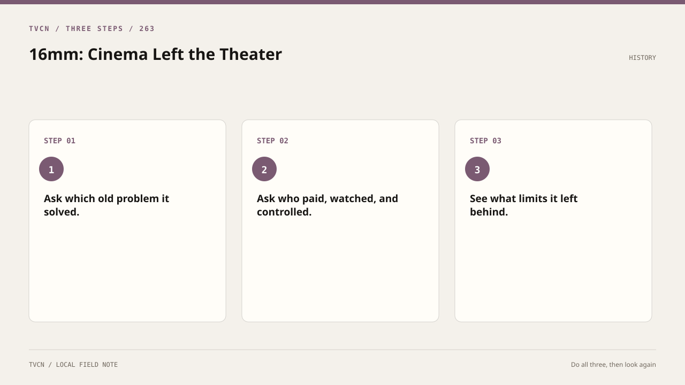

16mm made cameras light and cheap, taking cinema into classrooms, factories, and fields.

<!-- DIAGRAM_START -->
<h2>Diagram</h2>
<figure>
  
  <figcaption>Do the three steps in order, then look again at the image or file.</figcaption>
</figure>
<!-- DIAGRAM_END -->
<h2>On set</h2>

The 16mm gate is small, so wide lenses give deep focus and visible grain. Watch the grain and edges in classroom prints.

<h2>Do this</h2>

16mm made cameras lighter and cheaper, taking film from theaters into classrooms, factories, and fields.
<ol><li>Shoot with a wide lens and watch depth of field and grain.</li><li>Project in a classroom and inspect edges and shadows.</li><li>Record how much lighter and cheaper it was than 35mm.</li></ol>
<h2>Avoid</h2>

Do not demand 35mm sharpness from 16mm; its value is lightness and access.

<h2>Check</h2>
<ul><li>Visible grain and deeper focus appear in the image.</li><li>Classroom projection shows describable edge and shadow loss.</li><li>At least one weight or cost advantage over 35mm is stated.</li></ul>

<!-- SOURCES_START -->
## References

- [S10] BFI: Film history and moving-image research

Full links and notes: [`SOURCES.md`](../../SOURCES.md).
<!-- SOURCES_END -->
