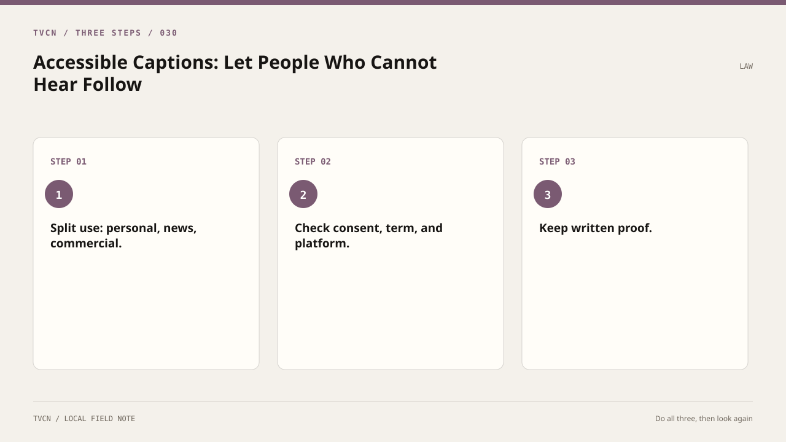

Accessible captions tell Deaf viewers who speaks, what happens, and how it sounds, not just the words.

<!-- DIAGRAM_START -->
<h2>Diagram</h2>
<figure>
  
  <figcaption>Do the three steps in order, then look again at the image or file.</figcaption>
</figure>
<!-- DIAGRAM_END -->
<h2>On set</h2>

Label speakers, effects, and tone. Keep under nine characters per second and write [door] for important sounds, not only dialogue.

<h2>Do this</h2>

Accessible captions tell deaf viewers who speaks, what happens, and what tone; dialogue alone is not enough.
<ol><li>Label speakers and name them when voices change.</li><li>Write key sounds as [door slam], [footsteps approaching].</li><li>Keep under nine characters per second and mark tone in words.</li></ol>
<h2>Avoid</h2>

Do not caption dialogue only; missing door slams, footsteps, and tone breaks the story for deaf viewers.

<h2>Check</h2>
<ul><li>Speaker labels appear when voices change.</li><li>At least three key sounds are bracketed.</li><li>Rate stays under nine characters per second and tone is written.</li></ul>

<!-- SOURCES_START -->
<h2>Sources</h2>

Experience: editorial statute comparison and project reviews; tested: no lab measurement; references: the laws, platform rules and institutional texts below.

<ul><li>[S06] W3C WAI: Captions and subtitles</li><li>[S39] W3C WCAG</li></ul>

<a href="../../SOURCES.md">Full links and notes in SOURCES.md</a>

<!-- SOURCES_END -->
