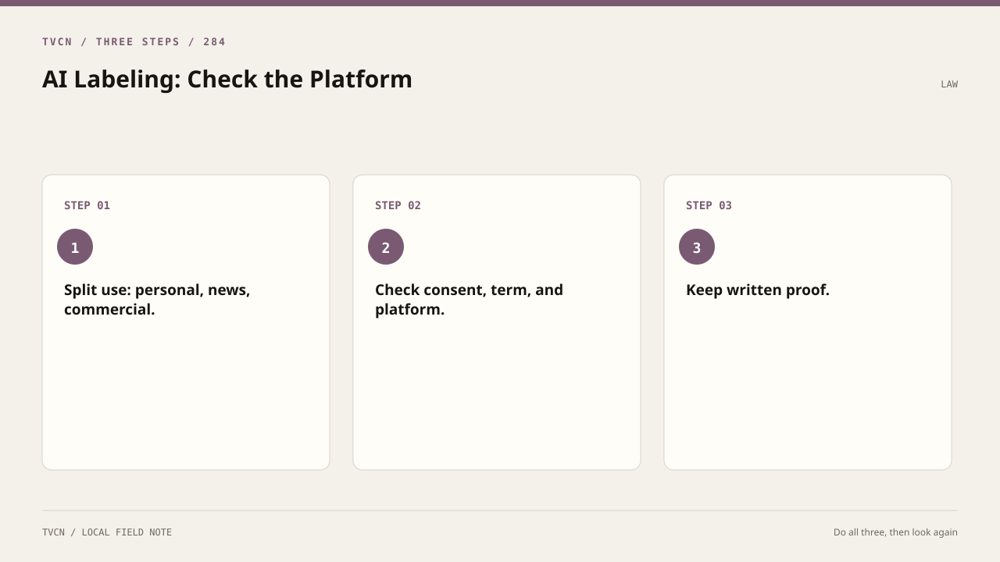

Check platform and local rules before choosing a label placement; rules change, so recheck before delivery.

<!-- DIAGRAM_START -->
<h2>Diagram</h2>
<figure>
  
  <figcaption>Do the three steps in order, then look again at the image or file.</figcaption>
</figure>
<!-- DIAGRAM_END -->
<h2>On set</h2>

Check platform and local rules. Put the label in the most visible place, whether opening, description, or corner, and recheck before delivery.

<h2>Do this</h2>

AI labeling starts with platform and regional rules, then decides opening, description, or corner mark; rules change, so recheck before delivery.
<ol><li>Check current labeling rules for the platform and region.</li><li>Choose the most visible placement: opening, description, or corner.</li><li>Recheck before delivery because rules may have changed.</li></ol>
<h2>Avoid</h2>

Do not hide the label in the last line of the description; if viewers miss it, it is not labeled.

<h2>Check</h2>
<ul><li>Labeling rules come from current platform or regional documents with links.</li><li>The label sits in the most visible of opening, description, or corner.</li><li>A pre-delivery recheck is logged with its date.</li></ul>

<!-- SOURCES_START -->
## References

- [S04] China's Interim Measures for Generative AI Services
- [S05] EU AI Act policy page

Full links and notes: [`SOURCES.md`](../../SOURCES.md).
<!-- SOURCES_END -->

<!-- DEEP_DIVE_START -->
## Deep dive

<strong>About 7 minutes.</strong> AI labeling is not a tiny line at the end. It tells the audience, before they watch, how the image was made.

### What counts as synthetic

Generated people, scenes, voices, dubbing, face swaps, and outpainting count as synthetic. Editing, grading, and noise reduction do not. The test is whether the frame contains an object that did not exist.

Even a small synthetic change that alters the facts needs a label: a sunny sky replaced, a passerby removed, a product logo added. Changing facts matters more than changing pixels.

### Label where it is seen

Use the platform's AI disclosure on upload. On your own site, put “this film contains AI-generated imagery” under the title or on the first frame, not only at the end of the description.

Say which part is AI: person, background, voice, whole shot. “Contains AI” alone does not tell the audience what to trust.

### Keep generation records

Keep prompts, model version, generation date, original output, and post steps. When a client asks, you can say which version is generated and which is live-action.

Do not mix synthetic material into news, testimony, medical, or financial high-risk contexts. If you cannot label it, do not use it. Labeling is an obligation, not an option.

### Five-minute drill: one label sentence

Take a film with AI and write one label: which section, which model, what was generated, what remains live-action. Under forty words, readable.

Put it under the first frame and show one person. If they can say which part is not live-action, the label works.

### When labeling is clear

Labeling is clear when the audience sees it before watching, can point to the generated section, can separate live-action from synthetic, and the platform disclosure matches the film. Four pass.

If they differ, rewrite. Do not hide behind “the platform already labeled it.” The platform records your claim; the audience trusts the film.

### Ten AI-label checks
<ul><li>Generated people, scenes, voices are synthetic</li><li>Editing, grading, denoise are not</li><li>Small factual changes need labels</li><li>Use platform AI disclosure</li><li>Own site: under title or first frame</li><li>Say which part is AI</li><li>Keep prompts, model, date</li><li>No synthetic in high-risk contexts</li><li>Label under forty words</li><li>Platform and film match</li></ul>
AI labeling is not a disclaimer. It tells the audience what in the frame to trust.

<!-- DEEP_DIVE_END -->
