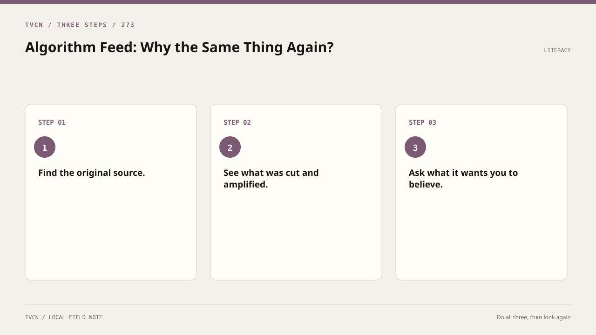

Feeds amplify what holds attention; the longer you stay, the more it assumes you like it.

<!-- DIAGRAM_START -->
<h2>Diagram</h2>
<figure>
  
  <figcaption>Do the three steps in order, then look again at the image or file.</figcaption>
</figure>
<!-- DIAGRAM_END -->
<h2>On set</h2>

Browse one topic for ten minutes on two accounts and log the difference. The longer you stay, the more it repeats.

<h2>Do this</h2>

Feeds amplify similarity based on watch time and interaction. The longer you stay, the more it assumes you like it.
<ol><li>Use two accounts on the same topic for ten minutes each and log the first twenty posts.</li><li>Mark repeated accounts, viewpoints, and emotions, then compare.</li><li>Search the opposite view and clear interest tags; watch how recommendations change.</li></ol>
<h2>Avoid</h2>

Do not mistake the feed for the world; it reflects your watch time.

<h2>Check</h2>
<ul><li>Two accounts watched the same topic for ten minutes each and logged twenty posts.</li><li>Repeated accounts, viewpoints, and emotions are marked.</li><li>The opposite view was searched, tags cleared, and feed changes observed.</li></ul>

<!-- SOURCES_START -->
## References

- [S01] UNESCO: Media and Information Literacy

Full links and notes: [`SOURCES.md`](../../SOURCES.md).
<!-- SOURCES_END -->
