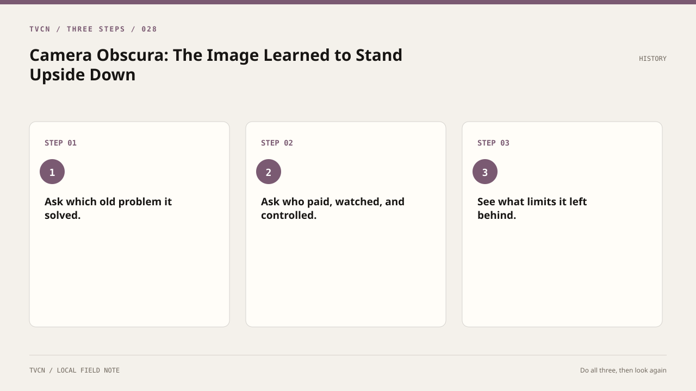

The camera obscura proved an image could be projected before it was drawn or recorded. It turned viewing into a process that could be built as a device, laying the physical basis for lenses, framing and photography.

<!-- DIAGRAM_START -->
<h2>Diagram</h2>
<figure>
  
  <figcaption>Watch “Build one from a shoebox: 0.5 mm pinhole,” and “Check that the image is inverted and measure”; judge what old problem it replaced and what new limit it added.</figcaption>
</figure>
<!-- DIAGRAM_END -->
<section><h2 id="section-1">What changed</h2><h2 id="section-2">How to use it now</h2><ul><li>To understand lens imaging, observe an inverted image through a pinhole or obscura before discussing focal length and perspective.</li><li>For an installation or projection, design ambient light, surface material and viewing distance.</li><li>When studying image history, keep the obscura separate from painting, science and photography; do not merge them into one invention story.</li></ul><h2 id="section-3">Do not misread</h2>
Do not treat the camera obscura as a “retro filter.” It is an imaging principle, not a visual style.
<h2 id="section-4">The camera obscura is not an ancient camera; it is projection geometry</h2>

The key is not a lens but a small aperture: light passes through a hole and forms an inverted image on a dark surface. It proves an image can be projected, not fixed. That explains why photography first solved fixation, not sharpness.

<h3>Common misreading</h3>

Calling it “the first camera” is inaccurate. It is an optical device with no sensitive material. Daguerre and others fixed the image. Another misreading: “smaller hole, sharper image.” Too small a hole diffracts and softens.

<h3>One use today</h3>

In a bright interior with strong backlight, the camera-obscura mindset says light from bright areas lands in dark areas. Blocking unwanted light matters more than adding a lamp. Block first, then decide where to fill.
</section><section><h2 id="section-5">On set</h2>
Make a camera obscura from a shoe box: a 0.5 mm pinhole and a screen 15 cm away; the image inverts. That is the basic relation.
</section><section><h2 id="section-6">Do this</h2>
The camera obscura already knew light forms an image; the new thing was turning sight into reproducible evidence.
<ol><li>Build one from a shoebox: 0.5 mm pinhole, screen 15 cm from the hole.</li><li>Check that the image is inverted and measure its size.</li><li>Double the pinhole and observe the trade between brightness and sharpness.</li></ol></section><section><h2 id="section-7">Avoid</h2>
Do not call the camera obscura the invention of photography; it forms an image but cannot fix it.
</section><section>
<strong>Use it today</strong>

Put the history back into a job: archive, restoration, teaching or a short film. Ask what it solved, then what it still cannot do.
<ul><li>Find one contemporary work and mark one old limit it inherited.</li><li>Find one condition it no longer needs and say why.</li><li>Write one thing it still cannot do today.</li></ul></section><section><h2>Source boundary</h2>
This is interpretation, not a primary archive. Check years, people and statutes against the original links in <a href="../../about/">SOURCES.md</a>. A secondhand summary is a lead, not evidence.
</section>
<h2>Check</h2><ul><li>The shoebox projects an inverted image with a 0.5 mm pinhole and 15 cm screen distance.</li><li>Image size is measured and related to hole distance.</li><li>Doubling the hole brightens but softens the image, and the trade is recorded.</li></ul>

<!-- SOURCES_START -->
## References and further reading

- [S07] [Daguerreotypes](https://www.loc.gov/pictures/collection/dag/background.html) — Accessed 2026-11-26. Used to check the terminology and public context in the opening paragraph (“The camera obscura already knew light could form an image; w”) against Collection background, scale and material notes on early photography; not a substitute for an on-set test.
- [S08] [Daguerre and the Invention of Photography](https://www.metmuseum.org/TOAH/hd/dagu/hd_dagu.htm) — Accessed 2026-11-26. Used to check the terminology and public context in the opening paragraph (“The camera obscura already knew light could form an image; w”) against Museum timeline for the 1839 announcement, the process and its early circulation; not a substitute for an on-set test.
- [S01] [Media and Information Literacy](https://www.unesco.org/mil4teachers/en/module1) — Accessed 2026-11-26. Used to check the terminology and public context in the opening paragraph (“The camera obscura already knew light could form an image; w”) against Definitions, teacher modules and critical questions; not a substitute for an on-set test.
- [S02] [Copyright FAQ](https://www.wipo.int/en/web/copyright/faq-copyright) — Accessed 2026-11-26. Used to check the terminology and public context in the opening paragraph (“The camera obscura already knew light could form an image; w”) against What copyright protects, economic rights and moral rights; not a substitute for an on-set test.
- [S03] [National People's Congress: Personal Information Protection Law](http://www.npc.gov.cn/npc/c2/c30834/202108/t20210820_313088.html) — Accessed 2026-11-26. Used to check the terminology and public context in the opening paragraph (“The camera obscura already knew light could form an image; w”) against The statutory text on personal data, sensitive data, notice and consent; not a substitute for an on-set test.
<!-- SOURCES_END -->

