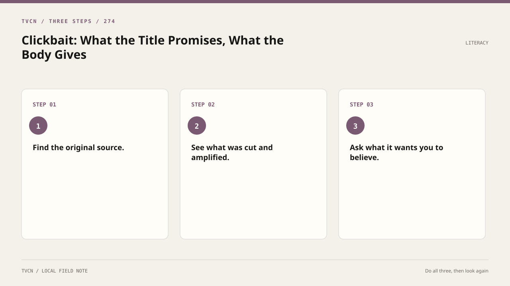

A usable hook is not “you will never guess,” but “at 0:37 he turns the camera around.” It promises a moment that exists so the viewer can find it.

<!-- DIAGRAM_START -->
<h2>Diagram</h2>
<figure>
  
  <figcaption>Watch “Rewrite the title as a promise and the” and “Check whether they describe the same thing and”; judge what old problem it replaced and what new limit it added.</figcaption>
</figure>
<!-- DIAGRAM_END -->
<section><h2 id="section-1">A hook points to a real moment in the film</h2>
Write the payoff at the same time: which second, what happens. If no payoff can be written, it is still a click trap.
<h2 id="section-2">Limits</h2>
A hook may create suspense, not false facts. If the title says “failed” and the film succeeds, that is not suspense; it is deception.
</section><section><h2 id="section-3">On set</h2>
Write one sentence for the headline and one for the body. If the headline promises A and the body gives B, it is clickbait.
</section><section><h2 id="section-4">Do this</h2>
Clickbait promises a strong result and delivers a weak example. Write one sentence for the title and one for the body.
<ol><li>Rewrite the title as a promise and the body as evidence.</li><li>Check whether they describe the same thing and whether the evidence supports the promise.</li><li>If the title promises A and the body gives B, it is clickbait.</li></ol></section><section><h2 id="section-5">Avoid</h2>
Do not just call the title exaggerated; name the evidence the body is missing.
</section><section><h2>Use it today</h2>
Put the history back into a job: archive, restoration, teaching or a short film. Ask what it solved, then what it still cannot do.
<ul><li>Find one contemporary work and mark one old limit it inherited.</li><li>Find one condition it no longer needs and say why.</li><li>Write one thing it still cannot do today.</li></ul></section><section><h2>Source boundary</h2>
This is interpretation, not a primary archive. Check years, people and statutes against the original links in <a href="../../about/">SOURCES.md</a>. A secondhand summary is a lead, not evidence.
</section>
<h2>Check</h2><ul><li>The title is rewritten as a promise and the body as evidence.</li><li>They describe the same thing and the evidence supports the promise.</li><li>You can name where the title promises A and the body gives B.</li></ul>

<!-- SOURCES_START -->
## References and further reading

- [S01] [Media and Information Literacy](https://www.unesco.org/mil4teachers/en/module1) — Accessed 2026-11-26. Used to check the terminology and public context in the opening paragraph (“Clickbait promises a strong result and delivers a weak examp”) against Definitions, teacher modules and critical questions; not a substitute for an on-set test.
- [S02] [Copyright FAQ](https://www.wipo.int/en/web/copyright/faq-copyright) — Accessed 2026-11-26. Used to check the terminology and public context in the opening paragraph (“Clickbait promises a strong result and delivers a weak examp”) against What copyright protects, economic rights and moral rights; not a substitute for an on-set test.
- [S03] [National People's Congress: Personal Information Protection Law](http://www.npc.gov.cn/npc/c2/c30834/202108/t20210820_313088.html) — Accessed 2026-11-26. Used to check the terminology and public context in the opening paragraph (“Clickbait promises a strong result and delivers a weak examp”) against The statutory text on personal data, sensitive data, notice and consent; not a substitute for an on-set test.
- [S16] [BBC Editorial Guidelines](https://www.bbc.co.uk/editorialguidelines/) — Accessed 2026-11-26. Used to check the terminology and public context in the opening paragraph (“Clickbait promises a strong result and delivers a weak examp”) against Editorial standards on accuracy, fairness, privacy and secret recording; not a substitute for an on-set test.
- [S10] [Film history and moving-image research](https://www.bfi.org.uk/) — Accessed 2026-11-26. Used to check the terminology and public context in the opening paragraph (“Clickbait promises a strong result and delivers a weak examp”) against Entry point to BFI film history, archives and moving-image research; not a substitute for an on-set test.
<!-- SOURCES_END -->

