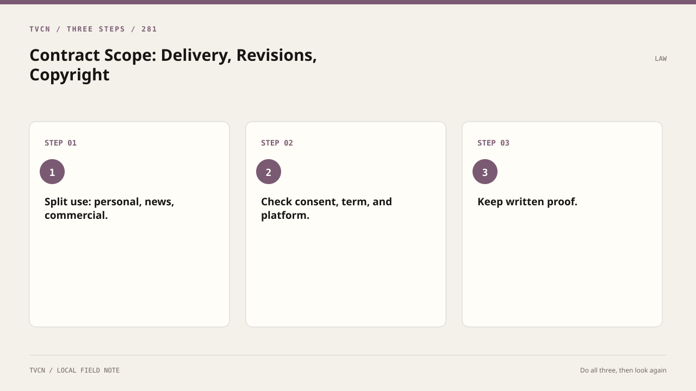

State deliverables, revision rounds, copyright, and usage; "shoot a film" guarantees a fight.

<!-- DIAGRAM_START -->
<h2>Diagram</h2>
<figure>
  
  <figcaption>Do the three steps in order, then look again at the image or file.</figcaption>
</figure>
<!-- DIAGRAM_END -->
<h2>On set</h2>

Write deliverables, revision rounds, copyright, usage, and payment milestones. Every item must be checkable.

<h2>Do this</h2>

A contract states deliverables, revision rounds, copyright, and usage; “shoot a video” guarantees a fight.
<ol><li>State deliverables: length, resolution, format, date.</li><li>State revision rounds and what each covers.</li><li>State copyright, usage, payment milestones, each verifiable.</li></ol>
<h2>Avoid</h2>

Do not write “shoot a video” as the deliverable; without length, format, and rounds, a fight is certain.

<h2>Check</h2>
<ul><li>Deliverables specify length, resolution, format, and date.</li><li>Revision rounds and scope have numbers.</li><li>Copyright, usage, and payment milestones are each verifiable.</li></ul>

<!-- SOURCES_START -->
## References

- [S02] WIPO: Copyright FAQ
- [S22] China's Civil Code

Full links and notes: [`SOURCES.md`](../../SOURCES.md).
<!-- SOURCES_END -->

<!-- DEEP_DIVE_START -->
## Deep dive

<strong>About 8 minutes.</strong> A contract is not distrust. It writes down what is made, for how long, where it is used, and how many revisions.

### Deliverables you can count

Do not write “a brand video.” Write “one sixty-second master, three fifteen-second cutdowns, one cover, two subtitle versions.” Count, duration, ratio, format.

Delivery dates are dates, not “as soon as possible.” Review rounds are numbers, not “until satisfied.” A clause you can count is a clause you can execute.

### Rights more detailed than price

Media, term, territory, exclusivity, sublicense: five separate lines. Organic usage is not paid media; one year is not forever.

State whether source files are delivered, when, and which layers. Many disputes are not about money; the client thinks they bought everything, you think they bought the finished film.

### Termination and surprises

Write cancellation milestones, costs incurred, whether the deposit is refundable, footage ownership, and force majeure. Do not only write “both parties will negotiate.” Negotiation is a process; clauses are the floor.

If client approval slips beyond a set number of days, the schedule moves. If the direction changes, it is a new quote. Two lines save many arguments.

### Five-minute drill: four-line contract summary

Reduce a one-page contract to four lines: what, when, how many revisions, which rights. Twenty words per line, readable by the client and executable by you.

If one line is vague, rewrite the contract. Do not fill it with “we will see.” What is not in the contract will not exist in delivery.

### When the contract is clear

The contract is clear when both sides can state the same four things without the appendix: deliverables, dates, revisions, rights. Four answers match.

If they differ, it is not bad memory; the contract allowed two readings. Rewrite it instead of explaining later.

### Ten contract-scope checks
<ul><li>Count, duration, ratio of deliverables</li><li>Delivery dates as dates</li><li>Review rounds as numbers</li><li>Media on its own line</li><li>Term on its own line</li><li>Territory on its own line</li><li>Exclusivity and sublicense separate</li><li>Source-file delivery separate</li><li>Cancellation and schedule slip written</li><li>Both sides can repeat the same four</li></ul>
A contract's value is not who you can sue. It is giving two people the same definition before there is a problem.

<!-- DEEP_DIVE_END -->
