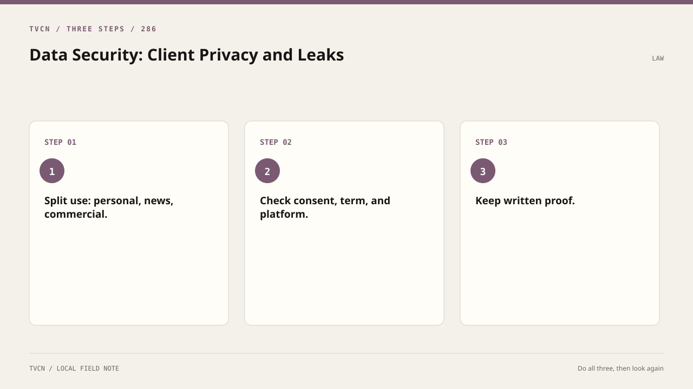

Data security covers drives, cloud, chat, and forwarding; client privacy is not only the final cut.

<!-- DIAGRAM_START -->
<h2>Diagram</h2>
<figure>
  
  <figcaption>Do the three steps in order, then look again at the image or file.</figcaption>
</figure>
<!-- DIAGRAM_END -->
<h2>On set</h2>

Encrypt drives, set cloud permissions, and control chat logs and forwarding. Client privacy includes outtakes and backups.

<h2>Do this</h2>

Footage security covers drives, cloud, chat logs, and forwarding rights; client privacy is not only the final cut.
<ol><li>Encrypt portable drives and set per-project cloud permissions.</li><li>Do not forward raw files in chat; send controlled links.</li><li>Treat rushes and backups as client-private too.</li></ol>
<h2>Avoid</h2>

Do not treat rushes as disposable; they contain client privacy too.

<h2>Check</h2>
<ul><li>Portable drives are encrypted and cloud access is project-scoped.</li><li>Raw files are not forwarded in chat; controlled links are used.</li><li>Rushes and backups follow the same privacy rules as the final cut.</li></ul>

<!-- SOURCES_START -->
## References

- [S03] China's Personal Information Protection Law (PIPL)

Full links and notes: [`SOURCES.md`](../../SOURCES.md).
<!-- SOURCES_END -->
