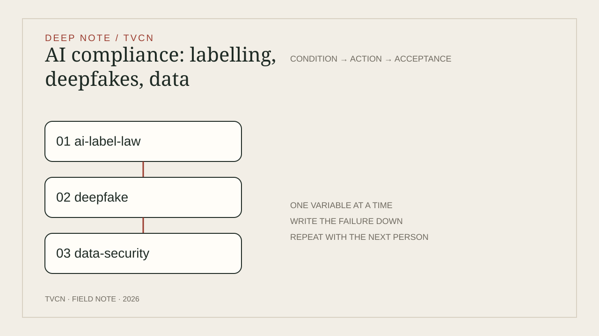

AI compliance is not one disclaimer; labelling, deepfakes and data provenance must pass together. One page of &amp;quot;AI Content Labels: Explicit, Implicit, and Platform Duties&amp;quot; solves one local problem; joining &amp;quot;AI Content Labels: Explicit, Implicit, and Platform Duties&amp;quot;, &amp;quot;Deepfake Detection: Look Beyond the Face&amp;quot; and &amp;quot;Data Security: Client Privacy and Leaks&amp;quot; exposes the real failure: conditions are missing, too many variables move, and the result cannot be reproduced.

<!-- DEEP_DIVE_START -->
<!-- DIAGRAM_START -->
<h2>图解</h2>
<figure>
  
  <figcaption>Read &quot;AI Content Labels: Explicit, Implicit, and Platfor…&quot; and &quot;Deepfake Detection: Look Beyond the Face&quot;: write the condition first, then check whether the failure can be recorded.</figcaption>
</figure>
<!-- DIAGRAM_END -->

<section><h2 id="section-1">Problem</h2>
The problem is not a lack of methods; each step works alone, but together they fail because the condition was not written, too many variables moved and the result cannot be reproduced.

The order is condition, judgement, one variable and evidence. A step is complete only when the next person can repeat it.
</section>
<section><h2 id="section-2">Judgement</h2><ul><li>First gate in &quot;AI Content Labels: Explicit, Implicit, and Platform Duties&quot;: Explicit label is visible/audible.</li><li>Second gate in &quot;Deepfake Detection: Look Beyond the Face&quot;: Implicit label and metadata are retained.</li><li>Third gate in &quot;Data Security: Client Privacy and Leaks&quot;: Editing did not remove/tamper labels.</li></ul>
If one gate fails, return to its single page; do not hide an unsolved point inside a longer chain.
</section>
<section><h2 id="section-3">Method</h2><ol><li>Write the condition first: turn &quot;Step through five seconds: are teeth a single row, ears symmetric, blinks natura…&quot; from &quot;AI Content Labels: Explicit, Implicit, and Platform Duties&quot; into three rows: material, environment, acceptance.</li><li>Run one minimal action: follow &quot;AI Content Labels: Explicit, Implicit, and Platform Duties&quot; for 30 seconds and do not add the second page yet.</li><li>Attach the second page: Check background text, signs, and reflections in glasses for continuity..</li><li>Use the third page as a control: Find the original source, a response from the person, or a second angle; if all ….</li><li>Change one variable at a time; write the other conditions down instead of remembering them.</li><li>Film the failure too: put failure and success side by side to see which step cannot be skipped.</li><li>Ask the next person to reproduce from the record; if they cannot, the record is not finished.</li></ol></section>
<section><h2 id="section-4">Field test</h2>
A reproducible test, not a client case: take 30 seconds of material, make version A using &quot;Explicit label is visible/audible.&quot; from &quot;AI Content Labels: Explicit, Implicit, and Platform Duties&quot;, then version B using &quot;Implicit label and metadata are retained.&quot; from &quot;Deepfake Detection: Look Beyond the Face&quot;; only one variable may differ. Put them side by side and record what breaks first in &quot;Data Security: Client Privacy and Leaks&quot;: condition, action or acceptance. If it works on the first try, add one real constraint and run it again.
</section>
<section><h2 id="section-5">Failure table</h2>
<table class="data-table"><thead><tr><th>Symptom</th><th>Cause</th><th>Replacement action</th></tr></thead><tbody><tr><td>Do not conclude “it looks fake”; name the specific mismatches.</td><td>Condition was not written</td><td>Return to page one and rewrite the three rows</td></tr><tr><td>Do not treat rushes as disposable; they contain client privacy to…</td><td>Condition was not written</td><td>Return to page one and rewrite the three rows</td></tr><tr><td>Only the result is kept, not the condition</td><td>Condition was not written</td><td>Return to page one and rewrite the three rows</td></tr></tbody></table>
</section>
<section><h2 id="section-6">Acceptance</h2><ul><li>Explicit label is visible/audible.</li><li>Implicit label and metadata are retained.</li><li>Editing did not remove/tamper labels.</li><li>Re-synthesis is relabeled.</li><li>Platform declaration and screenshot archived.</li><li>Likeness/voice/music clearances complete.</li><li>Portable drives are encrypted and cloud access is project-scoped.</li><li>Raw files are not forwarded in chat; controlled links are used.</li><li>Rushes and backups follow the same privacy rules as the final cut.</li><li>The condition from AI Content Labels: Explicit, Implicit, and Platform Duties fits on one line and can be repeated by someone else.</li></ul></section>
<section><h2 id="section-7">Alternatives</h2><ul><li>For a single-point problem in "AI Content Labels: Explicit, Implicit, and Platform Duties", go back to <a href="https://context.tvcn.org/en/article/ai-label-law/">AI Content Labels: Explicit, Implicit, and Platform Duties</a>; do not use the whole chain.</li><li>To compare two actions, read <a href="https://context.tvcn.org/en/article/deepfake/">Deepfake Detection: Look Beyond the Face</a> and leave the third page alone.</li><li>For acceptance only, use <a href="https://context.tvcn.org/en/article/data-security/">Data Security: Client Privacy and Leaks</a> as a self-test sheet.</li></ul></section>

<!-- SOURCES_START -->
## References and further reading

- [S04] [CAC: Interim Measures for Generative AI Services](https://www.cac.gov.cn/2023-07/13/c_1690898327029107.htm) — Accessed 2026-11-26. Used to check the terminology/method/rule in the “Failure table” section against China's generative-AI service rules, not technical implementation; it does not verify numbers, model choices or on-set conclusions derived from this page, and is not a substitute for a test.
- [S05] [European Commission: AI Act](https://digital-strategy.ec.europa.eu/en/policies/regulatory-framework-ai) — Accessed 2026-11-26. Used to check the terminology/method/rule in the “Problem” section against EU AI Act policy page, not Chinese law; it does not verify numbers, model choices or on-set conclusions derived from this page, and is not a substitute for a test.
<!-- SOURCES_END -->

