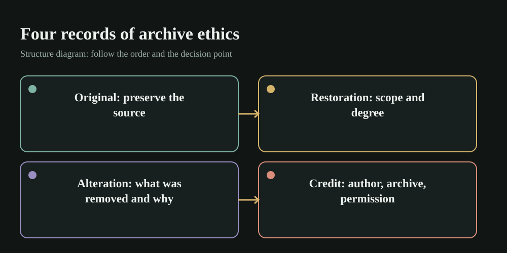

Old footage is restored, graded, subtitled and scored, then placed in a new film, and the audience assumes they are seeing “the image of the time”. But restoration is already an edit: scratches removed, time removed; speed changed, motion changed. Archive ethics is not refusing to restore; it is letting the audience know what was restored.

<!-- DIAGRAM_START -->
<h2 id="diagram">Diagram</h2>
<figure class="diagram">
  
  <figcaption>Check original, restoration, alteration and credit. Showing only the restored image lets the audience mistake an edit for history.</figcaption>
</figure>
<!-- DIAGRAM_END -->

<section><h2 id="section-1">On location</h2>
A 16mm home movie from 1968: scratched, red cast, no sound. A new film wants it for a story about a family moving. The family agrees but asks to remove an argument. The producers restore the image, add music and use subtitles for narration, but do not label restoration or removal. The audience believes they saw the complete original.
</section>
<section><h2 id="section-2">What to look for</h2><ul><li><strong>Is the original preserved:</strong> was an unprocessed scan or file kept before restoration? Without the original, restoration cannot be checked.</li><li><strong>Is restoration scope stated:</strong> scratches only, or also speed, colour, framing and sound? The larger the scope, the more it needs explanation.</li><li><strong>Is alteration labelled:</strong> removing an argument is an ethical decision and a historical edit; without a label, the audience misreads.</li><li><strong>Is credit complete:</strong> shooter, archive, restorer and licensor; missing one breaks the chain.</li></ul></section>
<section><h2 id="section-3">What to do</h2><ol><li>Preserve the original first: keep an unprocessed scan or transfer in a separate place with source, date, format and hash; restore from a copy.</li><li>Keep a restoration log: what was done at each step, which tools, how much changed; keep before and after frames.</li><li>Get three-way approval for alteration: family or rights holder, director, archive; write what was removed, why and who approved.</li><li>Label on screen: restoration, alteration, reconstruction, dubbing or subtitles, in one line, not buried in end credits.</li><li>Credit fully: shooter, archive, restorer, licence number; if anonymous, state why.</li></ol></section>
<section><h2 id="section-4">Failure modes</h2><ul><li><strong>Treating restoration as the original:</strong> scratches removed, colour changed, frames interpolated, no note; the audience thinks history looked like this.</li><li><strong>Silent alteration:</strong> an argument removed without a label; family history becomes a “harmonious version” and the audience does not know.</li><li><strong>No source:</strong> archive footage labelled only “file”; author, archive and licence all missing.</li></ul></section>
<section><h2 id="section-5">Limits</h2>
This is an editorial ethics framework, not a substitute for copyright, privacy or archive licence terms. Permission for home archives must separate use from alteration; agreeing to use is not agreeing to change. News archives are more public, but that does not mean free editing; with minors, victims or privacy, protect the person before completeness.
</section>
<section><h2 id="section-6">Check</h2><ul><li>Original, restoration copy and restoration log all exist.</li><li>The film has one clear on-screen note for restoration or alteration.</li><li>Credit includes shooter, archive, restorer and licence number.</li><li>Alteration has written approval from at least two parties, traceable to a date.</li></ul></section>
<!-- DEEP_DIVE_START -->
## Deep dive

<strong>About 8 minutes.</strong> This section places the same judgement in two different conditions, then gives a counterexample and a reusable model. It does not repeat the page; it decides when to change the method.

### Condition A: family or private archive

The first rights holder in a family archive is the person on screen, not the director. Ask three things before use: who is in the frame, who can consent, and to what degree. If the family says “you can use it”, ask separately whether you can cut, change speed or add music; do not package it as one “permission”.

Alteration needs extra care: removing an argument may protect one person and erase another's experience. Do not refuse to cut; write the cut into the opening or closing note and keep the pre-cut version in the archive. The audience has a right to know this is “selected memory”.

### Condition B: news or public archive

News archive ethics balances public knowledge against personal harm. Public figures in public places have wider use; minors, victims, patients and private homes need blurring or exclusion. Do not use “historical completeness” as an excuse to expose a face that should not be public.

Restoration of news archive should be conservative: no frame interpolation, no speed change, no generative upscaling; these alter evidence. Dust and scratch removal is acceptable with a note: “cleaning only; timing, order and sound unchanged”. The restorer is not the author and cannot decide for history.

### Counterexample: over-restoration becomes a new film

A 1960s street scene is restored with AI interpolation, colourisation and upscaling. Scratches are gone, colours are vivid, faces are sharp. The audience says “the past looked great”. But the original is 18 fps, black and white, visibly grainy; the restored image no longer has the colour or motion of that era.

The fix is not no restoration. Make two versions: a cleaning restoration that only removes dust and scratches and stabilises, keeping the original frame rate and black and white; an interpretive restoration that may colourise or interpolate but must be labelled “reconstruction, not original”. Show both and let the audience choose.

### Reusable model

<strong>Original → restoration → alteration → credit.</strong> The original is evidence, restoration is editing, alteration is selection, credit is responsibility. Keep all four records and archive use is not “take and run”.

For every archive use, write one A4 sheet: source, permission, restoration scope, alterations, credit and contact. The sheet travels with the film, not the project; if someone questions it three years later, you can produce the paper.

<!-- DEEP_DIVE_END -->
<!-- SOURCES_START -->
## Further reading

- [S43] [BFI: BFI National Archive](https://www.bfi.org.uk/bfi-national-archive) — accessed 2026-11-26. Used to check the terms, method or rule in the “What to look for” section; not the page's field numbers, gear models or conclusions, and not a substitute for a test or contract.
- [S44] [Academy Film Archive: Film archive and restoration](https://www.oscars.org/film-archive) — accessed 2026-11-26. Used to check the terms, method or rule in the “Limits” section; not the page's field numbers, gear models or conclusions, and not a substitute for a test or contract.
<!-- SOURCES_END -->
