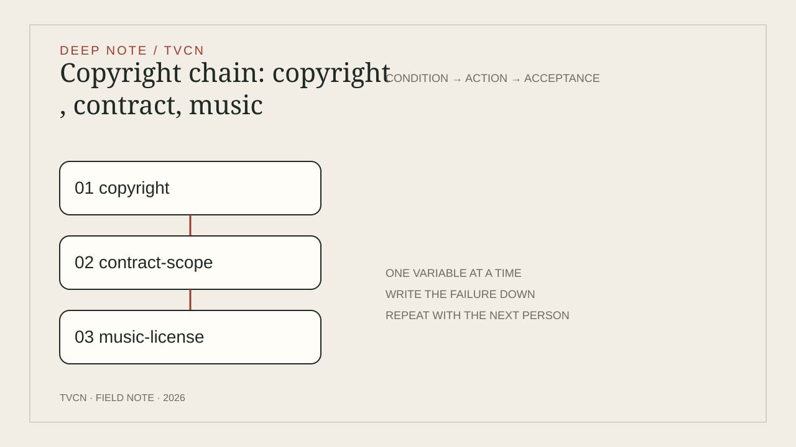

Copyright is not a line saying cleared; copyright, contract and music licence must match use, term and territory. One page of &amp;quot;copyright&amp;quot; solves one local problem; joining &amp;quot;copyright&amp;quot;, &amp;quot;Contract Scope: Price the “One More Revision” Before It Happens&amp;quot; and &amp;quot;Music Licensing: Sync, Performance, and Platform Libraries&amp;quot; exposes the real failure: conditions are missing, too many variables move, and the result cannot be reproduced.

<!-- DEEP_DIVE_START -->
<!-- DIAGRAM_START -->
<h2>图解</h2>
<figure>
  
  <figcaption>Read &quot;copyright&quot; and &quot;Contract Scope: Price the “One More Revision” Befo…&quot;: write the condition first, then check whether the failure can be recorded.</figcaption>
</figure>
<!-- DIAGRAM_END -->

<section><h2 id="section-1">Problem</h2>
The problem is not a lack of methods; each step works alone, but together they fail because the condition was not written, too many variables moved and the result cannot be reproduced.

The order is condition, judgement, one variable and evidence. A step is complete only when the next person can repeat it.
</section>
<section><h2 id="section-2">Judgement</h2><ul><li>First gate in &quot;copyright&quot;: Deliverables have count, duration, ratio, language.</li><li>Second gate in &quot;Contract Scope: Price the “One More Revision” Before It Happens&quot;: Revision rounds and overage rate are written.</li><li>Third gate in &quot;Music Licensing: Sync, Performance, and Platform Libraries&quot;: Acceptance standard and one approver.</li></ul>
If one gate fails, return to its single page; do not hide an unsolved point inside a longer chain.
</section>
<section><h2 id="section-3">Method</h2><ol><li>Write the condition first: turn &quot;can or cannot&quot; from &quot;copyright&quot; into three rows: material, environment, acceptance.</li><li>Run one minimal action: follow &quot;copyright&quot; for 30 seconds and do not add the second page yet.</li><li>Attach the second page: change one variable and hold everything else.</li><li>Use the third page as a control: shoot a same-condition version and compare.</li><li>Change one variable at a time; write the other conditions down instead of remembering them.</li><li>Film the failure too: put failure and success side by side to see which step cannot be skipped.</li><li>Ask the next person to reproduce from the record; if they cannot, the record is not finished.</li></ol></section>
<section><h2 id="section-4">Field test</h2>
A reproducible test, not a client case: take 30 seconds of material, make version A using &quot;Deliverables have count, duration, ratio, language.&quot; from &quot;copyright&quot;, then version B using &quot;Revision rounds and overage rate are written.&quot; from &quot;Contract Scope: Price the “One More Revision” Before It Happens&quot;; only one variable may differ. Put them side by side and record what breaks first in &quot;Music Licensing: Sync, Performance, and Platform Libraries&quot;: condition, action or acceptance. If it works on the first try, add one real constraint and run it again.
</section>
<section><h2 id="section-5">Failure table</h2>
<table class="data-table"><thead><tr><th>Symptom</th><th>Cause</th><th>Replacement action</th></tr></thead><tbody><tr><td>Only the result is kept, not the condition</td><td>Condition was not written</td><td>Return to page one and rewrite the three rows</td></tr><tr><td>Only the result is kept, not the condition</td><td>Condition was not written</td><td>Return to page one and rewrite the three rows</td></tr><tr><td>Only the result is kept, not the condition</td><td>Condition was not written</td><td>Return to page one and rewrite the three rows</td></tr></tbody></table>
</section>
<section><h2 id="section-6">Acceptance</h2><ul><li>Deliverables have count, duration, ratio, language.</li><li>Revision rounds and overage rate are written.</li><li>Acceptance standard and one approver.</li><li>Footage/music/font/AI rights are written.</li><li>Payment covers cost.</li><li>Termination and force majeure are workable.</li><li>The condition from copyright fits on one line and can be repeated by someone else.</li><li>Only one variable changes and the other page&#x27;s result still reproduces.</li><li>A failure is recorded as condition, action and result, not a feeling.</li><li>A colleague can reproduce the same version without asking you.</li></ul></section>
<section><h2 id="section-7">Alternatives</h2><ul><li>For a single-point problem in "copyright", go back to <a href="https://context.tvcn.org/en/article/copyright/">copyright</a>; do not use the whole chain.</li><li>To compare two actions, read <a href="https://context.tvcn.org/en/article/contract-scope/">Contract Scope: Price the “One More Revision” Before It Happens</a> and leave the third page alone.</li><li>For acceptance only, use <a href="https://context.tvcn.org/en/article/music-license/">Music Licensing: Sync, Performance, and Platform Libraries</a> as a self-test sheet.</li></ul></section>
