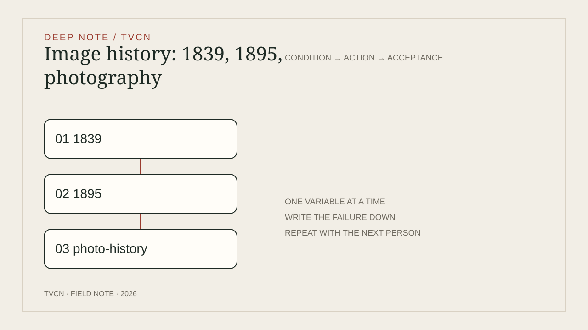

Image history is not a year list; 1839, 1895 and photography together show how recording became narrative. One page of &amp;quot;1839&amp;quot; solves one local problem; joining &amp;quot;1839&amp;quot;, &amp;quot;1895&amp;quot; and &amp;quot;photo-history&amp;quot; exposes the real failure: conditions are missing, too many variables move, and the result cannot be reproduced.

<!-- DEEP_DIVE_START -->
<!-- DIAGRAM_START -->
<h2>图解</h2>
<figure>
  
  <figcaption>Read &quot;1839&quot; and &quot;1895&quot;: write the condition first, then check whether the failure can be recorded.</figcaption>
</figure>
<!-- DIAGRAM_END -->

<section><h2 id="section-1">Problem</h2>
The problem is not a lack of methods; each step works alone, but together they fail because the condition was not written, too many variables moved and the result cannot be reproduced.

The order is condition, judgement, one variable and evidence. A step is complete only when the next person can repeat it.
</section>
<section><h2 id="section-2">Judgement</h2><ul><li>First gate in &quot;1839&quot;: The condition from 1839 fits on one line and can be repeated by someone else.</li><li>Second gate in &quot;1895&quot;: Only one variable changes and the other page&#x27;s result still reproduces.</li><li>Third gate in &quot;photo-history&quot;: A failure is recorded as condition, action and result, not a feeling.</li></ul>
If one gate fails, return to its single page; do not hide an unsolved point inside a longer chain.
</section>
<section><h2 id="section-3">Method</h2><ol><li>Write the condition first: turn &quot;can or cannot&quot; from &quot;1839&quot; into three rows: material, environment, acceptance.</li><li>Run one minimal action: follow &quot;1839&quot; for 30 seconds and do not add the second page yet.</li><li>Attach the second page: change one variable and hold everything else.</li><li>Use the third page as a control: shoot a same-condition version and compare.</li><li>Change one variable at a time; write the other conditions down instead of remembering them.</li><li>Film the failure too: put failure and success side by side to see which step cannot be skipped.</li><li>Ask the next person to reproduce from the record; if they cannot, the record is not finished.</li></ol></section>
<section><h2 id="section-4">Field test</h2>
A reproducible test, not a client case: take 30 seconds of material, make version A using &quot;The condition from 1839 fits on one line and can be repeated by s…&quot; from &quot;1839&quot;, then version B using &quot;Only one variable changes and the other page&#x27;s result still repro…&quot; from &quot;1895&quot;; only one variable may differ. Put them side by side and record what breaks first in &quot;photo-history&quot;: condition, action or acceptance. If it works on the first try, add one real constraint and run it again.
</section>
<section><h2 id="section-5">Failure table</h2>
<table class="data-table"><thead><tr><th>Symptom</th><th>Cause</th><th>Replacement action</th></tr></thead><tbody><tr><td>Only the result is kept, not the condition</td><td>Condition was not written</td><td>Return to page one and rewrite the three rows</td></tr><tr><td>Only the result is kept, not the condition</td><td>Condition was not written</td><td>Return to page one and rewrite the three rows</td></tr><tr><td>Only the result is kept, not the condition</td><td>Condition was not written</td><td>Return to page one and rewrite the three rows</td></tr></tbody></table>
</section>
<section><h2 id="section-6">Acceptance</h2><ul><li>The condition from 1839 fits on one line and can be repeated by someone else.</li><li>Only one variable changes and the other page&#x27;s result still reproduces.</li><li>A failure is recorded as condition, action and result, not a feeling.</li><li>A colleague can reproduce the same version without asking you.</li></ul></section>
<section><h2 id="section-7">Alternatives</h2><ul><li>For a single-point problem in "1839", go back to <a href="https://context.tvcn.org/en/article/1839/">1839</a>; do not use the whole chain.</li><li>To compare two actions, read <a href="https://context.tvcn.org/en/article/1895/">1895</a> and leave the third page alone.</li><li>For acceptance only, use <a href="https://context.tvcn.org/en/article/photo-history/">photo-history</a> as a self-test sheet.</li></ul></section>
<section><h2 id="section-8">Boundary</h2>
This chain is not evidence that one image regime is more real than another. Between 1839 and 1895, recording, projection and viewing institutions changed separately; compressing three nodes into one causal chain erases regional practice. The page treats the nodes as three samples of how recording becomes narrative, not as a timeline.
</section>

<!-- SOURCES_START -->
## References and further reading

- [S10] [BFI: Film History and Moving Image Research](https://www.bfi.org.uk/) — Accessed 2026-11-26. Used to check the terminology/method/rule in the “Problem” section against BFI film history and archive, not gear reviews; it does not verify numbers, model choices or on-set conclusions derived from this page, and is not a substitute for a test.
- [S11] [Britannica: Photography](https://www.britannica.com/technology/photography) — Accessed 2026-11-26. Used to check the terminology/method/rule in the “Judgement” section against Britannica photography entry, not a how-to manual; it does not verify numbers, model choices or on-set conclusions derived from this page, and is not a substitute for a test.
- [S50] [Kodak: Motion Picture](https://www.kodak.com/en/motion/home) — Accessed 2026-11-26. Used to check the terminology/method/rule in the “Method” section against Kodak film and motion-picture material, not digital settings; it does not verify numbers, model choices or on-set conclusions derived from this page, and is not a substitute for a test.
<!-- SOURCES_END -->

