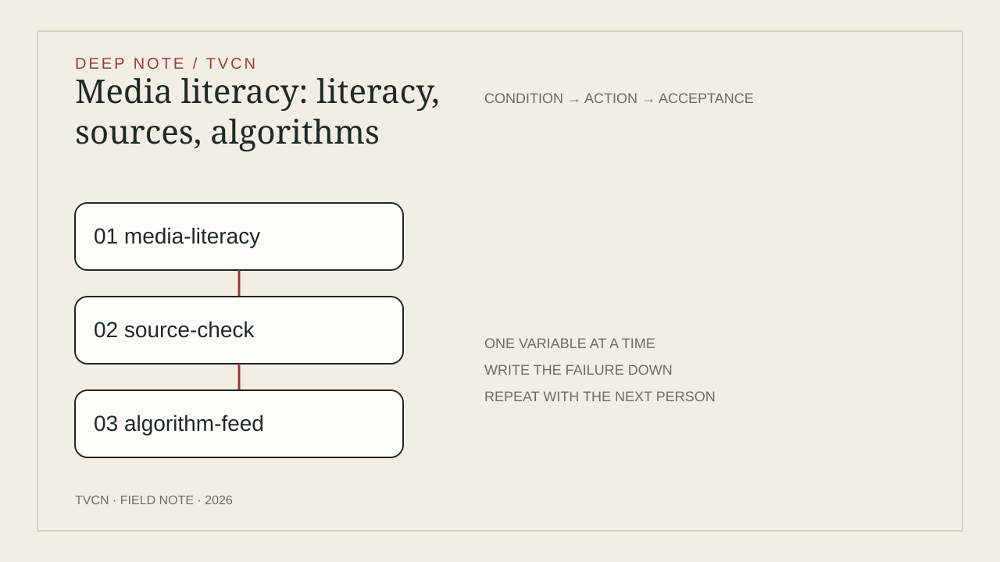

Media literacy is not do not trust the internet; sources, algorithms and emotional triggers become checks. One page of &amp;quot;media-literacy&amp;quot; solves one local problem; joining &amp;quot;media-literacy&amp;quot;, &amp;quot;Source Check: Who Posted It First?&amp;quot; and &amp;quot;Algorithm Feed: Why the Same Thing Again?&amp;quot; exposes the real failure: conditions are missing, too many variables move, and the result cannot be reproduced.

<!-- DEEP_DIVE_START -->
<!-- DIAGRAM_START -->
<h2>图解</h2>
<figure>
  
  <figcaption>Read &quot;media-literacy&quot; and &quot;Source Check: Who Posted It First?&quot;: write the condition first, then check whether the failure can be recorded.</figcaption>
</figure>
<!-- DIAGRAM_END -->

<section><h2 id="section-1">Problem</h2>
The problem is not a lack of methods; each step works alone, but together they fail because the condition was not written, too many variables moved and the result cannot be reproduced.

The order is condition, judgement, one variable and evidence. A step is complete only when the next person can repeat it.
</section>
<section><h2 id="section-2">Judgement</h2><ul><li>First gate in &quot;media-literacy&quot;: The earliest account, original file, and timestamp are saved.</li><li>Second gate in &quot;Source Check: Who Posted It First?&quot;: Reverse image or keyframe search found a second independent source.</li><li>Third gate in &quot;Algorithm Feed: Why the Same Thing Again?&quot;: At least three of four match: time, place, weather, signage.</li></ul>
If one gate fails, return to its single page; do not hide an unsolved point inside a longer chain.
</section>
<section><h2 id="section-3">Method</h2><ol><li>Write the condition first: turn &quot;Find the earliest account, original video or image, and save the link and timest…&quot; from &quot;media-literacy&quot; into three rows: material, environment, acceptance.</li><li>Run one minimal action: follow &quot;media-literacy&quot; for 30 seconds and do not add the second page yet.</li><li>Attach the second page: Use reverse image or keyframe search to find a second independent source..</li><li>Use the third page as a control: Check time, place, weather, and signage; at least three of four must agree..</li><li>Change one variable at a time; write the other conditions down instead of remembering them.</li><li>Film the failure too: put failure and success side by side to see which step cannot be skipped.</li><li>Ask the next person to reproduce from the record; if they cannot, the record is not finished.</li></ol></section>
<section><h2 id="section-4">Field test</h2>
A reproducible test, not a client case: take 30 seconds of material, make version A using &quot;The earliest account, original file, and timestamp are saved.&quot; from &quot;media-literacy&quot;, then version B using &quot;Reverse image or keyframe search found a second independent sourc…&quot; from &quot;Source Check: Who Posted It First?&quot;; only one variable may differ. Put them side by side and record what breaks first in &quot;Algorithm Feed: Why the Same Thing Again?&quot;: condition, action or acceptance. If it works on the first try, add one real constraint and run it again.
</section>
<section><h2 id="section-5">Failure table</h2>
<table class="data-table"><thead><tr><th>Symptom</th><th>Cause</th><th>Replacement action</th></tr></thead><tbody><tr><td>Do not treat “many people shared it” as evidence; sharing is only…</td><td>Condition was not written</td><td>Return to page one and rewrite the three rows</td></tr><tr><td>Do not mistake the feed for the world; it reflects your watch tim…</td><td>Condition was not written</td><td>Return to page one and rewrite the three rows</td></tr><tr><td>Only the result is kept, not the condition</td><td>Condition was not written</td><td>Return to page one and rewrite the three rows</td></tr></tbody></table>
</section>
<section><h2 id="section-6">Acceptance</h2><ul><li>The earliest account, original file, and timestamp are saved.</li><li>Reverse image or keyframe search found a second independent source.</li><li>At least three of four match: time, place, weather, signage.</li><li>A screenshot is not the original</li><li>Find the earliest publisher</li><li>Find the original file and full version</li><li>Check account history and time</li><li>Shadows, weather, signs match place</li><li>Two accounts watched the same topic for ten minutes each and logged twenty posts.</li><li>Repeated accounts, viewpoints, and emotions are marked.</li></ul></section>
<section><h2 id="section-7">Alternatives</h2><ul><li>For a single-point problem in "media-literacy", go back to <a href="https://context.tvcn.org/en/article/media-literacy/">media-literacy</a>; do not use the whole chain.</li><li>To compare two actions, read <a href="https://context.tvcn.org/en/article/source-check/">Source Check: Who Posted It First?</a> and leave the third page alone.</li><li>For acceptance only, use <a href="https://context.tvcn.org/en/article/algorithm-feed/">Algorithm Feed: Why the Same Thing Again?</a> as a self-test sheet.</li></ul></section>

<!-- SOURCES_START -->
## References and further reading

- [S14] [YouTube Community Guidelines](https://support.google.com/youtube/answer/2801973) — Accessed 2026-11-26. Used to check the terminology and public context in the opening paragraph (“Media literacy is not do not trust the internet; sources, al”) against Current platform rules on misleading content, dangerous acts, copyright and disclosure; not a substitute for an on-set test.
- [S01] [Media and Information Literacy](https://www.unesco.org/mil4teachers/en/module1) — Accessed 2026-11-26. Used to check the terminology and public context in the opening paragraph (“Media literacy is not do not trust the internet; sources, al”) against Definitions, teacher modules and critical questions; not a substitute for an on-set test.
- [S02] [Copyright FAQ](https://www.wipo.int/en/web/copyright/faq-copyright) — Accessed 2026-11-26. Used to check the terminology and public context in the opening paragraph (“Media literacy is not do not trust the internet; sources, al”) against What copyright protects, economic rights and moral rights; not a substitute for an on-set test.
- [S03] [National People's Congress: Personal Information Protection Law](http://www.npc.gov.cn/npc/c2/c30834/202108/t20210820_313088.html) — Accessed 2026-11-26. Used to check the terminology and public context in the opening paragraph (“Media literacy is not do not trust the internet; sources, al”) against The statutory text on personal data, sensitive data, notice and consent; not a substitute for an on-set test.
- [S16] [BBC Editorial Guidelines](https://www.bbc.co.uk/editorialguidelines/) — Accessed 2026-11-26. Used to check the terminology and public context in the opening paragraph (“Media literacy is not do not trust the internet; sources, al”) against Editorial standards on accuracy, fairness, privacy and secret recording; not a substitute for an on-set test.
<!-- SOURCES_END -->

